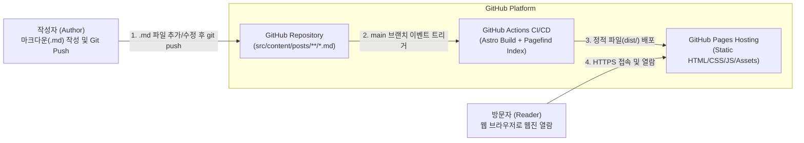
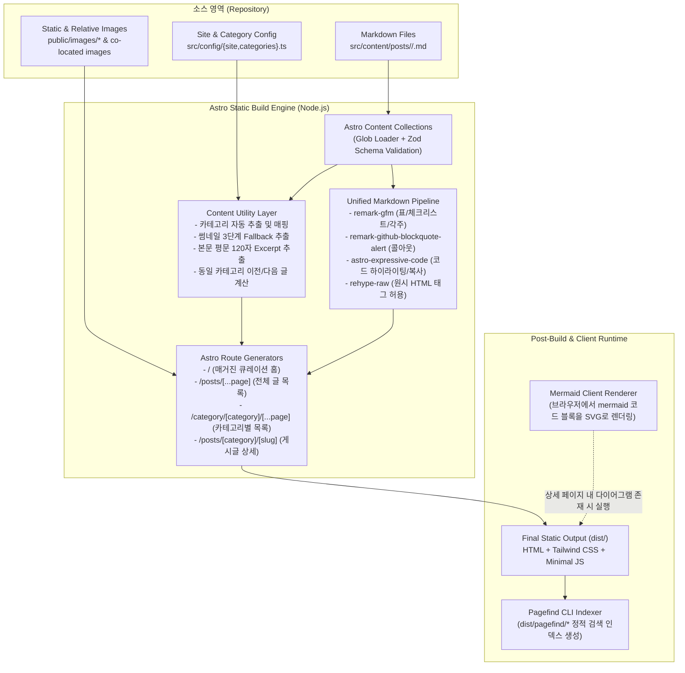
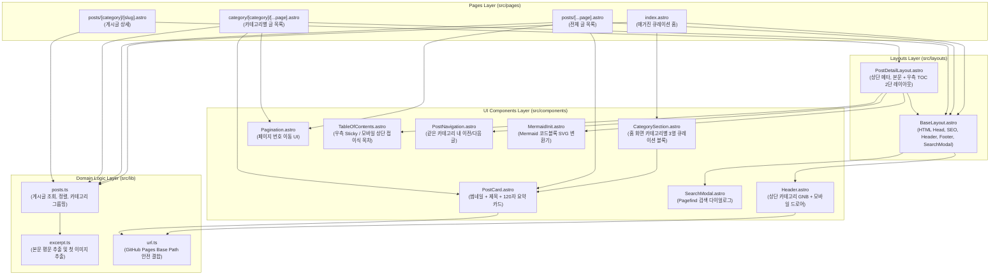

# 02. 시스템 아키텍처 및 기술 의사결정 기록 (Architecture & ADR)

> **문서 버전**: 1.0.0  
> **표준 준거**: C4 Model (Context, Container, Component) 및 Michael Nygard ADR 템플릿  
> **목적**: 전체 시스템의 정적 빌드 파이프라인, 컴포넌트 간 의존 관계, 그리고 핵심 기술 선정의 근거(ADR)를 정의한다.

---

## 1. C4 아키텍처 다이어그램 (C4 Model)

### 1.1 Level 1: 시스템 컨텍스트 다이어그램 (System Context)

작성자(Author)가 마크다운 파일을 Git 저장소에 푸시하면, GitHub Actions가 이를 감지하여 정적 웹사이트를 빌드하고 GitHub Pages CDN을 통해 독자(Reader)에게 제공하는 전체 흐름이다.



---

### 1.2 Level 2: 컨테이너 및 빌드 파이프라인 구조 (Container & Pipeline View)

정적 사이트 생성기(Astro) 내부에서 마크다운 파일이 어떻게 파싱·가공되어 최종 정적 산출물(`dist/`)로 변환되는지 나타낸다.



---

### 1.3 Level 3: 프론트엔드 컴포넌트 아키텍처 (Component View)

페이지 템플릿(`src/pages/`)과 레이아웃(`src/layouts/`), UI 컴포넌트(`src/components/`), 비즈니스 유틸리티(`src/lib/`) 간의 계층 구조이다.



---

## 2. 디렉토리 구조 설계 (Project Directory Structure)

구현 시 생성될 전체 프로젝트 파일 트리 구조는 다음과 같다.

```text
bisue-blog-static/
├── .github/
│   └── workflows/
│       └── deploy.yml                  # GitHub Pages 자동 빌드 및 배포 워크플로우
├── docs/                               # 프로젝트 설계 및 구현 계획 문서 폴더
│   ├── 01-srs-requirements.md
│   ├── 02-architecture-and-adr.md
│   ├── 03-data-and-markdown-spec.md
│   ├── 04-ui-ux-and-component-spec.md
│   └── 05-implementation-plan-wbs.md
├── public/                             # 정적 에셋 폴더 (빌드 시 루트로 그대로 복사)
│   ├── favicon.svg                     # 기본 파비콘
│   └── images/
│       └── default-thumbnail.svg       # 썸네일 미지정 및 본문 이미지 부재 시 기본 플레이스홀더
├── src/
│   ├── config/                         # 사이트 및 카테고리 설정 레이어
│   │   ├── site.ts                     # 사이트명, 설명, Base Path, 페이지당 게시글 수 등 전역 설정
│   │   └── categories.ts               # 폴더명(slug)별 한글 표시명(label), 설명, 정렬 순서 매핑
│   ├── content/                        # 마크다운 콘텐츠 저장소
│   │   └── posts/                      # 모든 게시글 루트 폴더
│   │       ├── tech/                   # 카테고리 폴더 예시 1 (tech)
│   │       │   └── markdown-guide.md
│   │       ├── essay/                  # 카테고리 폴더 예시 2 (essay)
│   │       │   └── first-webzine.md
│   │       └── review/                 # 카테고리 폴더 예시 3 (review)
│   │           └── book-review.md
│   ├── content.config.ts               # Astro 5 Content Collections 설정 및 Zod 스키마 정의
│   ├── lib/                            # 핵심 데이터 처리 및 유틸리티 함수
│   │   ├── posts.ts                    # 게시글 로드, 카테고리 추출, 페이지네이션, 이전/다음 글 탐색
│   │   ├── markdown-extract.ts         # 마크다운 본문에서 첫 번째 이미지 및 120자 평문 요약 추출
│   │   └── url.ts                      # Base Path(/bisue-blog-static) 자동 프리픽스 헬퍼
│   ├── layouts/                        # 페이지 공통 레이아웃
│   │   ├── BaseLayout.astro            # 전역 HTML 뼈대, Pretendard 폰트, Header, Footer, SearchModal
│   │   └── PostDetailLayout.astro      # 게시글 상세 화면 전용 레이아웃 (메타 헤더 + 본문 + TOC + 이전/다음 글)
│   ├── components/                     # UI 컴포넌트
│   │   ├── common/
│   │   │   ├── Header.astro            # 상단 고정 네비게이션 바 + 카테고리 메뉴 + 모바일 드로어
│   │   │   ├── Footer.astro            # 하단 웹진 푸터
│   │   │   ├── Pagination.astro        # 목록 페이지 번호 이동 컴포넌트
│   │   │   └── SearchModal.astro       # Pagefind 정적 검색 모달 컴포넌트
│   │   ├── post/
│   │   │   ├── PostCard.astro          # 썸네일 + 카테고리 배지 + 제목 + 120자 본문 미리보기 카드
│   │   │   ├── CategorySection.astro   # 홈 화면의 카테고리별 큐레이션 섹션 (최신 글 3개 + 더보기)
│   │   │   ├── TableOfContents.astro   # 상세 페이지 우측 Sticky / 모바일 상단 접이식 목차
│   │   │   ├── PostNavigation.astro    # 상세 페이지 하단 같은 카테고리 내 이전 글 / 다음 글
│   │   │   └── MermaidInit.astro       # 상세 페이지 내 Mermaid 코드 블록을 SVG로 변환하는 스크립트 컴포넌트
│   ├── pages/                          # 파일 기반 라우팅 페이지
│   │   ├── index.astro                 # 홈 화면 (카테고리별 최신 글 3~4개 큐레이션 웹진 메인)
│   │   ├── 404.astro                   # 404 에러 페이지
│   │   ├── posts/
│   │   │   ├── [...page].astro         # 전체 게시글 목록 페이지 (/posts/, /posts/2/ ...)
│   │   │   └── [category]/
│   │   │       └── [slug].astro        # 게시글 상세 페이지 (/posts/<category>/<slug>/)
│   │   └── category/
│   │       └── [category]/
│   │           └── [...page].astro     # 카테고리별 게시글 목록 페이지 (/category/<category>/, /category/<category>/2/ ...)
│   └── styles/
│       └── global.css                  # Tailwind CSS 엔트리, 웹진 디자인 토큰, 마크다운 Prose & Alert 스타일
├── astro.config.mjs                    # Astro 설정 (Markdown 플러그인, Expressive Code, Site/Base 경로)
├── package.json                        # 의존성 패키지 및 빌드 스크립트 (postbuild: pagefind)
└── tsconfig.json                       # TypeScript 엄격 모드 및 경로 별칭(@/*) 설정
```

---

## 3. 아키텍처 의사결정 기록 (Architecture Decision Records, ADR)

### ADR-001: 정적 사이트 생성기(SSG)로 Astro 5 + TypeScript + Tailwind CSS 채택
- **상태 (Status)**: 승인됨 (Accepted)
- **맥락 (Context)**: GitHub Pages에 호스팅할 마크다운 기반 웹진 사이트를 구축해야 하며, 빠른 로딩 속도와 강력한 마크다운 파이프라인, 타입 안전성이 필요하다.
- **결정 (Decision)**: **Astro 5**, **TypeScript**, **Tailwind CSS** 조합을 사용한다.
- **근거 (Rationale)**:
  1. Astro는 콘텐츠 중심 웹사이트에 특화되어 있으며 기본적으로 클라이언트에 불필요한 JS를 전송하지 않는다(Zero-JS by default).
  2. Content Collections API를 통해 특정 폴더(`src/content/posts/`)의 `.md` 파일들을 Zod 스키마로 검증하고 타입 안전하게 불러올 수 있다.
  3. Unified(`remark` / `rehype`) 생태계와 100% 호환되어 직접 파서를 만들지 않고도 검증된 마크다운 플러그인들을 선언적으로 결합할 수 있다.

---

### ADR-002: 폴더 구조 기반 1단계 카테고리 분류 및 하이브리드 설정 매핑
- **상태 (Status)**: 승인됨 (Accepted)
- **맥락 (Context)**: 작성자가 파일을 폴더에 넣는 것만으로 직관적으로 카테고리가 나뉘어야 하면서도, 웹진 화면에서는 깔끔한 한글 카테고리명과 원하는 메뉴 노출 순서를 지정할 수 있어야 한다.
- **결정 (Decision)**:
  1. `src/content/posts/<category>/<slug>.md`의 첫 번째 하위 폴더명(`<category>`)을 카테고리의 고유 식별자(`slug`)로 자동 추출한다.
  2. `src/config/categories.ts`에 등록된 카테고리는 지정된 `label`(예: `"테크 & 개발"`), `description`, `order`를 적용한다.
  3. 설정 파일에 등록하지 않고 새 폴더만 만든 경우에도 빌드 오류 없이 폴더명을 그대로 표시명으로 사용하여 자동 노출한다.
- **결과 (Consequences)**: 설정의 번거로움 없이 폴더 생성만으로 즉시 카테고리가 동작하며, 필요할 때만 표시 이름과 순서를 다듬을 수 있다.

---

### ADR-003: 코드 블록 하이라이팅 및 부가 기능에 `astro-expressive-code` 채택
- **상태 (Status)**: 승인됨 (Accepted)
- **맥락 (Context)**: 마크다운 내 코드 블록에 문법 강조(Syntax Highlighting), 클립보드 복사 버튼, 파일명 탭 UI 등이 필요하며, 이를 직접 바닥부터 구현하지 않고 검증된 라이브러리를 사용해야 한다.
- **결정 (Decision)**: Astro 공식 생태계(Starlight 등)에서 표준으로 사용하는 **`astro-expressive-code`** 통합 플러그인을 사용한다.
- **근거 (Rationale)**:
  1. Shiki 엔진 기반으로 수백 개 언어의 정확한 빌드 타임 하이라이팅을 제공한다.
  2. 복사 버튼, 코드 프레임 헤더, 줄 번호/특정 줄 강조 기능을 설정 몇 줄만으로 즉시 제공한다.
  3. 주의사항: `astro.config.mjs`에서 `integrations: [expressiveCode(), ...]`를 등록할 때, 내부적으로 마크다운 코드 블록을 먼저 변환하므로 별도의 복잡한 커스텀 파서 구현이 전혀 필요 없다.

---

### ADR-004: Mermaid 다이어그램 렌더링 방식 선정 (클라이언트 `mermaid` 패키지 연동)
- **상태 (Status)**: 승인됨 (Accepted)
- **맥락 (Context)**: 마크다운 내 ```` ```mermaid ```` 코드 블록을 다이어그램으로 렌더링해야 한다. 이때 빌드 서버(GitHub Actions)에서 무거운 Headless Chromium(Playwright) 설치 없이도 안정적으로 동작해야 하며, `astro-expressive-code`가 Mermaid 블록을 일반 코드 블록으로 가로채지 않도록 설정해야 한다.
- **결정 (Decision)**:
  1. 커스텀 소형 Remark 플러그인(약 15줄, AST의 `code` 노드 중 `lang === 'mermaid'`인 노드를 `<pre class="mermaid">...</pre>` HTML 노드로 변환) 또는 Expressive Code 제외 설정 후 공식 **`mermaid` npm 패키지**를 통해 브라우저에서 SVG로 렌더링한다.
  2. 다이어그램이 포함된 상세 페이지에서만 `mermaid` 스크립트가 비동기로 초기화되도록 구성한다.
- **근거 (Rationale)**:
  1. `rehype-mermaid`의 빌드 타임 렌더링은 Playwright 브라우저 바이너리 설치가 필수여서 CI 빌드 시간이 길어지고 환경 오류가 잦다.
  2. 반면 AST에서 `lang === 'mermaid'` 블록을 `<pre class="mermaid">`로 넘기고 공식 `mermaid` 라이브러리의 `mermaid.run()`을 호출하면 외부 바이너리 의존성 없이 100% 모든 Mermaid 문법이 렌더링된다.

---

### ADR-005: 마크다운 내 원시 HTML 허용 (`rehype-raw`) 및 콜아웃 블록 (`remark-github-blockquote-alert`)
- **상태 (Status)**: 승인됨 (Accepted)
- **맥락 (Context)**: 마크다운 파일 안에서 `<iframe>`(유튜브 등), `<details>`, `<kbd>`, `<mark>` 등의 원시 HTML 태그와 GitHub 스타일 콜아웃(`> [!NOTE]`)을 모두 지원해야 한다.
- **결정 (Decision)**:
  - `remark-gfm`: 표, 취소선, 체크리스트, 각주, 자동 링크 처리 (Astro 기본 내장 활성화)
  - `remark-github-blockquote-alert`: `> [!NOTE]`, `> [!TIP]`, `> [!IMPORTANT]`, `> [!WARNING]`, `> [!CAUTION]` 블록 변환
  - `rehype-raw`: 마크다운 내 원시 HTML 노드를 HAST(HTML AST)로 온전히 파싱하여 출력
- **근거 (Rationale)**: 모두 Unified 생태계의 표준 플러그인이므로 `astro.config.mjs`의 `markdown.remarkPlugins` 및 `markdown.rehypePlugins` 배열에 등록하는 것만으로 즉시 동작한다.

---

### ADR-006: 정적 키워드 검색 엔진으로 `Pagefind` 채택
- **상태 (Status)**: 승인됨 (Accepted)
- **맥락 (Context)**: 백엔드 서버가 없는 GitHub Pages 환경에서 한국어/영어 게시글 제목 및 본문 키워드 검색을 지원해야 한다.
- **결정 (Decision)**: 빌드 후처리(`postbuild`) 단계에서 실행되는 **`pagefind`** 정적 검색 라이브러리를 사용한다.
- **근거 (Rationale)**:
  1. 빌드된 `dist/` 폴더의 HTML을 스캔하여 청크 단위로 압축된 검색 인덱스와 한국어(ko) 다국어 WASM 검색 엔진을 자동 생성한다.
  2. 전체 게시글 JSON을 한 번에 클라이언트로 다운로드하는 방식과 달리, 검색어 입력 시 필요한 인덱스 조각만 로드하므로 게시글이 수백~수천 개로 늘어나도 초기 로딩 속도 저하가 없다.

---

### ADR-007: GitHub Pages 서브 경로(`base`) 대응 전략
- **상태 (Status)**: 승인됨 (Accepted)
- **맥락 (Context)**: `https://<username>.github.io/bisue-blog-static/`과 같이 서브 경로에서 호스팅될 때 `/category/tech`처럼 루트 상대 경로를 하드코딩하면 `https://<username>.github.io/category/tech`로 이동하여 404 에러가 발생한다.
- **결정 (Decision)**:
  1. `src/config/site.ts` 및 `astro.config.mjs`에서 `base: '/bisue-blog-static'`(또는 환경변수 `SITE_BASE`)을 단일 진실 공급원(SSOT)으로 관리한다.
  2. 모든 내부 페이지 링크 및 정적 에셋 참조 시 `withBase(path)` 헬퍼 함수(`import.meta.env.BASE_URL` 기반)를 거치도록 강제한다.
  3. 마크다운 본문 내부에 작성된 `/images/...` 경로 또한 빌드 타임 Rehype 단계(또는 이미지 해석 유틸리티)에서 `BASE_URL`이 자동으로 접두어로 붙도록 처리하여 작성자가 Base Path를 신경 쓰지 않고 글을 쓸 수 있게 한다.
