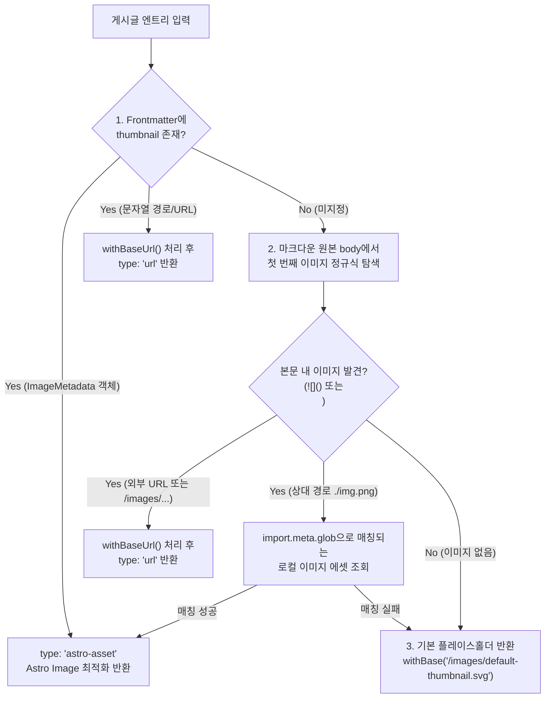
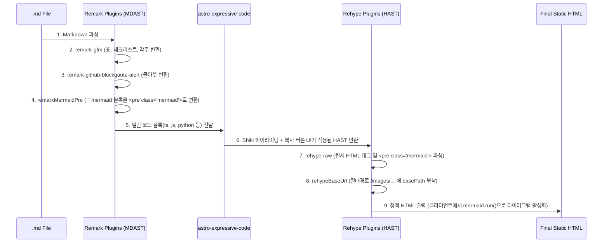

# 03. 데이터 스키마 및 마크다운 파이프라인 명세서 (Data & Markdown Specification)

> **문서 버전**: 1.0.0  
> **목적**: 마크다운(`.md`) 파일의 저장 규칙, Frontmatter 스키마, 카테고리 자동 매핑 알고리즘, 썸네일/미리보기(Excerpt) 추출 로직, 그리고 마크다운 렌더링 파이프라인의 상세 동작을 코드 수준으로 명세한다.

---

## 1. 콘텐츠 저장 규칙 및 폴더 구조 (Content Directory Convention)

### 1.1 기본 경로 규칙
모든 게시글 마크다운 파일은 반드시 아래 경로 패턴을 따른다.

```text
src/content/posts/<category-slug>/<post-slug>.md
```

- **`<category-slug>`**: `src/content/posts/` 바로 아래의 **1단계 하위 폴더명**이 곧 해당 게시글의 카테고리 식별자(`categorySlug`)가 된다.
  - 권장 네이밍: 영문 소문자 및 하이픈(`tech`, `essay`, `review`, `culture` 등) 권장 (단, 한글 폴더명도 URL 인코딩 및 자동 인식 가능하도록 구현).
- **`<post-slug>`**: 마크다운 파일명(확장자 `.md` 제외)이 해당 게시글의 URL 슬러그(`slug`)가 된다.
  - 예: `src/content/posts/tech/astro-static-blog.md`  
    → 카테고리: `tech`  
    → 슬러그: `astro-static-blog`  
    → 최종 상세 페이지 경로: `/posts/tech/astro-static-blog/`

### 1.2 이미지 파일 배치 규칙 (3가지 모두 지원)
작성자는 편의에 따라 아래 3가지 방식 중 어느 것으로든 본문 이미지 및 Frontmatter 썸네일을 지정할 수 있다.

| 방식 | 작성 예시 | 저장 위치 | 특징 |
| :--- | :--- | :--- | :--- |
| **1. 상대 경로 (Co-location)** | `./cover.png` 또는 `./assets/diagram.jpg` | `.md` 파일과 동일한 카테고리 폴더 내부 | Astro Image 최적화 파이프라인 적용 가능, 게시글과 이미지를 한 폴더에서 관리할 때 유리 |
| **2. `public/` 절대 경로** | `/images/posts/tech/cover.png` | `public/images/...` | 여러 글에서 공용으로 쓰는 이미지나 정적 경로를 그대로 유지할 때 유리 (빌드 시 Base Path 자동 부착) |
| **3. 외부 URL** | `https://images.unsplash.com/...` | 외부 이미지 서버 / CDN | 별도 로컬 파일 저장 없이 외부 이미지를 즉시 참조 |

---

## 2. 데이터 스키마 명세 (TypeScript & Zod Schemas)

### 2.1 사이트 전역 설정 스키마 (`src/config/site.ts`)

```typescript
export interface SiteConfig {
  /** 사이트 메인 타이틀 (상단 로고 및 브라우저 타이틀에 표시) */
  title: string;
  /** 사이트 부제 / 한 줄 소개 */
  subtitle: string;
  /** SEO 메타 description 기본값 */
  description: string;
  /** 작성자 또는 웹진 발행처 이름 */
  author: string;
  /** 배포 도메인 주소 (예: "https://<username>.github.io") */
  siteUrl: string;
  /** GitHub Pages 서브 경로 (예: "/bisue-blog-static", 루트 도메인 배포 시 "/") */
  basePath: string;
  /** 언어 코드 */
  locale: 'ko-KR';
  /** 홈 화면에서 각 카테고리 섹션당 보여줄 최신 게시글 개수 (기본값: 3) */
  homePostsPerCategory: number;
  /** 목록 화면(카테고리별 / 전체 글)에서 한 페이지당 보여줄 게시글 개수 (기본값: 9) */
  postsPerPage: number;
  /** 본문 미리보기(Excerpt) 자동 추출 시 최대 글자 수 (기본값: 120) */
  excerptLength: number;
  /** 기본 플레이스홀더 썸네일 경로 (public 폴더 기준) */
  defaultThumbnail: string;
}

export const siteConfig: SiteConfig = {
  title: 'BISUE WEBZINE',
  subtitle: '생각과 기술을 기록하는 디지털 웹진',
  description: '마크다운 기반의 큐레이션 웹진 블로그입니다.',
  author: 'Bisue',
  siteUrl: process.env.SITE_URL || 'https://example.github.io',
  basePath: process.env.SITE_BASE || '/bisue-blog-static',
  locale: 'ko-KR',
  homePostsPerCategory: 3,
  postsPerPage: 9,
  excerptLength: 120,
  defaultThumbnail: '/images/default-thumbnail.svg',
};
```

---

### 2.2 카테고리 메타 설정 스키마 (`src/config/categories.ts`)

폴더명을 기본으로 자동 인식하되, 화면에 보여줄 한글 이름(`label`), 설명(`description`), 메뉴 노출 순서(`order`)를 선택적으로 오버라이드할 수 있는 설정 파일이다.

```typescript
export interface CategoryMeta {
  /** 화면(상단 메뉴, 배지, 카테고리 헤더)에 표시할 이름 */
  label: string;
  /** 카테고리 목록 페이지 및 홈 섹션 상단에 표시할 짧은 소개 문구 */
  description?: string;
  /** 상단 메뉴 및 홈 화면 섹션 정렬 우선순위 (숫자가 작을수록 먼저 표시, 기본값: 999) */
  order?: number;
}

/**
 * key는 src/content/posts/<key>/ 의 폴더명과 일치해야 함.
 * 여기에 등록되지 않은 폴더가 src/content/posts/ 아래에 생겨도
 * 자동으로 폴더명을 label로 삼아 order: 999로 정상 노출됨.
 */
export const categoryConfig: Record<string, CategoryMeta> = {
  tech: {
    label: '테크 & 개발',
    description: '소프트웨어 엔지니어링, 아키텍처, 개발 도구에 관한 기록',
    order: 1,
  },
  essay: {
    label: '에세이 & 단상',
    description: '일상에서 발견한 인사이트와 깊이 있는 생각 정리',
    order: 2,
  },
  review: {
    label: '리뷰 & 큐레이션',
    description: '책, 영화, 프로덕트, 문화 콘텐츠 리뷰',
    order: 3,
  },
};
```

---

### 2.3 마크다운 Frontmatter 스키마 (`src/content.config.ts`)

각 `.md` 파일 최상단에 작성하는 YAML 메타데이터 규격이다. 작성자의 부담을 줄이기 위해 **`title`과 `pubDate`만 필수**이며, 나머지는 모두 선택 사항(자동 처리 포함)이다.

```typescript
import { defineCollection, z } from 'astro:content';
import { glob } from 'astro/loaders';

const postsCollection = defineCollection({
  loader: glob({ pattern: '**/*.md', base: './src/content/posts' }),
  schema: ({ image }) =>
    z.object({
      /** [필수] 게시글 제목 */
      title: z.string().min(1, '제목을 입력해 주세요.'),

      /** [필수] 작성일 (YYYY-MM-DD 또는 ISO 날짜 형식) */
      pubDate: z.coerce.date(),

      /** [선택] 최종 수정일 */
      updatedDate: z.coerce.date().optional(),

      /**
       * [선택] 목록 화면 미리보기 요약문.
       * 미입력 시 본문 마크다운에서 평문 120자를 자동 추출함.
       */
      description: z.string().optional(),

      /**
       * [선택] 대표 썸네일 이미지.
       * - 상대 경로 이미지(image() 스키마) 또는 문자열 경로('/images/...', 'https://...') 모두 허용.
       * - 미입력 시 본문 내 첫 번째 이미지를 자동 추출하며, 본문에도 없으면 기본 플레이스홀더 사용.
       */
      thumbnail: z.union([image(), z.string()]).optional(),

      /** [선택] 썸네일 이미지 대체 텍스트 (접근성용, 기본값은 게시글 title) */
      thumbnailAlt: z.string().optional(),

      /** [선택] 초안 여부 (true일 경우 프로덕션 빌드에서 제외, 기본값: false) */
      draft: z.boolean().default(false),
    }),
});

export const collections = {
  posts: postsCollection,
};
```

#### 마크다운 파일 작성 예시 (`src/content/posts/tech/markdown-features.md`)
```markdown
---
title: "웹진 블로그에서 지원하는 모든 마크다운 문법 가이드"
pubDate: 2026-11-03
description: "표, 코드 블록 하이라이팅, Mermaid 다이어그램, 원시 HTML까지 모든 마크다운 기능을 살펴봅니다."
thumbnail: "./cover-tech.png"
draft: false
---

여기에 본문을 작성합니다...
```

---

## 3. 가공된 도메인 모델 및 핵심 알고리즘 명세 (`src/lib/`)

### 3.1 가공된 게시글 엔티티 인터페이스 (`ProcessedPost`)

Astro의 원본 Collection Entry를 UI 컴포넌트에서 바로 쓸 수 있도록 변환한 표준 데이터 구조이다.

```typescript
import type { ImageMetadata } from 'astro';
import type { CollectionEntry } from 'astro:content';

export interface ResolvedCategory {
  /** 폴더명 기반 슬러그 (예: "tech") */
  slug: string;
  /** 화면 표시 이름 (예: "테크 & 개발") */
  label: string;
  /** 카테고리 설명 */
  description: string;
  /** 정렬 순서 */
  order: number;
  /** 해당 카테고리에 속한 게시글 총 개수 */
  count: number;
  /** 카테고리 목록 페이지 URL (Base Path 적용됨) */
  url: string;
}

export interface ResolvedThumbnail {
  /**최종 결정된 이미지 소스 구분 */
  type: 'astro-asset' | 'url';
  /** type === 'astro-asset' 일 때 Astro ImageMetadata 객체 */
  asset?: ImageMetadata;
  /** type === 'url' 일 때 최종 이미지 URL 문자열 (Base Path 적용 완료) */
  src: string;
  /** 이미지 alt 텍스트 */
  alt: string;
  /** 플레이스홀더 여부 */
  isFallback: boolean;
}

export interface ProcessedPost {
  /** 원본 Astro 컬렉션 엔트리 (render() 호출용) */
  entry: CollectionEntry<'posts'>;
  /** 고유 ID (예: "tech/markdown-features") */
  id: string;
  /** 파일명 기반 게시글 슬러그 (예: "markdown-features") */
  slug: string;
  /** 소속 카테고리 슬러그 (예: "tech") */
  categorySlug: string;
  /** 소속 카테고리 표시 이름 (예: "테크 & 개발") */
  categoryLabel: string;
  /** 게시글 제목 */
  title: string;
  /** 작성일 Date 객체 */
  pubDate: Date;
  /** 수정일 Date 객체 (있을 경우) */
  updatedDate?: Date;
  /** 포맷팅된 작성일 문자열 (예: "2026. 11. 03.") */
  formattedDate: string;
  /** 최종 결정된 120자 본문 미리보기 텍스트 */
  excerpt: string;
  /** 최종 결정된 썸네일 정보 (Frontmatter -> 본문 첫 이미지 -> 기본 플레이스홀더) */
  thumbnail: ResolvedThumbnail;
  /** 상세 페이지 최종 URL (예: "/bisue-blog-static/posts/tech/markdown-features/") */
  url: string;
  /** 카테고리 목록 페이지 URL (예: "/bisue-blog-static/category/tech/") */
  categoryUrl: string;
}
```

---

### 3.2 카테고리 및 슬러그 추출 알고리즘

`src/content/posts/<category>/<slug>.md`에서 로드된 엔트리의 `id`(또는 파일 경로)를 분해하는 규칙이다.

1. 엔트리 `id`를 `/` 기준으로 분리(`segments = entry.id.replace(/\.md$/, '').split('/')`)한다.
2. `segments.length >= 2`인 경우:
   - `categorySlug = segments[0]` (첫 번째 폴더명)
   - `slug = segments[segments.length - 1]` (파일명)
3. 만약 실수로 루트(`src/content/posts/hello.md`)에 파일을 넣은 경우(`segments.length === 1`):
   - 빌드 에러를 내는 대신 `categorySlug = 'uncategorized'`(표시명: `'미분류'`)로 안전하게 Fallback 처리한다.
4. 전체 게시글에서 수집된 고유 `categorySlug` 집합과 `categoryConfig`를 병합하여:
   - `order` 오름차순으로 1차 정렬하고,
   - `order`가 동일한 경우 `label.localeCompare(b.label, 'ko')` 가나다/알파벳순으로 2차 정렬한다.
   - 단, 게시글이 0개인 빈 카테고리는 상단 메뉴 및 홈 큐레이션 섹션에서 숨긴다(또는 설정에 따라 표시).

---

### 3.3 썸네일 3단계 Fallback 추출 알고리즘 (`resolveThumbnail`)



#### 본문 첫 번째 이미지 추출 정규식 명세
마크다운 원본 텍스트(`entry.body`)에서 코드 블록(```` ```...``` ````)을 먼저 제거한 뒤, 마크다운 이미지 문법과 HTML `` 태그 중 **문서 내 등장 위치(index)가 더 앞선 것**의 경로를 추출한다:
- 마크다운 이미지 정규식: `/!\[[^\]]*\]\(\s*([^\s)]+)(?:\s+["'][^"']*["'])?\s*\)/`
- HTML 이미지 태그 정규식: `/]+src=["']([^"']+)["'][^>]*>/i`

---

### 3.4 본문 미리보기(Excerpt) 120자 평문 추출 알고리즘 (`extractExcerpt`)

목록 화면에서 마크다운 문법 기호나 코드 조각이 노출되지 않고 깔끔한 웹진 기사 요약문이 보이도록 다음 순서로 정제한다.

1. **Frontmatter 우선 확인**: `entry.data.description`이 존재하고 공백이 아니면 해당 문자열을 사용한다.
2. **원본 본문 정제 파이프라인** (`entry.data.description`이 없을 때 `entry.body` 대상):
   1. 펜스 코드 블록 제거 (` ```[\s\S]*?``` ` 및 ` ~~~[\s\S]*?~~~ ` → 빈 문자열)
   2. GitHub Alert 식별자 제거 (`^\s*>\s*\[!(?:NOTE|TIP|IMPORTANT|WARNING|CAUTION)\]\s*$` → 빈 문자열)
   3. HTML 주석 및 모든 원시 HTML 태그 제거 (`<!--[\s\S]*?-->`, `<[^>]+>` → 빈 문자열)
   4. 마크다운 이미지 제거 (`!\[[^\]]*\]\([^)]*\)` → 빈 문자열)
   5. 마크다운 링크는 텍스트만 보존 (`\[([^\]]+)\]\([^)]*\)` → `$1`)
   6. 인라인 코드 기호 제거 (`` `([^`]+)` `` → `$1`)
   7. 제목(`#`), 인용(`>`), 목록 기호(`-`, `*`, `1.`), 체크박스(`[ ]`, `[x]`), 수평선(`---`, `***`), 표 구분선(`|`), 강조 기호(`**`, `__`, `~~`, `*`, `_`), 각주 참조(`[^1]`) 제거
   8. 연속된 줄바꿈 및 공백을 단일 공백(`' '`)으로 압축 후 `trim()` 수행
3. **길이 제한 (Truncation)**:
   - 정제된 문자열의 길이가 `maxLength`(기본 `120`자) 이하이면 그대로 반환한다.
   - `120`자를 초과하면 `slice(0, 120).trimEnd() + '...'`를 반환한다.

---

### 3.5 동일 카테고리 내 이전 글 / 다음 글 탐색 알고리즘

상세 화면(`/posts/<category>/<slug>/`) 하단에 표시할 이전 글·다음 글은 **같은 카테고리(`categorySlug`)에 속한 게시글들만 필터링**한 뒤 작성일(`pubDate`) 내림차순(최신순) 배열을 기준으로 결정한다.

- 정렬 기준: `pubDate` 내림차순 (날짜가 같으면 `slug` 사전순 정렬로 결정론적 순서 보장)
- 현재 글의 인덱스가 `i`일 때:
  - **다음 글 (Newer / Next)**: `categoryPosts[i - 1] ?? null` (현재 글보다 더 최근에 작성된 글)
  - **이전 글 (Older / Prev)**: `categoryPosts[i + 1] ?? null` (현재 글보다 이전에 작성된 글)

---

## 4. 마크다운 렌더링 파이프라인 상세 명세 (`astro.config.mjs`)

직접 파서를 만들지 않고 검증된 라이브러리들을 조합하여 **모든 마크다운 문법 + 확장 문법**을 처리하는 파이프라인 구성이다.

### 4.1 적용 라이브러리 목록 및 역할

| 기능 영역 | 사용 패키지 (NPM) | 동작 시점 | 설명 |
| :--- | :--- | :--- | :--- |
| **GFM 표준 확장** | `remark-gfm` (Astro 내장) | Build-time (Remark) | 표(`table`), 취소선(`del`), 체크리스트(`taskList`), 각주(`footnote`), 자동 링크 |
| **콜아웃 / 알림 블록** | `remark-github-blockquote-alert` | Build-time (Remark) | `> [!NOTE]`, `> [!TIP]`, `> [!IMPORTANT]`, `> [!WARNING]`, `> [!CAUTION]`을 시맨틱 알림 박스로 변환 |
| **Mermaid 코드 블록 보존** | `remarkMermaidPre` (15줄 AST 매퍼) + `mermaid` | Build-time + Client | `lang === 'mermaid'` 코드 블록을 `<pre class="mermaid">`로 출력하여 Expressive Code 가로채기를 방지하고, 브라우저에서 공식 `mermaid` 패키지가 SVG로 렌더링 |
| **코드 블록 하이라이팅** | `astro-expressive-code` | Build-time (Integration) | Shiki 기반 문법 강조, 클립보드 복사 버튼, 언어 배지, 파일명 프레임, 줄 강조 자동 생성 |
| **원시 HTML 허용** | `rehype-raw` | Build-time (Rehype) | 마크다운 내 작성된 `<iframe>`, `<details>`, `<video>`, `<mark>`, `<kbd>`, 커스텀 `<div>` 등을 HTML DOM으로 온전히 보존 |
| **헤딩 앵커 및 ID** | Astro 내장 Heading ID 생성기 | Build-time (Rehype) | `h2`, `h3` 등에 고유 `id`를 부여하여 우측 목차(TOC) 클릭 시 해당 섹션으로 스크롤 이동 |
| **서브 경로 이미지 보정** | `rehypeBaseUrl` | Build-time (Rehype) | 마크다운 본문 내 `/images/...`로 시작하는 이미지/링크 경로 앞에 GitHub Pages `base` 경로를 자동 프리픽스 |

### 4.2 파이프라인 실행 순서 다이어그램



---

## 5. URL 라우팅 및 GitHub Pages Base Path 명세

### 5.1 전체 라우트 테이블

`siteConfig.basePath`가 `/bisue-blog-static`일 때 생성되는 전체 정적 라우트 규격이다.

| 화면명 | Astro 파일 경로 | 실제 빌드 URL (`basePath` 포함) | 페이지네이션 여부 |
| :--- | :--- | :--- | :--- |
| **매거진 큐레이션 홈** | `src/pages/index.astro` | `/bisue-blog-static/` | 없음 (카테고리별 최신 3개 큐레이션) |
| **전체 게시글 목록 (1페이지)** | `src/pages/posts/[...page].astro` | `/bisue-blog-static/posts/` | 9개/페이지 |
| **전체 게시글 목록 (N페이지)** | `src/pages/posts/[...page].astro` | `/bisue-blog-static/posts/2/` | 9개/페이지 |
| **카테고리별 목록 (1페이지)** | `src/pages/category/[category]/[...page].astro` | `/bisue-blog-static/category/<category>/` | 9개/페이지 |
| **카테고리별 목록 (N페이지)** | `src/pages/category/[category]/[...page].astro` | `/bisue-blog-static/category/<category>/2/` | 9개/페이지 |
| **게시글 상세 화면** | `src/pages/posts/[category]/[slug].astro` | `/bisue-blog-static/posts/<category>/<slug>/` | 없음 (하단 동일 카테고리 이전/다음 글) |
| **404 페이지** | `src/pages/404.astro` | `/bisue-blog-static/404.html` | 없음 |

### 5.2 Base Path 안전 결합 함수 (`src/lib/url.ts`)

```typescript
/**
 * 내부 경로에 GitHub Pages base 경로(import.meta.env.BASE_URL)를 안전하게 결합한다.
 * - 외부 URL(http://, https://, mailto:, #)은 변환하지 않고 그대로 반환한다.
 * - 이미 base 경로로 시작하는 경우 중복 부착하지 않는다.
 */
export function withBase(path: string): string {
  if (!path) return import.meta.env.BASE_URL;
  if (/^(https?:\/\/|mailto:|tel:|#|data:)/i.test(path)) {
    return path;
  }

  const base = import.meta.env.BASE_URL.replace(/\/$/, '');
  const cleanPath = path.startsWith('/') ? path : `/${path}`;

  if (base && (cleanPath === base || cleanPath.startsWith(`${base}/`))) {
    return cleanPath;
  }

  return `${base}${cleanPath}`;
}
```
