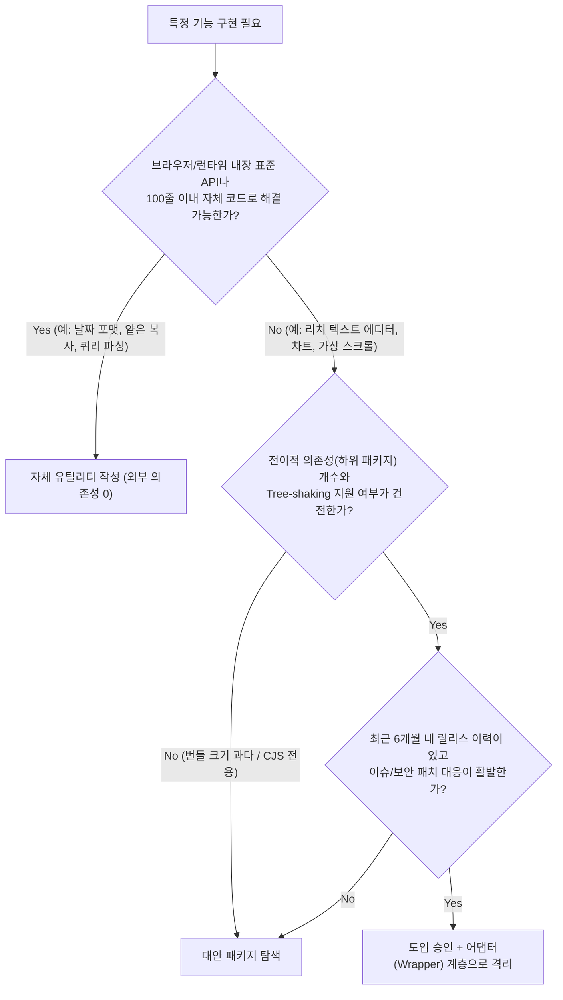

현대의 웹 개발 생태계, 특히 npm 생태계는 축복이자 동시에 거대한 지뢰밭이다. 날짜 포맷팅부터 애니메이션, 폼 검증, 쿼리 스트링 파싱까지 우리가 겪는 거의 모든 문제는 터미널에 `npm install <패키지명>` 한 줄만 입력하면 3초 만에 해결되는 것처럼 보인다. 나 역시 한때는 *"바퀴를 다시 발명하지 말라(Don't Reinvent the Wheel)"*는 격언을 맹신하며, 조금만 귀찮은 UI나 유틸리티가 필요하면 주저 없이 외부 패키지부터 검색해 설치하곤 했다.

하지만 그렇게 가벼운 마음으로 추가했던 라이브러리 하나가 1년 뒤 **프레임워크 메이저 버전 업그레이드를 가로막는 유일한 족쇄**가 되고, 불과 30줄짜리 기능을 쓰기 위해 **번들 사이즈를 180KB나 부풀리는 주범**이 되는 일을 겪으면서 내 태도는 180도 바뀌었다.[^1] <mark>`package.json`에 의존성 한 줄을 추가하는 것은 무료로 코드를 얻는 일이 아니라, 이름도 모르는 외부 메인테이너의 기술 부채와 보안 리스크를 우리 팀의 미래로 입양하는 결정</mark>이다. 오늘은 내가 새로운 라이브러리를 도입하기 전 반드시 거치는 5가지 검증 기준을 정리해 본다.

---

## 1. 사건의 교훈: "그냥 그거 npm 설치하면 5분 컷인데 왜 짜요?"

2년 전, 사내 어드민과 고객용 대시보드에 숫자가 부드럽게 카운트업되는 롤링 애니메이션과 간단한 통화(Currency) 포맷팅 기능을 넣어야 했다. 당시 팀원이 GitHub 스타 1,200개짜리 가벼운 오픈소스 UI 유틸리티 패키지를 찾아왔고, 우리는 별다른 고민 없이 설치해 프로젝트 곳곳의 40여 개 컴포넌트에 적용했다.

문제는 1년 뒤 React 19와 TypeScript 5.x로 코어 스택을 업그레이드하려던 시점에 터졌다.

1. 해당 라이브러리의 유일한 메인테이너가 14개월 전부터 활동을 중단(Abandoned)한 상태였다.
2. 패키지 내부에서 이미 폐기된 구버전 라이프사이클 API와 엄격하지 않은 `peerDependencies` 제약을 걸어두어 `npm install` 시 의존성 트리 전체가 충돌했다.
3. 게다가 그 패키지가 내부적으로 끌고 들어온 전이적 의존성(Transitive Dependencies) 중 하나에서 **Prototype Pollution 보안 취약점(CVE)** 경고가 발생해 사내 보안 감사 파이프라인이 멈춰 섰다.

결국 우리는 업그레이드를 멈추고 이틀 동안 40개 파일을 뒤져 그 라이브러리를 걷어내야 했다. 막상 우리가 직접 작성한 대체 코드는 **표준 `Intl.NumberFormat` API와 `requestAnimationFrame`을 합쳐 단 45줄**에 불과했다. ~~5분을 아끼려다 팀 전체의 이틀을 태운 셈이었다.~~

---

## 2. 외부 의존성 도입 의사결정 플로우차트

그날의 혹독한 대가를 치른 뒤, 나는 새로운 패키지를 설치하고 싶어질 때마다 머릿속으로 아래의 의사결정 트리를 먼저 통과시킨다.



---

## 3. 설치 명령어를 치기 전에 확인하는 5가지 핵심 기준

위 플로우차트를 구체화한 다섯 가지 실무 점검 항목은 다음과 같다.

### 3.1 표준 웹 API(Web Platform APIs)로 대체할 수 없는가?

과거에는 크로스 브라우징 이슈와 부족한 내장 기능 때문에 `lodash`, `moment`, `uuid`, `query-string`, `classnames` 같은 라이브러리가 필수였다. 하지만 2026년 현재, 브라우저와 Node.js 런타임이 기본으로 제공하는 내장 API의 수준은 놀라울 정도로 강력해졌다.

```typescript title="src/utils/nativeReplacements.ts (외부 라이브러리 없이 표준 API로 해결하기)"
// 1. 깊은 객체 복사: lodash.cloneDeep 대신 내장 structuredClone 사용
const original = { user: { name: 'Bisue', roles: ['admin'] }, createdAt: new Date() };
const cloned = structuredClone(original);

// 2. 고유 ID 생성: uuid 패키지 대신 내장 Web Crypto API 사용
const requestId = crypto.randomUUID(); // "36b8f84d-df4e-4d49-b662-bcde71a8764f"

// 3. 통화 및 상대 시간 포맷팅: 무거운 날짜/포맷 라이브러리 대신 Intl API 사용
const krwFormatter = new Intl.NumberFormat('ko-KR', { style: 'currency', currency: 'KRW' });
const formattedPrice = krwFormatter.format(145000); // "₩145,000"

const rtf = new Intl.RelativeTimeFormat('ko', { numeric: 'auto' });
const twoDaysAgo = rtf.format(-2, 'day'); // "그저께"

// 4. 배열 그룹핑: lodash.groupBy 대신 Object.groupBy 표준 메서드 사용
const ordersByStatus = Object.groupBy(orders, (order) => order.status);
```

> [!TIP]
> **표준 API의 가장 큰 무기는 '수명'입니다**
> 오픈소스 라이브러리는 유행이 바뀌면 지원이 끊기지만, 웹 표준(`Intl`, `URLSearchParams`, `AbortController`, `IntersectionObserver`)은 향후 10년 뒤에도 브라우저가 하위 호환성을 보장하며 번들 사이즈가 **0 Byte**입니다.

### 3.2 전이적 의존성(Transitive Dependencies)과 번들 무게는 얼마인가?

내가 `package.json`에 추가한 패키지는 단 1개일지라도, 그 패키지가 내부적으로 의존하는 하위 패키지가 50개라면 내 `node_modules`에는 51개의 잠재적 고장 지점이 생긴다. 나는 설치 전에 반드시 아래 두 가지를 확인한다.

- **Bundlephobia / pkg-size**: Gzip 압축 후 용량뿐만 아니라 **ESM(ES Modules) 기반의 Tree-shaking**이 완벽히 지원되는지 확인한다.
- **npmgraph**: 하위 의존성 그래프가 얼마나 깊게 뻗어 나가는지 시각화하여 확인한다.

### 3.3 메인테이너 버스 팩터(Bus Factor)와 릴리스 활력도

GitHub 스타(Star) 개수는 과거의 인기 투표일 뿐 현재의 유지보수 건강 상태를 대변하지 않는다.[^2] 스타가 2만 개여도 최근 커밋이 2년 전이고 열려 있는 PR 80개가 방치되어 있다면 죽은 프로젝트다.

- 최근 6개월 이내에 마이너/패치 릴리스가 꾸준히 이루어지고 있는가?
- 핵심 기여자(Contributors)가 1명에게만 99% 편중되어 있지는 않은가?
- 메이저 런타임(React, Node.js, TypeScript 최신 버전)의 Breaking Change 이슈가 올라왔을 때 대응 쓰레드가 활성화되어 있는가?

### 3.4 라이선스(License)와 보안 취약점 이력

회사 프로젝트에서 아무 생각 없이 설치한 패키지의 라이선스가 **GPL이나 AGPL** 계열이라면 법무팀과 심각한 문제를 겪을 수 있다. 상용 서비스에 안전하게 포함할 수 있는 `MIT`, `Apache-2.0`, `BSD` 라이선스인지 확인해야 한다.

### 3.5 우리 코드베이스와 직접 결합(Tight Coupling)되지 않고 감쌀 수 있는가?

아무리 신중하게 골라도 언젠가는 라이브러리를 교체해야 할 날이 온다. 이때 프로젝트의 100개 파일 상단에 `import { something } from 'some-third-party-lib'`이 직접 박혀 있으면 교체 비용이 기하급수적으로 치솟는다.

```typescript title="src/lib/dateAdapter.ts (어댑터 패턴으로 외부 라이브러리 격리하기)"
// 프로젝트 내에서 date-fns나 dayjs를 직접 import하는 유일한 파일!
// 나머지 도메인 코드들은 모두 이 파일의 인터페이스만 바라본다.
import dayjs from 'dayjs';
import utc from 'dayjs/plugin/utc';
import timezone from 'dayjs/plugin/timezone';

dayjs.extend(utc);
dayjs.extend(timezone);

export const DateUtil = {
  formatKstDate(isoString: string, pattern = 'YYYY.MM.DD'): string {
    return dayjs(isoString).tz('Asia/Seoul').format(pattern);
  },
  isExpired(expiresAtIso: string, nowMs = Date.now()): boolean {
    return dayjs(expiresAtIso).valueOf() < nowMs;
  },
};
```

> [!IMPORTANT]
> **ESLint `no-restricted-imports` 규칙과 함께 쓰기**
> 어댑터 모듈을 만들었다면 ESLint 설정에 `no-restricted-imports` 규칙을 추가해 팀원들이 컴포넌트에서 외부 라이브러리를 직접 import할 때 에디터 경고가 뜨도록 강제하면 아키텍처 일관성이 완벽하게 유지됩니다.

---

## 4. 직접 구현(In-house) vs 외부 라이브러리 도입 판단 매트릭스

실무에서 어떤 기능은 직접 짜야 하고 어떤 기능은 검증된 라이브러리를 써야 할까? 우리 팀이 기준으로 삼는 비교표는 다음과 같다.

| 기능 카테고리 | 권장 선택 | 핵심 판단 근거 | 대표 사례 |
| :--- | :---: | :--- | :--- |
| **단순 데이터 변환 / 포맷팅** | **직접 구현 (표준 API)** | 코드가 30줄 이내이며 비즈니스 요구사항에 맞춰 미세 조정할 일이 많음 | 날짜/통화 포맷, 배열 그룹핑, 디바운스/쓰로틀 |
| **웹 접근성(A11y) 기반 복합 UI** | **검증된 헤드리스 라이브러리** | 키보드 트랩, 스크린 리더 ARIA 속성, 포커스 복원 등 엣지 케이스가 방대함 | 모달 다이얼로그, 콤보박스, 팝오버 (`Radix UI` 등) |
| **보안 / 암호화 / 인증 프로토콜** | **표준 런타임 or 업계 표준 라이브러리** | 보안 알고리즘을 직접 구현하는 것은 치명적인 취약점으로 직결됨 | JWT 서명 검증, 비밀번호 해싱, OAuth/OIDC |
| **복잡한 브라우저 호환성 엔진** | **외부 전문 라이브러리** | 브라우저별 DOM/Canvas 차이와 수학적 계산 복잡도가 도메인 밖의 영역임 | 리치 텍스트 에디터(`ProseMirror`), 대용량 차트, PDF 파서 |
| **우리 서비스만의 핵심 비즈니스 로직** | **무조건 직접 구현** | 외부 패키지의 추상화에 우리 도메인 모델을 끼워 맞추면 주객이 전도됨 | 장바구니 할인 정책 엔진, 권한 매트릭스 계산기 |

<details>
<summary>유틸리티 패키지를 통째로 설치하는 대신 '코드 조각만 복사(Vendoring)'하는 전략</summary>

최근 `shadcn/ui`가 큰 인기를 끈 이유도 여기에 있습니다. `node_modules`라는 블랙박스 안에 컴포넌트를 숨겨두고 Props로만 씨름하는 대신, 잘 짜인 50줄짜리 오픈소스 함수나 컴포넌트 코드를 우리 저장소의 `src/lib/` 폴더로 직접 가져와(Copy & Paste with License header) **우리가 소유권을 갖고 유지보수**하는 방식입니다. 작은 유틸리티 함수라면 npm 패키지 의존성을 추가하는 것보다 이 방식이 훨씬 안전할 때가 많습니다.

</details>

---

## 5. `npm install`을 실행하기 전 최종 체크리스트

PR에 `package.json`과 `package-lock.json` 변경 사항이 포함될 때, 나는 아래 5가지 질문에 대한 답을 PR 설명란에 함께 적는다.

- [x] 이 기능을 표준 Web API나 50줄 이내의 자체 함수로 구현할 수 없는 명확한 이유가 있는가?
- [x] 번들 분석기를 통해 확인한 Gzip 기준 크기 증가분이 그 기능이 주는 효용 대비 합리적인가? (ESM Tree-shaking 동작 확인 완료)
- [x] `npm audit` 결과 알려진 보안 취약점이 0건이며, 라이선스가 `MIT` / `Apache-2.0` 등 사내 정책에 부합하는가?
- [x] 최근 6개월간 커밋 및 이슈 대응이 활발하며, 현재 프로젝트의 메이저 프레임워크 버전과 `peerDependencies` 충돌이 없는가?
- [ ] 향후 이 라이브러리를 다른 대안으로 교체할 때 변경 범위를 한 파일로 국한시킬 수 있도록 **래퍼(Wrapper/Adapter) 인터페이스**를 두었는가?

> [!NOTE]
> **정기적인 의존성 다이어트 날 지정하기**
> 새로운 라이브러리를 신중히 들이는 것만큼이나, 더 이상 쓰지 않는 패키지를 지우는 것도 중요합니다. 분기마다 한 번씩 `npx depcheck`를 실행해 코드베이스 어디에서도 참조하지 않는 유령 의존성(Unused Dependencies)을 청소해 보세요.

---

## 6. 마치며: 가장 관리하기 좋은 코드는 존재하지 않는 외부 의존성이다

외부 라이브러리는 분명 우리의 개발 속도를 비약적으로 높여주는 고마운 지렛대다. 특히 접근성(Accessibility)이 보장되어야 하는 UI 프리미티브나 복잡한 상태 동기화 영역에서는 검증된 오픈소스 거인의 어깨 위에 올라타는 것이 현명하다.

하지만 **단순한 편리함과 게으름을 구분하는 눈**은 언제나 엔지니어의 몫이다. 오늘 터미널을 열고 습관적으로 <kbd>Ctrl</kbd> + <kbd>V</kbd>로 설치 명령어를 붙여넣기 전에, 단 5분만 시간을 내어 그 패키지의 속살을 들여다보자. 그 5분의 깐깐함이 1년 뒤 당신의 프로젝트를 의존성 지옥에서 구원해 줄 것이다.

[^1]: 실제로 JavaScript 생태계의 유명한 `left-pad` 사태(2016) 이후, 단 11줄짜리 문자열 패딩 함수를 외부 패키지에 의존했다가 전 세계 수많은 빌드 파이프라인이 멈춰 섰던 사건은 의존성 관리의 경각심을 일깨운 역사적 사례로 남아 있습니다.
[^2]: 버스 팩터(Bus Factor)란 프로젝트의 핵심 개발자 몇 명이 갑작스러운 사고(버스에 치이는 등)로 이탈했을 때 프로젝트가 중단되는지를 나타내는 위험 지표입니다. 버스 팩터가 1인 라이브러리는 핵심 경로(Critical Path) 도입 시 각별한 주의가 필요합니다.
