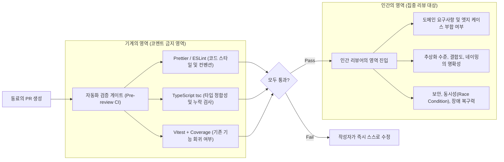

오후 네 시, 배포 마감을 앞두고 슬랙 알림이 울린다. 동료가 올린 450줄짜리 PR(Pull Request) 링크다. 내가 지금 하고 있는 작업의 컨텍스트를 놓치기 싫어 대충 스크롤을 위아래로 한 번 훑어본 뒤, 눈에 띄는 변수명 오타 하나를 지적하고 코멘트 창에 네 글자를 적는다.

> **`LGTM! 👍 (Looks Good To Me)`**

솔직히 고백하건대, 나 역시 바쁜 스프린트 기간에는 이런 영혼 없는 승인 도장을 찍어준 적이 적지 않았다. 반대로 내가 심혈을 기울여 설계하고 고민한 PR에 단 1분 만에 `LGTM`만 달리고 머지될 때의 묘한 허탈감도 잘 알고 있다. 더 나쁜 경우는 **들여쓰기나 세미콜론 같은 지엽적인 스타일 문제로 20개의 공격적인 코멘트가 달리면서 감정만 상하고, 정작 치명적인 메모리 누수나 아키텍처 결합도 문제는 그대로 운영 서버에 배포되는 상황**이다.[^1]

오늘은 우리 개발팀이 형식적인 `LGTM`과 소모적인 기싸움을 걷어내고, <mark>서로의 성장을 자극하면서도 리뷰 피로도를 절반으로 줄인 실전 코드 리뷰 문화와 피드백 화법</mark>을 정리해 보려 한다.

---

## 1. 인간은 인간만 할 수 있는 리뷰에 집중해야 한다

코드 리뷰가 피곤하고 날카로워지는 가장 큰 이유는 **기계가 해야 할 일을 사람이 눈으로 하고 있기 때문**이다.

- *"여기 중괄호 띄어쓰기가 안 맞네요."*
- *"import 순서가 컨벤션이랑 다릅니다."*
- *"사용하지 않는 변수가 남아있어요."*

이런 코멘트가 PR마다 반복되면 작성자는 방어적인 태도를 갖게 되고, 리뷰어는 정작 중요한 비즈니스 로직을 볼 에너지를 소진한다.

### 1.1 CI 파이프라인과 사람의 역할 분리 아키텍처

우리는 **"기계가 잡을 수 있는 것은 코드 리뷰 테이블에 올리지 않는다"**는 대원칙을 세우고, 리뷰가 시작되기 전에 CI가 1차 필터링을 완벽히 끝내도록 파이프라인을 재구축했다.



이렇게 스타일과 컨벤션 지적을 ESLint와 Prettier에게 100% 위임하고 나니, PR 코멘트 개수는 절반으로 줄었지만 코멘트 하나하나의 밀도는 비교할 수 없이 깊어졌다.

---

## 2. 피드백의 온도와 중요도를 일치시키는 '접두사(Prefix) 규칙'

텍스트 기반의 코멘트는 표정과 억양이 생략되기 때문에, 리뷰어는 가벼운 아이디어 차원에서 던진 말인데 작성자는 **'반드시 고쳐야만 승인해 주겠다는 강제 명령'**으로 받아들여 불필요한 논쟁이 생기곤 한다.

이를 해결하기 위해 우리는 Conventional Comments 철학을 차용한 **의도 명시 접두사**를 도입했다.[^2]

### 2.1 똑같은 코드에 대한 두 가지 상반된 리뷰 코멘트 비교

예를 들어 동료가 대량 알림 발송 로직을 `for...of` 루프 안의 `await`로 작성했을 때, 나쁜 리뷰와 좋은 리뷰가 어떻게 다른지 살펴보자.

```typescript title="PR 대상 코드 조각: src/services/notificationSender.ts"
export async function sendBulkAlerts(userIds: string[], message: string) {
  for (const userId of userIds) {
    // 100명에게 순차적으로 발송하면 100번의 네트워크 왕복 시간 소요
    await pushClient.send(userId, message);
  }
}
```

과거의 날 선 코멘트와 개선된 구조적 코멘트는 다음과 같은 차이를 보인다.

```markdown title="피해야 할 코멘트 vs 지향하는 코멘트 비교"
❌ [피해야 할 코멘트 - 단정적이고 대안이 없음]
"이렇게 for문 안에서 await 쓰면 느려서 안 됩니다. Promise.all로 다시 짜세요."

✅ [지향하는 코멘트 - 배경 설명 + 트레이드오프 고려 + 구체적 제안]
"[P2: 제안/성능] 현재 구조에서는 대상 유저가 500명일 경우 순차 실행으로 인해 API 타임아웃(30초)을
초과할 위험이 있어 보입니다!
다만 `Promise.all`로 한 번에 500개를 동시 호출하면 외부 Push 서버의 Rate Limit에 걸릴 수 있으니,
아래처럼 20개씩 청크(Chunk) 단위로 병렬 처리하거나 `p-limit`을 적용하는 건 어떨까요?

(참고 예시)
const limit = pLimit(20);
await Promise.allSettled(userIds.map(id => limit(() => pushClient.send(id, message))));"
```

> [!IMPORTANT]
> **"당신의 코드"가 아니라 "이 코드"를 주어로 삼으세요**
> *"왜 이렇게 짜셨나요?"*(You-message)는 상대를 심문대 위에 올리지만, *"이 함수에 빈 배열이 들어오면 어떤 값을 반환하게 되나요?"*(Code-message)나 *"제가 이 부분의 비즈니스 맥락을 잘 몰라서 그러는데 설명해 주실 수 있나요?"*(I-message)는 함께 문제를 푸는 동료의 태도를 만듭니다.

---

## 3. 우리 팀이 사용하는 코드 리뷰 우선순위(P1~P5) 매트릭스

모든 코멘트 앞에는 `[P1]`부터 `[P5]`까지의 태그를 붙여, 작성자가 지금 당장 코드를 고쳐야 하는지 아니면 다음 티켓으로 넘겨도 되는지 1초 만에 판단할 수 있게 약속했다.

| 등급 태그 | 의미 및 강제성 | 머지(Approve) 차단 여부 | 대표적인 적용 상황 및 예시 |
| :--- | :--- | :---: | :--- |
| **`[P1: 필수 수정]`** | 치명적 결함 (Blocker) | **차단 (Request Changes)** | 운영 장애 유발 버그, 보안 취약점, 데이터 유실 가능성, 핵심 기획 누락 |
| **`[P2: 강력 권장]`** | 설계 및 품질 개선 | 협의 후 반영 (보통 수정함) | 잠재적 Race Condition, 과도한 결합도, 예외 처리 누락, 테스트 케이스 보강 |
| **`[P3: 제안/고민]`** | 더 나은 대안 제시 (Nit/Idea) | **승인 가능 (Approve)** | 가독성을 높이는 변수명 제안, 리팩토링 아이디어 (이번 PR이나 차후 반영 선택) |
| **`[P4: 질문/공유]`** | 단순 궁금증 및 지식 공유 | **승인 가능 (Approve)** | 도메인 배경 질문, *"아, 이런 Web API도 있군요!"* 같은 참고 자료 공유 |
| **`[P5: 칭찬]`** | 훌륭한 코드에 대한 감탄 | **승인 가능 (Approve)** | 복잡한 문제를 우아하게 푼 로직, 꼼꼼한 테스트 작성에 대한 구체적인 찬사 |

### 3.1 `[P5: 칭찬]` 코멘트가 팀 문화를 바꾸는 힘

많은 개발자들이 코드 리뷰를 **'틀린 그림 찾기'**라고 생각한다. 그러다 보니 잘 짜인 코드 95%는 당연한 듯 침묵으로 넘어가고, 아쉬운 5%에만 코멘트가 달린다.

나는 의식적으로 매 PR마다 최소 한 개 이상의 **`[P5: 칭찬]` 코멘트**를 남기려고 노력한다.

> *"`[P5: 칭찬]` 와, 기존에 `OrderModal` 안에 강하게 결합되어 있던 결제 검증 로직을 `validateOrderPolicy` 순수 함수로 분리해 주신 덕분에 테스트 코드가 정말 읽기 편해졌네요! 저도 다음 작업 때 이 패턴 그대로 적용해 보겠습니다 🙌"*

이런 구체적인 칭찬 한 줄이 달리는 순간, 코드 리뷰 시간은 '검사받는 시간'에서 **'내 노력을 인정받고 설계를 교류하는 즐거운 시간'**으로 바뀐다.

<details>
<summary>리뷰를 받는 작성자(Author)가 먼저 챙겨야 할 배려: '셀프 리뷰(Self-Review)'</summary>

좋은 코드 리뷰는 리뷰어만의 노력으로 이루어지지 않습니다. PR을 올린 작성자가 리뷰어를 배려하는 가장 좋은 방법은 **PR을 생성한 직후 리뷰어를 할당하기 전에 스스로 Files changed 탭을 열어서 첫 번째 리뷰어가 되어보는 것**입니다.
1. 변경된 파일이 15개, 코드 라인이 400줄을 넘는다면 기능 단위로 PR을 쪼갤 수 없는지 먼저 고민합니다.
2. 왜 굳이 일반적인 방식 대신 지금의 우회 로직을 택했는지 해당 코드 라인에 **작성자 코멘트(Self-comment)**를 미리 달아두면, 리뷰어가 의도를 추측하느라 쓰는 시간을 80% 이상 아껴줄 수 있습니다.

</details>

---

## 4. 30분 안에 깊이 있는 리뷰를 마치는 나만의 시선 이동 순서

PR 하나를 열었을 때 첫 번째 파일의 1번 줄부터 무작정 읽기 시작하면 나무만 보다가 숲을 놓치기 쉽다. 나는 항상 아래의 4단계 순서로 시선을 이동하며 읽는다.

1. **PR 본문과 티켓 요구사항 대조 (3분)**: 이 변경이 해결하려는 비즈니스 문제가 무엇인지 먼저 파악한다.
2. **타입 정의(`types.ts`)와 테스트 코드(`*.test.ts`) 먼저 읽기 (7분)**: 구현 코드를 보지 않고 **입출력 인터페이스와 테스트 케이스**만 먼저 읽으면 전체 아키텍처의 윤곽이 한눈에 들어온다.
3. **핵심 비즈니스 로직과 상태 변화 추적 (15분)**: 에러가 발생했을 때 롤백이나 Fallback이 안전한지, 비동기 경합 조건이나 메모리 누수(클린업 누락)가 없는지 집중 점검한다.
4. **UI 컴포넌트 및 유틸리티 연결 확인 (5분)**: 접근성(키보드 네비게이션, 시맨틱 태그)과 엣지 케이스(빈 데이터, 긴 텍스트 말줄임)를 확인한다.

> [!TIP]
> **GitHub PR 화면에서 유용한 단축키 활용하기**
> GitHub의 `Files changed` 탭에서 파일을 하나씩 다 읽었다면 키보드의 <kbd>V</kbd> 키를 눌러보세요! 해당 파일의 `Viewed` 체크박스가 토글되면서 파일이 깔끔하게 접혀, 이미 확인한 파일과 아직 안 본 파일을 헷갈리지 않고 리뷰할 수 있습니다.

---

## 5. 리뷰 완료(`Submit Review`) 버튼을 누르기 전 체크리스트

오늘도 동료의 PR에 최종 코멘트를 남기기 전, 나는 아래 다섯 가지 항목을 스스로에게 되묻는다.

- [x] **아키텍처 및 도메인 정합성**: 이 코드가 해결하려는 문제가 올바른 계층(도메인 vs UI vs 인프라)에 위치해 있는가?
- [x] **실패 시나리오(Unhappy Path)**: 네트워크가 끊기거나, 배열이 비어 있거나, 사용자가 버튼을 연타했을 때도 시스템이 우아하게 대처하는가?
- [x] **피드백의 구체성**: 단순히 *"별론데요"*가 아니라 **왜 문제인지(Why)**와 **어떻게 고치면 좋을지(How/Suggestion)**를 함께 제시했는가?
- [x] **우선순위 명시**: 작성자가 당장 고쳐야 할 블로커(`[P1]`)와 단순 아이디어(`[P3]`)를 명확히 구분해 주었는가?
- [ ] **긍정적 피드백 포함**: 동료가 고민한 흔적이 보이는 좋은 설계나 깔끔한 리팩토링 지점에 구체적인 칭찬 코멘트를 남겼는가?

> [!NOTE]
> **코멘트 핑퐁이 3번을 넘어가면 즉시 허들(Huddle)이나 자리로 가세요**
> 텍스트 코멘트로 서로의 의견이 3번 이상 평행선을 달린다면, 타자를 치는 것을 멈추고 5분만 음성 통화나 대면으로 이야기하세요. 텍스트로 1시간 걸릴 오해가 화면 공유와 함께 대화하면 3분 만에 해결되고, 결론만 PR 코멘트에 요약해 두면 됩니다.

---

## 6. 마치며: 코드 리뷰는 팀의 지식을 동기화하는 가장 강력한 미디어다

코드 리뷰의 제1 목적은 버그 색출이 아니다. 버그는 자동화된 테스트와 정적 분석 도구가 훨씬 더 잘 잡는다. 인간이 하는 코드 리뷰의 진짜 가치는 **'팀 전체의 코드 소유권(Collective Code Ownership) 공유'**와 **'도메인 지식 및 설계 철학의 상향 평준화'**에 있다.

오늘 동료의 PR을 열었을 때 습관적으로 `LGTM` 네 글자만 적고 창을 닫으려 했다면, 단 5분만 더 머물러 보자. 동료가 고민 끝에 작성한 함수의 의도를 물어봐 주고, 훌륭한 추상화에 진심 어린 찬사를 보내고, 미처 보지 못한 엣지 케이스를 함께 짚어주는 그 대화 속에서 팀의 기술력은 가장 단단하게 자라난다.

[^1]: 이를 소프트웨어 공학에서는 **자전거 보관소 효과(Bikeshedding, 파킨슨의 사소함의 법칙)**라고 부릅니다. 원자력 발전소 설계안처럼 복잡하고 중요한 안건은 어렵기 때문에 아무도 의견을 내지 못하고 쉽게 통과시키는 반면, 누구나 한마디씩 거들기 쉬운 자전거 보관소 지붕 색깔(변수명, 들여쓰기 등)을 두고는 몇 시간씩 열띤 논쟁을 벌이는 현상입니다.
[^2]: 폴 봄바르디에(Paul Slaughter)가 제안한 *Conventional Comments(conventionalcomments.org)* 표준으로, `praise:`, `nitpick:`, `suggestion:`, `issue:`, `question:`, `thought:` 같은 레이블을 통해 코멘트의 톤앤매너와 강제성을 명확히 전달하는 기법입니다.
