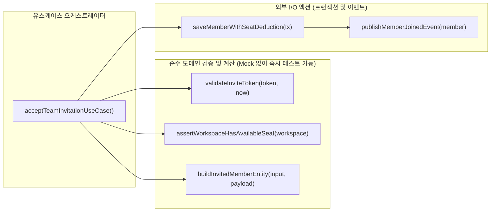

프로그래밍을 하면서 겪는 가장 흔한 병목 중 하나는 알고리즘 구현이 아니라 **함수 이름 짓기**다. 커서를 깜빡이며 5분째 `handleUserSubmit`, `processOrderData`, `checkAndSaveAndNotifyUser` 같은 이름들을 적었다 지웠다 반복하고 있다면, 그것은 어휘력이 부족해서가 아니다. 지금 작성하고 있는 그 함수가 **단일 책임 원칙(Single Responsibility Principle)**을 어기고 너무 많은 일을 한꺼번에 처리하고 있다는 가장 정직한 구조 신호다.[^1]


오늘은 레거시 회원 가입 및 워크스페이스 초기 설정 모듈을 리팩토링하면서 마주쳤던 250줄짜리 괴물 함수를 어떻게 해체했는지, 그리고 <mark>함수의 이름을 명확한 동사+목적어 하나로 좁혀나가는 과정이 어떻게 자연스럽게 클린 아키텍처와 테스트 용이성으로 이어지는지</mark> 복기해 보려 한다.

---

## 1. 이름에 `And`, `Or`, `Process`, `Handle`이 들어가는 순간

코드 리뷰를 하거나 내가 3개월 전에 짠 코드를 다시 열어볼 때, 함수 이름만 봐도 내부의 스파게티 구조가 짐작되는 단어들이 있다.

- **`validateAndSaveOrder`**: 검증도 하고 저장도 한다. 만약 검증만 재사용하고 싶다면?
- **`handleUserLoginProcess`**: `handle`과 `process`는 사실상 *"이 안에서 로그인과 관련된 온갖 잡다한 일을 다 합니다"*라는 선언과 다름없다.
- **`fetchOrCreateProfile`**: 조회(Query)와 생성(Command)이라는 두 가지 상반된 부수효과가 하나의 함수 안에 공존한다.

### 1.1 실무에서 마주친 `processTeamInvitation`의 내부

얼마 전 사내 B2B SaaS 제품의 '팀원 초대 수락' 플로우에서 간헐적으로 환영 이메일은 발송되었는데 정작 워크스페이스 권한은 부여되지 않는 버그를 조사하게 되었다. 문제의 중심에는 `processTeamInvitation`이라는 모호한 이름의 함수가 자리 잡고 있었다.

```typescript title="src/services/invitationService.ts (리팩토링 전 - 4가지 책임이 뒤섞인 함수)"
export async function processTeamInvitation(rawToken: string, userInput: UserSignupDto) {
  // 1. 토큰 복호화 및 만료 검증 (보안/파싱 책임)
  const payload = verifyJwtToken(rawToken, process.env.INVITE_SECRET!);
  if (!payload || payload.expiresAt < Date.now()) {
    throw new Error('만료되었거나 유효하지 않은 초대장입니다.');
  }

  // 2. 사용자 입력값 정규화 및 비밀번호 해싱 (데이터 변환 책임)
  const normalizedEmail = userInput.email.trim().toLowerCase();
  if (normalizedEmail !== payload.invitedEmail) {
    throw new Error('초대받은 이메일 주소와 일치하지 않습니다.');
  }
  const passwordHash = await bcrypt.hash(userInput.password, 12);

  // 3. 외부 마케팅 CRM 웹훅 및 웰컴 이메일 먼저 발송?! (외부 I/O 부수효과)
  await emailClient.sendWelcomeTemplate(normalizedEmail, payload.workspaceName);
  await crmWebhook.trackEvent('INVITE_ACCEPTED', { email: normalizedEmail });

  // 4. DB 트랜잭션 저장 및 좌석(Seat) 차감 (영속성 및 비즈니스 규칙)
  const workspace = await db.workspace.findUnique({ where: { id: payload.workspaceId } });
  if (workspace.usedSeats >= workspace.maxSeats) {
    // 여기서 에러가 터지면 이미 위에서 이메일은 발송된 상태!
    throw new Error('워크스페이스의 최대 사용 가능 좌석을 초과했습니다.');
  }

  return await db.user.create({
    data: {
      email: normalizedEmail,
      passwordHash,
      workspaceId: payload.workspaceId,
      role: payload.assignedRole,
    },
  });
}
```

코드를 읽어보면 왜 이 함수의 이름을 `acceptInvitation`이나 `createInvitedUser`처럼 명확하게 짓지 못하고 두루뭉술하게 `processTeamInvitation`이라고 지었는지 단번에 이해가 간다. **토큰 파싱, 비밀번호 암호화, 외부 이메일 발송, 요금제 좌석 한도 검사, DB 생성까지 무려 다섯 가지 추상화 수준의 작업이 한 몸에 엉켜 있었기 때문**이다.

> [!CAUTION]
> **부수효과(Side Effect)와 도메인 검증의 순서 역전**
> 위 코드의 가장 치명적인 결함은 3번(외부 이메일 발송)이 4번(워크스페이스 좌석 한도 검증)보다 먼저 실행된다는 점입니다. 한 함수 안에 모든 코드가 평면적으로 나열되어 있으면 이처럼 트랜잭션 경계와 외부 I/O 시점이 쉽게 뒤엉킵니다.

---

## 2. 함수를 쪼개는 두 가지 축: 순수 계산과 부수효과 분리

이름 짓기 어려운 거대 함수를 발견했을 때 내가 가장 먼저 적용하는 기법은 에릭 노먼드(Eric Normand)의 『쏙쏙 들어오는 함수형 코딩』에서 강조하는 **액션(Action)에서 계산(Calculation)을 빼내기**다.[^2]

- **계산(Pure Calculation)**: 입력값이 같으면 언제 호출하든 100% 동일한 출력값을 반환하며 외부 세계에 아무런 영향을 주지 않는 순수 함수
- **액션(Effectful Action)**: 실행 시점이나 횟수에 의존하는 DB 조회/저장, 네트워크 호출, 이메일 발송 등의 부수효과 함수

### 2.1 책임 분리 후의 아키텍처 흐름

거대했던 `processTeamInvitation`을 각자의 명확한 이름을 가진 작은 함수들로 분해하면 제어 흐름이 아래 다이어그램처럼 선명해진다.



### 2.2 명확한 이름을 얻은 작은 함수들

이제 각 함수는 이름에 `And`나 `Process`를 쓰지 않고도 자신이 하는 일을 정확히 한 문장으로 설명한다.

```typescript title="src/domain/invitationPolicy.ts (순수 도메인 함수들 - 외부 의존성 0개)"
export function validateInviteTokenPayload(
  payload: InviteTokenPayload | null,
  targetEmail: string,
  nowMs: number,
): ValidatedInvite {
  if (!payload || payload.expiresAt < nowMs) {
    throw new InvitationExpiredError();
  }
  const normalizedEmail = targetEmail.trim().toLowerCase();
  if (normalizedEmail !== payload.invitedEmail) {
    throw new EmailMismatchError(normalizedEmail, payload.invitedEmail);
  }
  return {
    workspaceId: payload.workspaceId,
    email: normalizedEmail,
    role: payload.assignedRole,
  };
}

export function assertSeatCapacityAvailable(workspace: { usedSeats: number; maxSeats: number }): void {
  if (workspace.usedSeats >= workspace.maxSeats) {
    throw new WorkspaceSeatLimitExceededError(workspace.maxSeats);
  }
}
```

그리고 상위 오케스트레이터 함수(`acceptTeamInvitation`)는 이 조각들을 **동일한 추상화 수준(Single Level of Abstraction)**에서 조립하는 역할만 담당한다.

```typescript title="src/usecases/acceptTeamInvitation.ts (오케스트레이터 함수)"
export async function acceptTeamInvitation(rawToken: string, userInput: UserSignupDto) {
  const tokenPayload = verifyJwtToken(rawToken);
  const validInvite = validateInviteTokenPayload(tokenPayload, userInput.email, Date.now());

  const workspace = await workspaceRepo.findByIdOrThrow(validInvite.workspaceId);
  assertSeatCapacityAvailable(workspace);

  const passwordHash = await hashPassword(userInput.password);

  // DB 트랜잭션이 완전히 성공한 이후에만 외부 알림 발송!
  const newMember = await workspaceRepo.registerMemberInTransaction({
    ...validInvite,
    passwordHash,
  });

  await notificationService.sendWelcomeNotification(newMember);
  return newMember;
}
```

---

## 3. 나쁜 함수 이름의 징후와 리팩토링 처방전

실무에서 자주 마주치는 '모호한 함수 이름 패턴'과 그 이면에 숨어 있는 구조적 문제, 그리고 이를 어떻게 쪼개야 하는지 표로 정리했다.

| 위험한 함수 이름 패턴 | 실제 코드 내부의 문제점 | 리팩토링 처방 및 개선된 이름 예시 |
| :--- | :--- | :--- |
| **`checkAndUpdateStatus()`** | 상태 조회/판별 로직과 DB 상태 변경 부수효과가 결합됨 | 판별 함수 `canTransitionToPaid(order)`와 변경 함수 `markOrderAsPaid(orderId)`로 분리 (CQS 원칙) |
| **`handleOrderData()`** | 입력값 파싱, 할인 금액 계산, API 응답 포맷팅이 한곳에 뭉쳐 있음 | `parseOrderRequest()`, `calculateDiscountedTotal()`, `toOrderResponseDto()`로 파이프라인 분리 |
| **`getUserInfo(id, createIfMissing)`** | 불리언 플래그에 따라 `SELECT`만 하거나 `INSERT`까지 수행하여 예측 불가능 | `findUserById(id)`와 `getOrCreateDefaultUser(id)` 두 개의 명시적 함수로 분리 |
| **`formatCartItems()`** (내부에서 원본 배열 변이) | 이름은 단순 포맷팅인데 내부에서 원본 객체의 프로퍼티를 직접 수정(Mutation)함 | 원본을 건드리지 않고 새 배열을 반환하는 `toFormattedCartViewItems(items)` 순수 함수로 변경 |
| **`initPage()`** | 권한 체크, 초기 데이터 패칭, 이벤트 리스너 등록, 애널리틱스 로깅이 섞임 | 각 역할별 훅(`useRequireAuth`, `useDashboardQuery`, `usePageViewTracker`)으로 분해 |

> [!TIP]
> **명령-조회 분리 원칙(CQS: Command-Query Separation)**
> 버트런드 마이어가 고안한 CQS 원칙에 따르면, 모든 함수는 **상태를 변경하는 명령(Command)**이거나 **데이터를 반환하는 조회(Query)** 둘 중 하나여야지, 두 가지를 동시에 해서는 안 됩니다. `get`이나 `check`, `validate`로 시작하는 함수가 몰래 전역 상태나 DB를 수정하고 있지 않은지 항상 경계하세요.

---

## 4. 단위 테스트 작성 시간이 30분에서 1분으로 줄어든 경험

함수를 쪼개기 전 `processTeamInvitation`을 테스트하려면 그야말로 지옥 같은 준비 과정(Setup)이 필요했다.

- `bcrypt.hash` 모듈을 Mocking해야 했다.
- `emailClient`와 `crmWebhook` 네트워크 클라이언트를 스파이(Spy) 객체로 감싸야 했다.
- 테스트용 인메모리 DB나 Prisma Mock 객체를 띄워 `workspace.findUnique`와 `user.create`의 반환값을 일일이 지정해야 했다.

결국 좌석 한도 초과 조건문(`usedSeats >= maxSeats`) 단 두 줄을 검증하기 위해 **45줄의 Mocking 보일러플레이트 코드**를 짜야 했고, 그러다 보니 팀원 아무도 테스트 코드를 추가하지 않게 되었다.

반면 순수 도메인 계산 함수인 `validateInviteTokenPayload`와 `assertSeatCapacityAvailable`을 분리하고 나니, 어떤 Mocking 라이브러리도 없이 순수한 JSON 입력과 출력만으로 **0.002초 만에 실행되는 단위 테스트 15개**를 3분 만에 작성할 수 있었다.

<details>
<summary>리팩토링 전후 단위 테스트 코드 비교 더보기</summary>

리팩토링 후 작성한 도메인 테스트는 외부 인프라(`db`, `emailClient`)를 전혀 알 필요가 없어 비즈니스 규칙 명세서처럼 읽힙니다.

```typescript title="src/domain/__tests__/invitationPolicy.test.ts"
describe('assertSeatCapacityAvailable', () => {
  it('현재 사용 중인 좌석이 최대 좌석과 같으면 WorkspaceSeatLimitExceededError를 던진다', () => {
    expect(() =>
      assertSeatCapacityAvailable({ usedSeats: 10, maxSeats: 10 })
    ).toThrow(WorkspaceSeatLimitExceededError);
  });

  it('여유 좌석이 1개 이상 남아있으면 예외 없이 통과한다', () => {
    expect(() =>
      assertSeatCapacityAvailable({ usedSeats: 9, maxSeats: 10 })
    ).not.toThrow();
  });
});
```

</details>

---

## 5. 함수를 작성하고 커밋하기 전 스스로에게 묻는 체크리스트

IDE에서 새 함수를 작성한 뒤 <kbd>F2</kbd>(Rename Symbol) 단축키를 눌러 이름을 다듬을 때, 나는 아래 5가지 기준을 통과하는지 점검한다.

- [x] 함수 이름에 `And`, `Or`, `Then` 같은 접속사를 쓰지 않고도 하는 일을 완벽히 설명할 수 있는가?
- [x] `handle`, `process`, `manage`, `data`, `info` 같은 **의미 없는 만능 단어(Weasel Words)**를 구체적인 도메인 동사로 대체했는가?
- [x] 함수 내부의 모든 코드 라인이 **동일한 추상화 수준(Level of Abstraction)**에 머물러 있는가? (고수준 비즈니스 흐름 옆에 저수준 정규식 파싱이 섞여 있지 않은가?)
- [x] 반환 타입이 boolean이거나 `get`/`find`/`calculate`로 시작하는 함수가 내부에서 몰래 상태를 변이(Mutate)시키거나 외부 I/O를 일으키지 않는가?
- [ ] 이 함수의 핵심 분기 로직을 검증하는 단위 테스트를 작성할 때 `vi.mock()`이나 `jest.mock()`을 2개 이하로 사용할 수 있는가?

> [!NOTE]
> **함수를 작게 쪼개면 파일 내 함수 개수가 너무 많아지지 않나요?**
> 맞습니다. 하지만 300줄짜리 거대한 함수 하나를 위아래로 스크롤하며 지역 변수 15개의 상태 변화를 머릿속에 담아두는 것보다, 잘 지어진 이름을 가진 15줄짜리 함수 10개로 목차처럼 읽히는 코드가 인지 부하(Cognitive Load) 측면에서 비교할 수 없을 만큼 유리합니다.

---

## 6. 마치며: 네이밍은 사후 포장이 아니라 설계의 나침반이다

예전에는 코드를 일단 끝까지 다 짜놓은 뒤에 마지막에 그럴듯한 이름을 붙이려고 애썼다. 하지만 이제는 반대로 접근한다. **함수의 시그니처와 이름을 먼저 짓고, 그 이름이 약속한 범위 밖의 코드는 처음부터 그 함수 안에 들여놓지 않는 것**이다.

오늘 작성 중인 함수의 이름이 선뜻 떠오르지 않아 모니터 앞에서 멈칫하고 있다면, 사전을 뒤지는 대신 함수를 둘로 쪼개보자. 이름이 기가 막히게 잘 지어지는 순간, 당신의 코드 구조도 이미 깔끔하게 정돈되어 있을 것이다.

[^1]: 로버트 C. 마틴은 『클린 코드(Clean Code)』 2장과 3장에서 "함수는 한 가지를 해야 한다. 그 한 가지를 잘해야 한다. 그 한 가지만을 해야 한다"고 강조하며, 함수의 이름을 추상화 수준이 같은 단 하나의 동사구로 지을 수 없다면 그 함수는 둘 이상의 일을 하고 있는 증거라고 설명합니다.
[^2]: 함수형 아키텍처에서는 इसे **Functional Core, Imperative Shell(함수형 코어와 명령형 셸)** 패턴이라고도 부릅니다. 복잡한 분기와 비즈니스 규칙은 중심부의 순수 함수(Core)에 모아두고, 껍데기(Shell)에서 DB 조회와 저장만 수행하는 구조입니다.
