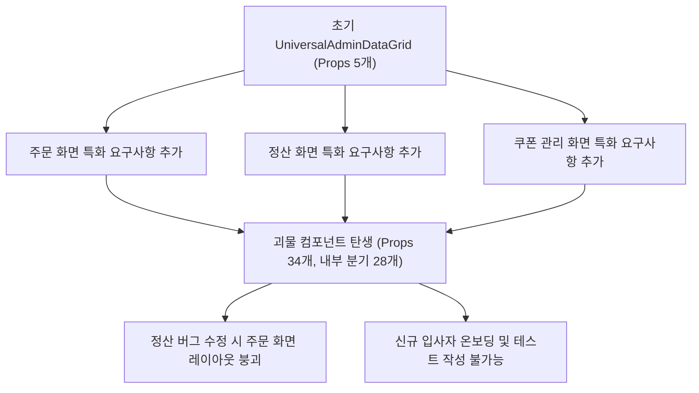

개발자로 일하다 보면 본능적으로 **중복 코드(Duplication)**를 혐오하게 되는 시기가 찾아온다. 두 파일에서 다섯 줄 이상 비슷한 코드가 보이면 손가락이 근질거리고, 당장 `common`이나 `shared`, `utils` 폴더를 만들어 그 코드를 추출해야만 직성이 풀리는 것이다. `DRY(Don't Repeat Yourself)` 원칙을 금과옥조처럼 여기며 *"역시 나는 깔끔한 아키텍처를 설계하는 개발자야"*라고 뿌듯해하던 시절이 나에게도 있었다.

하지만 실무 연차가 쌓이고 프로덕트의 생애주기를 여러 번 겪으면서, 나는 뼈아픈 진실 하나를 마주했다. <mark>잘못된 추상화(Wrong Abstraction)가 가져오는 유지보수 비용은 단순한 중복 코드가 가져오는 비용보다 열 배는 더 비싸다</mark>는 사실이다.[^1] 오늘은 지난 분기 결제·정산 어드민 대시보드를 개편하면서 내가 직접 만들었던 '괴물 공통 컴포넌트'의 탄생과 몰락, 그리고 그것을 다시 해체하며 배운 설계 원칙을 기록해 두려 한다.

---

## 1. 비극의 시작: "어? 이 테이블 두 개가 거의 똑같네?"

사건의 발단은 사내 백오피스에서 사용하는 두 개의 데이터 목록 화면이었다. 하나는 **'주문 내역 조회(`OrderListTable`)'** 화면이었고, 다른 하나는 **'파트너 정산 내역 조회(`SettlementListTable`)'** 화면이었다. 초기 기획서를 받았을 때 두 화면은 놀라울 정도로 비슷해 보였다.

- 상단에 기간 선택 데이트피커(DatePicker)와 검색어 입력창이 있다.
- 중앙에 페이지네이션이 적용된 데이터 테이블이 렌더링된다.
- 우측 상단에 '엑셀 다운로드' 버튼이 존재한다.
- 각 행(Row)을 클릭하면 상세 모달이 열린다.

당시 나는 이 두 화면을 각각 구현하는 대신, 앞으로 추가될 수많은 어드민 목록 화면까지 단번에 해결해 줄 마법의 컴포넌트 `UniversalAdminDataGrid`를 설계하기로 마음먹었다. ~~이때 누군가 내 키보드에서 <kbd>Ctrl</kbd> + <kbd>N</kbd>을 막았어야 했다.~~

### 1.1 선의로 시작된 초기 추상화

처음 만든 `UniversalAdminDataGrid`는 꽤 우아해 보였다. 제네릭 타입 `T`를 받아 컬럼 정의와 API 엔드포인트만 넘기면 알아서 데이터를 패칭하고 테이블과 검색바를 그려주는 구조였다.

```typescript title="src/components/common/UniversalAdminDataGrid.tsx (초기 버전)"
export interface ColumnDef<T> {
  key: keyof T;
  header: string;
  render?: (value: T[keyof T], row: T) => React.ReactNode;
}

export interface UniversalGridProps<T> {
  title: string;
  endpoint: string;
  columns: ColumnDef<T>[];
  enableExcelExport?: boolean;
  onRowClick?: (row: T) => void;
}

export function UniversalAdminDataGrid<T extends { id: string }>({
  title,
  endpoint,
  columns,
  enableExcelExport = true,
  onRowClick,
}: UniversalGridProps<T>) {
  // 공통 검색 상태, 페이지네이션, 엑셀 다운로드 로직이 한곳에 응집됨
  const { data, isLoading } = useFetchGridData<T>(endpoint);
  // ... 렌더링 로직
}
```

코드 리뷰 시간에도 팀원들의 찬사가 쏟아졌다. *"와, 이제 새 어드민 페이지 만들 때 10분이면 끝나겠네요!"*라는 칭찬에 어깨가 으쓱했다. 실제로 첫 2주 동안은 아무런 문제가 없었다.

### 1.2 우연한 중복(Accidental Duplication)의 함정

문제는 두 도메인의 비즈니스 요구사항이 각자의 방향으로 진화하기 시작하면서 터져 나왔다. 주문 내역과 정산 내역은 **지금 당장 화면에 보이는 모양(Representation)**만 같았을 뿐, 그 이면의 **비즈니스 변경 이유(Reason to Change)**는 완전히 달랐던 것이다.[^2]

> "코드가 똑같이 생겼다고 해서 같은 개념인 것은 아니다. 우연히 같은 시점에 비슷한 형태를 띠고 있을 뿐, 시간이 흐르면 전혀 다른 방향으로 갈라질 수 있다."

---

## 2. 플래그 파라미터의 증식과 결합도의 폭발

런칭 후 한 달이 지나자 기획팀과 재무팀에서 각 화면에 대한 개선 요청이 쏟아지기 시작했다.

1. **주문 내역 화면 요구사항**:
   - 부분 취소된 주문은 행 전체 배경색을 붉은색으로 표시해 주세요.
   - 체크박스로 여러 주문을 선택한 뒤 '일괄 배송 준비중 처리' 버튼을 눌러야 합니다.
   - 엑셀 다운로드 시 개인정보 마스킹 해제 사유를 입력하는 보안 팝업이 먼저 떠야 합니다.
2. **파트너 정산 내역 화면 요구사항**:
   - 테이블 하단에 현재 페이지 합계와 전체 기간 누적 정산 금액 요약 행(Summary Footer)을 고정해 주세요.
   - 날짜 필터가 단순 시작일~종료일이 아니라 '귀속월(YYYY-MM)' 기준 분기 선택기로 바뀌어야 합니다.
   - 행 클릭 시 모달이 아니라 우측 슬라이드 드로어(Drawer)가 열리면서 세금계산서 미리보기가 나와야 합니다.

### 2.1 조건문 지옥으로 변해버린 공통 컴포넌트

이 요구사항들을 마주했을 때, 나는 이미 만들어둔 `UniversalAdminDataGrid`라는 추상화를 포기하지 못했다. 매몰 비용 오류(Sunk Cost Fallacy)에 빠져 *"옵션 Props 몇 개만 더 추가하면 하위 호환성을 지키면서 해결할 수 있어!"*라고 생각한 것이다.



결국 3개월 뒤 `UniversalAdminDataGrid`의 인터페이스는 아래와 같은 끔찍한 형태가 되어 있었다.

```typescript title="src/components/common/UniversalAdminDataGrid.tsx (3개월 후의 참상)"
export interface UniversalGridProps<T> {
  title: string;
  endpoint: string;
  columns: ColumnDef<T>[];
  // 주문 도메인 때문에 추가된 플래그들
  enableRowSelection?: boolean;
  onBulkAction?: (selectedIds: string[]) => Promise<void>;
  bulkActionLabel?: string;
  getRowWarningStyle?: (row: T) => boolean;
  requireReasonBeforeExcelExport?: boolean;
  excelSecurityPolicyCode?: 'ORDER_PII' | 'DEFAULT';
  // 정산 도메인 때문에 추가된 플래그들
  dateFilterMode?: 'RANGE' | 'YEAR_MONTH' | 'QUARTER' | 'NONE';
  showSummaryFooter?: boolean;
  summaryEndpoint?: string;
  detailOpenMode?: 'MODAL' | 'DRAWER' | 'INLINE_EXPAND';
  renderDrawerTaxInvoice?: (row: T) => React.ReactNode;
  // 쿠폰 도메인 때문에 추가된 정체불명의 콜백들
  customHeaderSlot?: React.ReactNode;
  disablePaginationWhenSearchEmpty?: boolean;
  legacyQueryParamMapping?: Record<string, string>;
}
```

> [!WARNING]
> **추상화 오염의 대표적 징후**
> 공통 컴포넌트나 함수에 특정 호출자(Caller)만을 위한 `boolean` 플래그나 `if (mode === 'SPECIAL_CASE')` 분기가 추가되기 시작했다면, 그 추상화는 이미 수명을 다한 것입니다.

### 2.2 한쪽을 고치면 반대쪽이 깨지는 도미노 현상

가장 치명적인 문제는 **사이드 이펙트 예측 불가**였다. 정산 화면의 귀속월 필터 버그를 고치기 위해 공통 컴포넌트 내부의 `useEffect` 의존성 배열을 수정했더니, 전혀 상관없는 주문 내역 화면에서 페이지네이션 초기화가 무한 루프에 빠지는 장애가 발생했다.

<details>
<summary>당시 실제로 발생했던 무한 렌더링 버그 리포트 더보기</summary>

정산 화면에서는 `dateFilterMode === 'YEAR_MONTH'`일 때 URL 쿼리 파라미터를 `ym=2026-10` 형태로 동기화해야 했습니다. 이를 처리하겠다고 공통 컴포넌트 내부에서 `searchParams`를 파싱해 기본 날짜 상태를 덮어쓰는 로직을 넣었는데, 주문 화면에서는 기본 날짜 포맷이 `startDate`/`endDate`여서 매 렌더링마다 날짜 객체 참조값이 새로 생성되며 API를 초당 40회씩 호출하는 대형 사고로 이어졌습니다.

</details>

---

## 3. 해체 작업: 다시 중복으로 돌아가는 용기

결국 나는 팀 주간 기술 회의에서 백기를 들었다. *"제가 만든 `UniversalAdminDataGrid`를 폐기하겠습니다."* 샌디 메츠(Sandi Metz)가 제시한 유명한 조언 그대로, 잘못된 추상화를 고치는 가장 빠른 길은 **다시 인라인(Inline)하여 중복을 복원한 뒤, 진짜로 변하지 않는 저수준 메커니즘만 다시 추출하는 것**이었다.

### 3.1 잘못된 추상화 vs 건전한 합성(Composition) 비교

우리가 기존에 저질렀던 실수와 새롭게 리팩토링한 방향의 차이를 표로 정리해 보았다.

| 비교 항목 | 성급한 거대 추상화 (`UniversalAdminDataGrid`) | 헤드리스 훅 + 합성 패턴 (`DataTable` 조각들) |
| :--- | :--- | :--- |
| **설계 철학** | 설정(Configuration)을 통한 모든 케이스 제어 | 합성(Composition)을 통한 제어권 역전(IoC) |
| **Props 개수** | 30개 이상 (도메인 요구사항마다 계속 증가) | 각 하위 컴포넌트당 3~5개 내외 |
| **도메인 결합도** | 주문·정산·쿠폰 비즈니스 규칙이 한 파일에 혼재 | 도메인 로직은 각 페이지 컴포넌트가 100% 소유 |
| **변경 파급력** | 한 화면 수정 시 전체 어드민 회귀 테스트 필요 | 수정한 페이지에만 영향이 국한됨 |
| **코드 라인 수** | 총 라인 수는 적어 보이나 조건문 복잡도가 극악 | 페이지별 보일러플레이트는 조금 늘어나나 직관적 |
| **단위 테스트** | Mocking할 의존성이 너무 많아 사실상 포기 | 순수 유틸 함수와 개별 UI 조각 단위로 즉시 검증 |

### 3.2 제어권 역전(Inversion of Control)을 적용한 재설계

우리는 "화면 전체를 대신 그려주는 프레임워크 같은 컴포넌트"를 버리고, 각 도메인 페이지가 직접 조립해서 쓸 수 있는 **작고 순수한 빌딩 블록(Building Blocks)**으로 쪼갰다.

```typescript title="src/pages/settlement/SettlementListPage.tsx (리팩토링 후)"
export function SettlementListPage() {
  const [yearMonth, setYearMonth] = useQueryState('ym', '2026-11');
  const [selectedSettlement, setSelectedSettlement] = useState<Settlement | null>(null);

  const { data, summary, isLoading } = useSettlementListQuery({ yearMonth });

  return (
    <AdminPageLayout title="파트너 정산 내역">
      <AdminToolbar>
        <YearMonthPicker value={yearMonth} onChange={setYearMonth} />
        <ExcelExportButton endpoint="/api/settlements/export" params={{ yearMonth }} />
      </AdminToolbar>

      <BaseTable
        data={data}
        columns={settlementColumns}
        isLoading={isLoading}
        onRowClick={(row) => setSelectedSettlement(row)}
        footer={<SettlementSummaryRow summary={summary} />}
      />

      <TaxInvoiceDrawer
        settlement={selectedSettlement}
        onClose={() => setSelectedSettlement(null)}
      />
    </AdminPageLayout>
  );
}
```

이렇게 바꾸자 각 페이지 파일의 길이는 40줄에서 90줄로 늘어났지만, **코드를 읽을 때 파일 하나만 위에서 아래로 읽으면 무슨 일이 벌어지는지 100% 파악할 수 있게 되었다.** 더 이상 <kbd>F12</kbd>(정의로 이동)를 눌러가며 800줄짜리 공통 컴포넌트 내부의 `if-else` 미로를 탐험할 필요가 없어진 것이다.

> [!TIP]
> **추상화 계층을 나눌 때의 핵심 기준**
> UI 골격(`BaseTable`, `AdminToolbar`)과 비즈니스 정책(보안 사유 입력 팝업, 세금계산서 드로어)은 절대 같은 추상화 계층에 섞지 마세요. 순수 UI 프리미티브만 공유하고, 조립은 각 도메인 페이지에게 맡기는 것이 훨씬 안전합니다.

---

## 4.Rule of Three: 세 번 반복될 때까지 기다려라

이번 실패를 통해 우리 프론트엔드 팀은 **'추상화 도입 가이드라인'**을 명문화했다. 마틴 파울러가 『리팩터링』에서 언급한 **Rule of Three(3의 법칙)**가 그 핵심이다.

1. 첫 번째로 기능을 구현할 때는 그냥 작성한다.
2. 두 번째로 비슷한 코드를 작성하게 되면, 일단 눈이 찌푸려지더라도 **복사해서 붙여넣는다(Duplication).**
3. 세 번째로 동일한 패턴이 등장했을 때 비로소 세 사례의 교집합과 차집합을 분석하여 추상화를 시작한다.

왜 하필 세 번일까? 표본이 두 개뿐일 때는 무엇이 **본질적인 공통점(Essential)**이고 무엇이 **우연한 일치(Accidental)**인지 구분할 수 있는 데이터가 부족하기 때문이다. 세 번째 유스케이스가 등장해야 비로소 변하는 축(Axis of Change)이 명확히 드러난다.

> [!IMPORTANT]
> **폴더 구조가 주는 심리적 압박 줄이기**
> 프로젝트 루트의 `src/utils`나 `src/components/common`에 파일을 넣는 순간, 팀원들은 그것을 '전사 표준 모듈'로 인식하여 쉽게 삭제하거나 시그니처를 바꾸지 못합니다. 확실해지기 전까지는 도메인 폴더 내부(`src/features/order/components/`)에 두세요.

---

## 5. 실무에서 공통 모듈을 추출하기 전 점검하는 체크리스트

지금도 나는 새로운 유틸리티 함수나 공통 커스텀 훅을 분리하고 싶어질 때마다 아래 체크리스트를 먼저 통과하는지 스스로에게 묻는다.

- [x] 동일한 코드 패턴이 서로 다른 도메인에서 **최소 3번 이상** 반복되었는가?
- [x] 함께 묶으려는 코드들이 단순한 형태적 유사성이 아니라 **동일한 비즈니스 변경 이유(단일 책임)**를 공유하는가?
- [x] 추출한 함수나 컴포넌트의 시그니처에 특정 호출자만을 위한 `boolean` 플래그나 분기 처리가 **단 하나도 없는가**?
- [x] 추상화 내부를 열어보지 않고 **이름과 타입 시그니처만 보고도** 동작과 부수효과를 100% 예측할 수 있는가?
- [ ] 만약 내일 한쪽 도메인의 기획이 완전히 뒤집혔을 때, 이 추상화를 5분 안에 다시 인라인(해체)할 수 있을 만큼 결합도가 낮은가?

---

## 6. 마치며: 약간 지루하고 정직한 코드의 가치

주니어 시절에는 남들이 보기에 현란한 제네릭과 고차 함수(Higher-Order Function), 복잡한 상속 구조로 이루어진 코드가 '고급 코드'라고 믿었다. 하지만 수년간 운영 환경의 장애를 맞고 요구사항 변경의 파도를 넘어오면서 깨달은 좋은 코드는 오히려 **약간은 지루할 정도로 정직하고 평탄한 코드**였다.

중복을 두려워하지 말자. 성급한 추상화로 서로 다른 두 도메인의 운명을 쇠사슬로 묶어버리는 것보다, 각자의 파일에서 스무 줄쯤 중복된 채로 자유롭게 진화하게 두는 편이 미래의 나와 동료들을 구원하는 길일 때가 훨씬 많다.

[^1]: Sandi Metz의 아티클 *"The Wrong Abstraction"(2016)*에서 제시된 핵심 명제로, "duplication is far cheaper than the wrong abstraction"이라는 문장으로 널리 알려져 있습니다.
[^2]: 로버트 C. 마틴(Uncle Bob)이 정의한 단일 책임 원칙(SRP)에서도 '책임'이란 곧 '변경의 이유(Actor)'를 뜻합니다. 주문 담당 부서와 회계 정산 부서라는 서로 다른 액터의 요구사항이 하나의 모듈에 묶이면 필연적으로 결합도 문제가 발생합니다.
