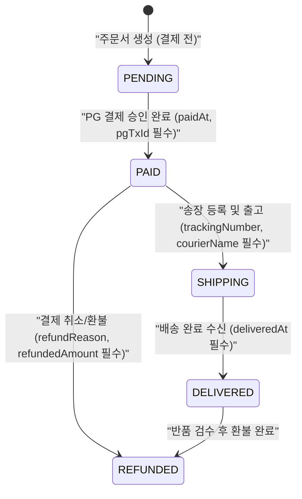

프로덕션 레거시 코드베이스에서 `any` 타입을 걷어내는 작업을 시작할 때만 해도, 나는 이 작업이 그저 귀찮고 단순한 **'빈칸 채우기(Type Annotation) 노동'**일 거라고 생각했다. 백엔드 API 스펙 문서를 옆에 띄워놓고 인터페이스 프로퍼티 몇 개를 정의해서 갈아 끼우면 반나절이면 끝날 줄 알았던 것이다.

하지만 결제 및 배송 상태 추적 모듈에 박혀 있던 32개의 `any`와 느슨한 옵셔널(`?`) 프로퍼티들을 하나씩 지워나가면서, 나는 충격적인 사실을 깨달았다. 코드에 `any`가 쓰인 자리는 단순히 당시 개발자가 타자 치기 귀찮아서 남겨둔 흔적이 아니었다. <mark>그곳은 기획자와 백엔드, 프론트엔드 개발자 누구도 그 데이터의 정확한 생명주기(Lifecycle)와 상태 전이 규칙을 명확히 정의하지 못했던 '도메인 모델링의 블랙홀'</mark>이었다.[^1] 오늘은 `any`를 지우려다 결국 도메인 모델 자체를 **구별된 유니온(Discriminated Unions)**으로 전면 재설계하게 된 과정을 기록한다.

---

## 1. `any`를 지웠더니 나타난 더 끔찍한 괴물: '옵셔널 백화점'

문제가 되었던 코드는 주문 상세 페이지에서 배송 및 환불 상태를 렌더링하는 `OrderStatusCard` 컴포넌트였다. 처음 파일을 열었을 때 Props 타입은 처참하게도 `orderData: any`로 되어 있었다.

나는 의기양양하게 백엔드 응답 JSON 샘플들을 모아 `OrderDetail` 인터페이스를 정의하고 `any`를 지웠다. 그런데 완성된 인터페이스를 본 순간 뭔가 단단히 잘못되었다는 느낌을 받았다.

### 1.1 첫 번째 시도: 모든 필드가 옵셔널(`?`)인 가짜 타입 안전성

주문 상태가 '결제 대기'일 때와 '배송 중'일 때, 그리고 '환불 완료'일 때 내려오는 필드가 조금씩 다르다 보니, 하나의 인터페이스로 묶으려다 보니 거의 모든 프로퍼티에 물음표(`?`)가 붙어버린 것이다.

```typescript title="src/types/order.ts (1차 수정 - any는 없지만 불가능한 상태를 허용하는 나쁜 타입)"
export interface OrderDetail {
  id: string;
  status: 'PENDING' | 'PAID' | 'SHIPPING' | 'DELIVERED' | 'REFUNDED';
  totalAmount: number;
  // 결제 완료 이후에만 존재하는 필드들
  paidAt?: string;
  pgTransactionId?: string;
  // 배송 시작 이후에만 존재하는 필드들
  courierName?: string;
  trackingNumber?: string;
  shippedAt?: string;
  deliveredAt?: string;
  // 환불 시에만 존재하는 필드들
  refundReason?: string;
  refundedAmount?: number;
  refundedAt?: string;
  // 도대체 언제 들어오는지 아무도 몰라서 남아있던 필드
  extraMetadata?: Record<string, unknown>;
}
```

이 인터페이스로 `any`를 대체하자마자 컴포넌트 코드 곳곳에서 빨간 줄이 터져 나왔다. `status === 'SHIPPING'`인 분기문 안에서도 TypeScript 컴파일러는 `order.trackingNumber`가 `string | undefined`라며 계속해서 방어 코드를 요구했기 때문이다. ~~결국 개발자들은 귀찮음을 이기지 못하고 `order.trackingNumber!` 같은 Non-null assertion(`!`)이나 `as string`을 남발하기 시작했다.~~

> [!WARNING]
> **옵셔널(`?`) 남발이 만드는 '불가능한 상태(Impossible States)'의 조합**
> 위 타입 정의에 따르면 `status: 'PENDING'`(결제 대기)이면서 동시에 `deliveredAt`(배송 완료 시각)과 `refundedAmount`(환불 금액)가 존재하는 기괴한 객체도 TypeScript 컴파일을 100% 통과합니다. 타입 시스템이 비즈니스 규칙을 전혀 대변하지 못하는 상태입니다.

---

## 2. 불가능한 상태를 표현조차 할 수 없게 만들기

그제야 나는 얀 민스키(Yaron Minsky)의 유명한 격언인 **"불가능한 상태를 표현할 수 없게 만들어라(Make Illegal States Unrepresentable)"**를 떠올렸다.[^2] 주문(`Order`)은 하나의 거대한 고정 구조체가 아니라, 시간의 흐름에 따라 형태와 보유 데이터가 완전히 달라지는 **유한 상태 기계(Finite State Machine)**였던 것이다.

### 2.1 주문 생명주기 상태 전이 다이어그램

백엔드 팀원들과 화이트보드 앞에 모여 실제 DB에서 각 상태별로 절대 `NULL`일 수 없는 불변 조건(Invariant)을 다시 정리했다.



### 2.2 구별된 유니온(Discriminated Union)을 통한 도메인 재모델링

화이트보드에서 도출한 상태별 불변 조건을 그대로 TypeScript의 **태그된 유니온(Tagged / Discriminated Union)** 타입으로 옮겨 적자, 물음표(`?`)가 거짓말처럼 사라졌다!

```typescript title="src/types/order.ts (2차 수정 - 도메인 규칙이 타입에 완벽히 투영된 모델)"
interface OrderBase {
  id: string;
  totalAmount: number;
  createdAt: string;
}

export interface PendingOrder extends OrderBase {
  status: 'PENDING';
}

export interface PaidOrder extends OrderBase {
  status: 'PAID';
  paidAt: string;
  pgTransactionId: string;
}

export interface ShippingOrder extends OrderBase {
  status: 'SHIPPING';
  paidAt: string;
  pgTransactionId: string;
  courierName: string;
  trackingNumber: string;
  shippedAt: string;
}

export interface DeliveredOrder extends OrderBase {
  status: 'DELIVERED';
  paidAt: string;
  pgTransactionId: string;
  courierName: string;
  trackingNumber: string;
  shippedAt: string;
  deliveredAt: string;
}

export interface RefundedOrder extends OrderBase {
  status: 'REFUNDED';
  paidAt: string;
  pgTransactionId: string;
  refundReason: string;
  refundedAmount: number;
  refundedAt: string;
}

// 식별자(status)를 통해 완벽히 좁혀지는 유니온 타입
export type OrderDetail =
  | PendingOrder
  | PaidOrder
  | ShippingOrder
  | DeliveredOrder
  | RefundedOrder;
```

---

## 3. 철저한 망라성 검사(`never`)와 UI 코드의 극적인 변화

도메인 모델을 유니온 타입으로 재정의하자, 이를 소비하는 UI 컴포넌트 코드는 방어적 `if (!order.trackingNumber)` 조건문 밭에서 해방되어 정교한 `switch` 문으로 탈바꿈했다.

```typescript title="src/components/order/OrderStatusBanner.tsx (Exhaustive Check 적용)"
function assertNever(UnhandledValue: never): never {
  throw new Error(`처리되지 않은 주문 상태입니다: ${JSON.stringify(UnhandledValue)}`);
}

export function OrderStatusBanner({ order }: { order: OrderDetail }) {
  switch (order.status) {
    case 'PENDING':
      return <p>결제를 완료하시면 상품 준비가 시작됩니다.</p>;

    case 'PAID':
      // 이 블록 안에서 order는 자동으로 PaidOrder로 추론됨!
      return <p>결제 완료 ({order.paidAt}) - 판매자가 발송을 준비 중입니다.</p>;

    case 'SHIPPING':
      // optional chaining(?.) 없이도 trackingNumber에 100% 안전하게 접근!
      return (
        <p>
          {order.courierName} ({order.trackingNumber}) 배송이 시작되었습니다.
        </p>
      );

    case 'DELIVERED':
      return <p>{order.deliveredAt}에 배송이 완료되었습니다.</p>;

    case 'REFUNDED':
      return (
        <p>
          환불 완료: {order.refundedAmount.toLocaleString()}원 (사유: {order.refundReason})
        </p>
      );

    default:
      // 향후 백엔드에 'EXCHANGE_REQUESTED' 같은 새 상태가 추가되면
      // 런타임이 아니라 빌드 타임에 즉시 컴파일 에러를 발생시켜 누락을 막아줌!
      return assertNever(order);
  }
}
```

> [!TIP]
> **`assertNever` 패턴의 위력**
> 만약 3개월 뒤 기획이 추가되어 `OrderDetail` 유니온에 `ExchangeRequestedOrder`가 추가되면, 프로젝트 내의 모든 `switch (order.status)` 문장의 `default: return assertNever(order)` 줄에서 **컴파일 에러**가 발생합니다. 개발자가 어떤 화면을 함께 수정해야 하는지 에디터가 하나도 빠짐없이 찾아주는 셈입니다.

---

## 4. 느슨한 타입 vs 도메인 주도 엄격한 타입 비교

`any`와 옵셔널 필드로 도배된 모델에서 구별된 유니온 및 브랜디드 타입(Branded Types)으로 전환했을 때 얻은 실익을 표로 정리했다.

| 비교 기준 | `any` 및 `as` 타입 단언 남발 | 단일 인터페이스 + 옵셔널(`?`) 도배 | 구별된 유니온 + 런타임 스키마 검증 (`Zod`) |
| :--- | :--- | :--- | :--- |
| **컴파일 타임 안전성** | 전무함 (오타가 나도 통과) | 낮음 (불가능한 상태 조합을 허용함) | **최상** (허용된 상태 전이만 코드 작성 가능) |
| **컴포넌트 내 방어 코드** | 실행해 보기 전까지 `undefined` 에러 폭탄 | `order?.courierName ?? ''`가 모든 줄에 반복됨 | 분기 진입 시 타입이 좁혀져 불필요한 `?.` 제거 |
| **신규 상태 추가 시 파급 파악** | 전체 파일 텍스트 검색(`Ctrl+Shift+F`)에 의존 | 어느 컴포넌트에서 분기가 누락되었는지 알 수 없음 | `never` 망라성 검사로 **빌드 즉시 수정 위치 안내** |
| **문서화 가치** | 코드를 다 읽어야 데이터 구조 짐작 가능 | 어떤 필드가 언제 존재하는지 백엔드에게 물어봐야 함 | **타입 정의 파일 자체가 완벽한 비즈니스 상태 명세서** |

<details>
<summary>외부 API 경계(Boundary)에서 `as` 대신 `Zod`를 써야 하는 이유</summary>

아무리 TypeScript 내부에서 완벽한 유니온 타입을 만들어 두어도, `const data = (await res.json()) as OrderDetail`처럼 `as`(Type Assertion)를 써버리면 백엔드가 약속을 어기고 `SHIPPING` 상태에서 `trackingNumber: null`을 내려보냈을 때 런타임에서 화면이 하얗게 죽어버립니다.
그래서 외부 네트워크 응답이 들어오는 **가장 바깥쪽 경계(API Client Layer)**에서는 반드시 `z.discriminatedUnion('status', [...])` 같은 런타임 파서를 통과시켜 **"검증하는 것이 아니라 파싱하라(Parse, don't validate)"** 원칙을 지키는 것이 핵심입니다.

</details>

---

## 5. 레거시 코드에서 `any`와 `as`를 걷어낼 때의 실천 체크리스트

우리 팀은 매주 금요일 오후마다 기술 부채 해소 시간을 갖고 아래 체크리스트에 따라 타입 시스템을 정교화하고 있다.

- [x] 하나의 인터페이스에 **3개 이상의 옵셔널(`?`) 프로퍼티**가 특정 상태(`status`, `type`, `kind`)에 따라 세트로 묶여 있다면 구별된 유니온으로 분리했는가?
- [x] `isLoading: boolean`, `isError: boolean`, `data: T | null`처럼 서로 모순될 수 있는 불리언 플래그 조합 대신 `status: 'idle' | 'loading' | 'success' | 'error'` 상태 유니온을 사용했는가?
- [x] 외부 입력(`JSON.parse`, `fetch`, `localStorage`, URL 파라미터)을 받을 때 `as SomeType`으로 눈을 가리는 대신 **`unknown`으로 받은 뒤 타입 가드(Type Guard)나 스키마 파서**를 거쳤는가?
- [x] 모든 유니온 분기 처리(`switch`)의 마지막 `default` 절에 `never` 타입을 활용한 망라성 검사(Exhaustiveness Check)를 넣었는가?
- [ ] `userId: string`과 `orderId: string`처럼 같은 원시 타입이지만 절대 섞이면 안 되는 식별자에 대해 Branded Type 도입을 검토했는가?

> [!IMPORTANT]
> **`any` 대신 무조건 `unknown`부터 시작하세요**
> 당장 정확한 타입을 정의하기 어려운 외부 서드파티 페이로드를 다룰 때도 `any` 대신 `unknown`을 적으세요. `any`는 타입 검사기를 완전히 꺼버리지만, `unknown`은 값을 사용하기 전에 반드시 타입 좁히기(Narrowing)를 강제하여 전염병처럼 타입 오염이 퍼지는 것을 막아줍니다.

---

## 6. 마치며: 타입은 컴파일러를 위한 힌트가 아니라 도메인의 거울이다

이번 리팩토링을 거치며 실제로 백엔드 DB에 `status`는 `'SHIPPING'`인데 송장 번호(`trackingNumber`)가 빈 문자열로 들어간 채 방치되어 있던 오래된 정합성 버그 14건을 함께 찾아내어 수정할 수 있었다. 만약 계속해서 `order?.trackingNumber`로 대충 얼버무리며 넘어갔다면 영원히 발견하지 못했을 데이터 오염이었다.

TypeScript에서 타입이 깔끔하게 떨어지지 않고 자꾸만 `as`나 `!`, `?`를 쓰고 싶어진다면 잠시 손을 멈추자. 그것은 문법의 문제가 아니라 **우리가 다루고 있는 비즈니스 도메인의 경계와 규칙이 아직 선명하게 정의되지 않았다는 신호**다. 타입을 다듬는 시간은 곧 도메인을 가장 깊이 이해하는 시간이다.

[^1]: 알렉시스 킹(Alexis King)의 아티클 *"Parse, don't validate"(2019)*에서 설파하듯, 데이터 검증 결과를 단지 boolean으로 흘려보내지 않고 더 정밀한 타입(Refined Type)으로 변환해 두면 프로그램의 나머지 부분에서 중복 방어 코드가 완전히 사라집니다.
[^2]: Yaron Minsky가 OCaml을 활용한 트레이딩 시스템 설계 강연 *"Effective ML"*에서 제시한 원칙으로, 현대 TypeScript와 Rust 도메인 모델링의 가장 중요한 근간으로 꼽힙니다.
