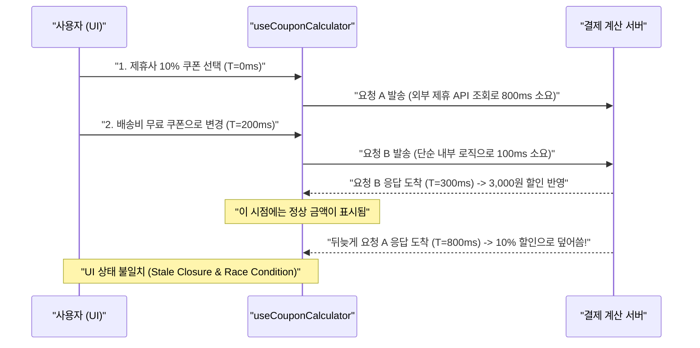

새벽 두 시, 모니터 불빛만 켜진 방 안에서 네 시간째 같은 파일의 40줄 남짓한 코드만 노려보고 있었다. 분명히 내 로컬 개발 환경에서는 백 번을 눌러도 완벽하게 동작하는 장바구니 쿠폰 적용 로직이, 스테이징 환경에서 특정 순서로 클릭할 때만 귀신같이 이전 금액을 덮어쓰는 현상이었다. 콘솔 로그(`console.log('여기 찍힘 1')`, `console.log('제발 찍혀라 2')`)가 파일을 뒤덮었지만 원인은 오리무중이었다.

결국 나는 의자 등받이에 깊숙이 몸을 묻고, 모니터 옆에 놓인 노란 **고무 오리(Rubber Duck)**—사실은 지난 컨퍼런스에서 받아온 작은 캐릭터 피규어—를 향해 소리 내어 코드를 한 줄씩 설명하기 시작했다. 그리고 놀랍게도 설명을 시작한 지 단 3분 만에, 내 입에서 나온 문장 스스로가 버그의 정체를 자백하고 말았다.[^1] 오늘은 그날 새벽 나를 괴롭혔던 **비동기 경쟁 상태(Race Condition)** 버그의 전말과, 왜 머릿속으로만 코드를 읽을 때보다 말이나 글로 인출할 때 뇌의 디버깅 회로가 전혀 다르게 작동하는지 이야기해보려 한다.

---

## 1. 유령 같은 버그: "빠르게 두 번 바꾸면 총액이 이상해요"

문제가 발생했던 화면은 이커머스 결제 직전 단계인 **주문서 작성 및 할인 계산 섹션**이었다. 사용자가 보유한 할인 쿠폰을 드롭다운에서 선택하면, 서버의 가격 계산 API(`POST /api/v1/checkout/calculate`)를 호출해 배송비와 등급 할인, 쿠폰 할인이 모두 반영된 최종 결제 금액을 받아와 화면에 갱신하는 구조였다.

QA 팀에서 올라온 버그 티켓의 재현 경로는 묘했다.

> "사용자가 '10% 할인 쿠폰(최대 5만 원)'을 선택했다가, 0.5초 만에 마음이 바뀌어 '3,000원 배송비 무료 쿠폰'으로 변경하면 화면의 선택된 쿠폰 이름은 '배송비 무료 쿠폰'인데 실제 결제 예정 금액은 '10% 할인 쿠폰'이 적용된 금액으로 멈춰 있습니다."

### 1.1 아무리 봐도 결점이 없어 보였던 초기 코드

처음 코드를 열어봤을 때는 아무런 문제가 없어 보였다. `async/await`도 빼먹지 않았고, 에러 핸들링도 꼼꼼히 들어가 있었기 때문이다. ~~내가 짠 코드에 버그가 있을 리 없다는 오만한 확신이 시야를 가렸다.~~

```typescript title="src/features/checkout/useCouponCalculator.ts (버그가 숨어있던 코드)"
export function useCouponCalculator(cartId: string) {
  const [selectedCouponId, setSelectedCouponId] = useState<string | null>(null);
  const [pricingResult, setPricingResult] = useState<PricingSummary | null>(null);
  const [isCalculating, setIsCalculating] = useState(false);

  const handleSelectCoupon = async (couponId: string | null) => {
    setSelectedCouponId(couponId);
    setIsCalculating(true);

    try {
      const response = await fetch('/api/v1/checkout/calculate', {
        method: 'POST',
        headers: { 'Content-Type': 'application/json' },
        body: JSON.stringify({ cartId, couponId }),
      });
      const data: PricingSummary = await response.json();
      setPricingResult(data);
    } catch (error) {
      console.error('가격 계산 실패:', error);
    } finally {
      setIsCalculating(false);
    }
  };

  return { selectedCouponId, pricingResult, isCalculating, handleSelectCoupon };
}
```

로컬에서 테스트할 때는 백엔드 API가 항상 30ms 이내에 균일하게 응답했기 때문에 아무리 마우스를 빨리 클릭해도 첫 번째 요청이 먼저 끝나고 두 번째 요청이 나중에 끝났다. 하지만 실제 스테이징 서버에서는 **쿠폰 종류에 따라 DB 조회 복잡도와 외부 제휴사 검증 유무가 달라 응답 시간이 역전**되고 있었다.

### 1.2 네트워크 응답 역전이 만든 타임라인

고무 오리에게 손가락으로 화면을 짚어가며 설명하기 전까지, 내 뇌는 암묵적으로 *"먼저 보낸 요청은 당연히 먼저 돌아온다"*는 가정을 깔고 코드를 뛰어넘어 읽고 있었다. 실제 서버와 브라우저 사이에서 벌어진 일은 아래 시퀀스 다이어그램과 같았다.



---

## 2. 고무 오리 앞에서 멈춰 선 순간

새벽 두 시 반, 나는 피규어를 앞에 두고 이렇게 중얼거렸다.

- *"자, 오리야 들어봐. 사용자가 드롭다운을 바꾸면 `handleSelectCoupon`이 실행돼."*
- *"그러면 먼저 `setSelectedCouponId`로 드롭다운 UI 상태를 즉시 바꾸고, 서버에 `fetch` 요청을 보내고 `await`로 기다리지."*
- *"근데 사용자가 응답이 오기 전에 다른 쿠폰을 또 누르면... 어? 잠깐만. 두 번째 `handleSelectCoupon`이 호출되면 첫 번째 `await`에서 대기 중이던 함수는 어떻게 되는 거지?"*

바로 그 순간 머릿속에 번개가 쳤다. <mark>첫 번째 함수 실행 컨텍스트는 사라진 게 아니라 여전히 메모리에서 응답을 기다리고 있었고, 뒤늦게 응답이 도착하자 아무런 거리낌 없이 `setPricingResult(data)`를 호출해 최신 상태를 과거의 응답으로 덮어쓰고 있었던 것이다!</mark> 심지어 `finally` 블록의 `setIsCalculating(false)` 역시 첫 번째 요청이 끝나는 시점에 두 번째 요청의 로딩 스피너를 일찍 꺼버리는 버그까지 동반하고 있었다.

> [!IMPORTANT]
> **고무 오리 디버깅이 작동하는 인지과학적 원리**
> 우리가 눈으로만 코드를 읽을 때 뇌는 '실제 코드에 적힌 것'을 읽는 대신 **'내가 의도했던 기억'**을 자동 완성하여 읽습니다. 반면 타인(또는 오리)에게 문장으로 구술하려면 암묵적 가정을 명시적 언어로 변환(Encoding)해야 하므로, 논리적 비약이 있는 지점에서 말문이 막히게 됩니다.[^2]

---

## 3. 해결책 적용: `AbortController`로 이전 요청 취소하기

원인을 정확히 파악하고 나니 해결책은 10분도 걸리지 않았다. 새로운 쿠폰 선택 이벤트가 발생했을 때, 아직 진행 중인 이전 네트워크 요청이 있다면 `AbortController`를 통해 즉시 폐기(Cancel)하고 상태 업데이트를 차단하도록 리팩토링했다.

```typescript title="src/features/checkout/useCouponCalculator.ts (Race Condition 완벽 해결 버전)"
export function useCouponCalculator(cartId: string) {
  const [selectedCouponId, setSelectedCouponId] = useState<string | null>(null);
  const [pricingResult, setPricingResult] = useState<PricingSummary | null>(null);
  const [isCalculating, setIsCalculating] = useState(false);
  
  // 진행 중인 직전 요청의 컨트롤러를 참조로 보관
  const abortControllerRef = useRef<AbortController | null>(null);

  const handleSelectCoupon = useCallback(async (couponId: string | null) => {
    // 1. 진행 중인 이전 요청이 있다면 즉시 취소!
    if (abortControllerRef.current) {
      abortControllerRef.current.abort();
    }

    // 2. 현재 요청을 위한 새 AbortController 생성
    const controller = new AbortController();
    abortControllerRef.current = controller;

    setSelectedCouponId(couponId);
    setIsCalculating(true);

    try {
      const response = await fetch('/api/v1/checkout/calculate', {
        method: 'POST',
        headers: { 'Content-Type': 'application/json' },
        body: JSON.stringify({ cartId, couponId }),
        signal: controller.signal, // AbortSignal 연결
      });
      const data: PricingSummary = await response.json();

      // 3. 혹시라도 JSON 파싱 도중 취소되었는지 한 번 더 확인
      if (!controller.signal.aborted) {
        setPricingResult(data);
      }
    } catch (error) {
      // 의도적인 요청 취소(AbortError)는 에러로 취급하지 않고 무시
      if (error instanceof DOMException && error.name === 'AbortError') {
        return;
      }
      console.error('가격 계산 실패:', error);
    } finally {
      // 4. 가장 마지막에 발송된 활성 요청이 끝났을 때만 로딩 상태 해제
      if (abortControllerRef.current === controller) {
        setIsCalculating(false);
      }
    }
  }, [cartId]);

  // 컴포넌트 언마운트 시 클린업
  useEffect(() => {
    return () => abortControllerRef.current?.abort();
  }, []);

  return { selectedCouponId, pricingResult, isCalculating, handleSelectCoupon };
}
```

> [!TIP]
> **로딩 상태(`isCalculating`) 해제 시 주의할 점**
> `finally` 블록에서 무조건 `setIsCalculating(false)`를 호출하면 취소된 첫 번째 요청이 `catch`를 거쳐 `finally`로 빠져나오면서 아직 진행 중인 두 번째 요청의 로딩 스피너를 꺼버립니다. 반드시 `abortControllerRef.current === controller` 조건으로 **최신 요청인지 검증**해야 합니다.

---

## 4. 혼자 삽질할 때 vs 구조화된 디버깅 기법 비교

그날 밤 4시간의 삽질과 3분의 고무 오리 대화를 겪은 뒤, 나는 디버깅이 막혔을 때 내가 취하는 행동 패턴들을 돌아보며 아래 표처럼 정리해 두었다.

| 디버깅 방식 | 평균 해결 소요 시간 | 인지적 부하 | 주요 한계점 및 특징 |
| :--- | :--- | :--- | :--- |
| **무작정 코드 노려보기** | 2시간 이상 (측정 불가) | 매우 높음 (피로 누적) | 자신의 가정을 의심하지 않아 같은 줄만 수십 번 반복해서 읽음 |
| **무분별한 `console.log` 도배** | 40분 ~ 1시간 | 중간 | 비동기 타이밍이나 클로저 참조 문제는 로그만으로 인과관계 파악이 어려움 |
| **브레이크포인트(Debugger) 추적** | 20분 ~ 40분 | 낮음 | 동기 로직에는 강력하나, 실행을 멈추는 순간 비동기 Race Condition이 사라지는 하이젠버그(Heisenbug) 발생 |
| **고무 오리 디버깅 (구술/글쓰기)** | **5분 ~ 15분** | 낮음 (생각 정리됨) | 가정과 실제 코드의 괴리를 즉시 발견하며, 동료에게 질문하기 전 스스로 해결하게 됨 |

<details>
<summary>슬랙(Slack) 질문 작성창이 최고의 고무 오리인 이유</summary>

사무실에서 소리 내어 혼잣말을 하기 민망하다면, 시니어 동료에게 보낼 질문 메시지를 마크다운 포맷으로 정성껏 작성해 보세요.
1. 현재 구현하려는 기능의 배경
2. 내가 기대한 동작 순서
3. 실제 발생하는 이상 현상과 재현 조건
4. 내가 지금까지 시도해 본 가설 3가지

놀랍게도 3번과 4번을 적으며 코드를 복사해 붙여넣는 순간 *"아, 맞다! 여기가 비동기였지!"* 하고 깨닫게 되어, 결국 <kbd>Backspace</kbd>를 눌러 글을 지우고 혼자 조용히 미소 짓게 되는 경험을 일주일에 두 번은 하게 됩니다.

</details>

---

## 5. 미궁에 빠진 버그를 만났을 때 실천하는 5단계 루틴

이제 나는 어떤 버그든 **30분 이상** 원인을 찾지 못하고 제자리를 맴돌고 있다는 신호가 오면, 즉시 키보드에서 손을 떼고 아래 체크리스트를 순서대로 수행한다.

- [x] **타이머 30분 규칙**: 30분 동안 새로운 단서를 하나도 얻지 못했다면 무의미한 코드 수정을 즉시 멈췄는가?
- [x] **가설의 명문화**: *"이 변수는 절대 `null`일 리 없다"*, *"이 API는 순서대로 응답할 것이다"* 같은 내 머릿속의 암묵적 전제 조건 3가지를 메모장에 적었는가?
- [x] **고무 오리 브리핑**: 코드의 입력값부터 출력값까지 제어 흐름을 한 줄도 건너뛰지 않고 소리 내어(혹은 텍스트로) 설명했는가?
- [x] **네트워크 쓰로틀링 재현**: 비동기 관련 버그라면 Chrome DevTools의 Network 탭에서 속도를 `Slow 3G`로 낮추거나 인위적인 `sleep()` 지연을 넣어 타이밍 문제를 증폭시켜 보았는가?
- [ ] **물리적 컨텍스트 스위칭**: 그래도 안 풀린다면 자리에서 일어나 물 한 잔을 마시거나 10분간 산책하며 뇌의 작업 기억(Working Memory)을 환기했는가?

> [!NOTE]
> **하이젠버그(Heisenbug)를 조심하세요**
> 관찰하려고 브레이크포인트를 걸거나 네트워크 속도가 빠른 로컬 환경에서 실행하면 감쪽같이 사라지는 버그를 하이젠버그라고 부릅니다. 이런 버그는 실행을 멈추는 디버거보다 요청 고유 ID(`requestId`)와 타임스탬프를 함께 기록하는 타임라인 로깅이 훨씬 효과적입니다.

---

## 6. 마치며

그날 새벽 두 시 반에 버그를 잡고 커밋을 푸시한 뒤 마셨던 시원한 탄산수의 맛은 아직도 잊히지 않는다. 개발자에게 디버깅이란 단순히 고장 난 코드를 고치는 작업이 아니라, **내가 세운 멘탈 모델(Mental Model)과 실제 컴퓨터가 실행하는 물리적 현실 사이의 오차를 교정하는 과정**이다.

오늘도 원인 모를 버그 앞에서 모니터를 뚫어져라 쳐다보며 괴로워하고 있다면, 잠시 멈추고 책상 위 작은 사물에게 말을 걸어보자. 답은 이미 당신이 짠 코드와 당신의 목소리 사이에 숨어 있을지도 모른다.

[^1]: 고무 오리 디버깅(Rubber Duck Debugging)은 앤드류 헌트와 데이비드 토머스의 명저 『실용주의 프로그래머(The Pragmatic Programmer)』에서 유래한 용어로, 고무 오리를 옆에 두고 코드를 한 줄씩 설명하다 보면 스스로 해답을 찾게 되는 현상을 뜻합니다.
[^2]: 심리학에서는 이를 **프로테우스 효과 및 자기 설명 효과(Self-Explanation Effect)**라고 부릅니다. 정보를 수동적으로 읽을 때보다 능동적으로 인출하여 재구성할 때 메타인지가 극대화되어 논리적 모순을 즉각 감지하게 됩니다.
