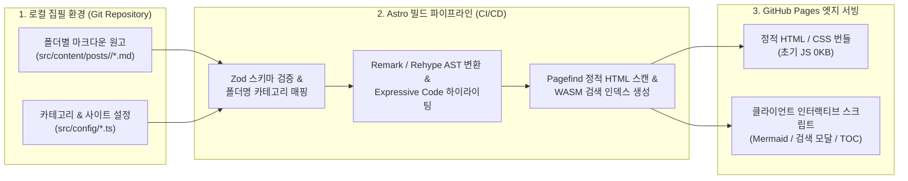
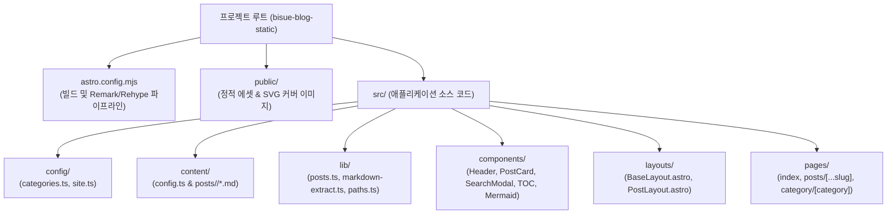

안녕하세요! **바닥부터 만드는 마크다운 정적 웹진 엔진(Static Webzine Engine)** 7부작 연재 강의의 첫 번째 시간에 오신 것을 환영합니다. 많은 개발자와 기술 작가들이 자신의 지식과 아티클을 정리하기 위해 블로그 플랫폼을 고민합니다. Velog, Tistory, Medium 같은 가입형 플랫폼은 시작하기 쉽지만 디자인 커스터마이징과 데이터 소유권에 한계가 있고, 직접 백엔드 서버와 데이터베이스를 구축하자니 매달 나가는 클라우드 유지비와 보안 패치 부담이 발목을 잡습니다.

이번 시리즈에서는 이러한 딜레마를 근본적으로 해결하기 위해 **로컬 폴더의 마크다운(`.md`) 파일만으로 동작하면서도, 상용 온라인 매거진 수준의 큐레이션 UI·다이어그램 렌더링·초고속 전문 검색을 제공하는 정적 웹진**을 처음부터 끝까지 직접 설계하고 구현합니다. 그 첫걸음인 이번 1편에서는 **왜 정적 사이트 생성기(SSG)[^1]와 Astro 아일랜드 아키텍처[^2]를 선택했는지** 배경 이론을 살펴보고, 전체 시스템 요구사항 정의서(SRS)와 확장 가능한 폴더 구조를 설계합니다.

> [!NOTE]
> **바닥부터 만드는 마크다운 정적 웹진 7부작 전체 커리큘럼**
> - **1편 (현재 글)**: 왜 정적 사이트인가? 요구사항 정의와 폴더 구조 설계
> - **2편**: Astro Content Collections와 Zod로 마크다운 스키마 구축하기
> - **3편**: 마크다운 본문에서 대표 썸네일과 120자 요약문 자동 추출기 만들기
> - **4편**: Remark·Rehype 플러그인과 Expressive Code로 모든 마크다운 문법 지원하기
> - **5편**: Mermaid 다이어그램 동적 렌더링과 스크롤 연동 목차(TOC) 구현하기
> - **6편**: 카테고리 메가 메뉴와 Pagefind 서버리스 전문 검색 모달 붙이기
> - **7편 (완결)**: GitHub Pages 서브 경로 보정과 GitHub Actions 무중단 배포 자동화

---

## 1. 배경 이론: 왜 기술 웹진에는 정적 사이트(SSG)가 최적일까?

웹 애플리케이션을 브라우저에 전달하는 렌더링 전략은 크게 **CSR(Client-Side Rendering)**, **SSR(Server-Side Rendering)**, **SSG(Static Site Generation)** 세 가지로 나뉩니다. 우리가 만들 웹진 블로그는 다음과 같은 명확한 트래픽 및 데이터 특성을 가지고 있습니다.

1. **쓰기(Write)보다 읽기(Read)가 압도적으로 많음**: 글은 하루나 일주일에 몇 번 작성되지만, 독자의 조회 요청은 수천~수만 번 발생합니다.
2. **요청 시점마다 데이터가 변하지 않음**: 모든 독자는 동일한 마크다운 원고로부터 변환된 동일한 HTML 아티클을 읽습니다.
3. **검색 엔진 최적화(SEO)와 초기 로딩 속도(LCP)가 생명**: 검색 크롤러가 자바스크립트 실행 없이도 즉시 시맨틱 HTML과 Open Graph 메타데이터를 수집할 수 있어야 합니다.

> "런타임에 변하지 않는 데이터를 매 요청마다 데이터베이스에서 쿼리하고 HTML로 조합하는 것은 서버 자원의 낭비다. 빌드 타임에 단 한 번만 렌더링하라."

### 1.1 렌더링 아키텍처 및 프레임워크 대안 비교

블로그 및 웹진 구축을 위해 고려할 수 있는 주요 기술 스택을 비교해 보면 왜 **Astro 5 기반의 SSG 아키텍처**가 가장 합리적인 선택인지 명확해집니다.

| 평가 항목 | 전통적 CMS (WordPress 등) | SPA / CSR (React Vite) | 하이브리드 SSR (Next.js) | **Astro 5 SSG (우리의 선택)** |
| :--- | :--- | :--- | :--- | :--- |
| **초기 로딩 속도 (TTFB)** | 느림 (DB 쿼리 + PHP 실행) | 보통 (빈 HTML + 거대 JS 번들) | 빠름 (Edge/Node 서버 필요) | **최상 (CDN에서 정적 HTML 즉시 반환)** |
| **기본 JS 페이로드** | 플러그인에 따라 무거움 | 150KB ~ 500KB+ | 80KB ~ 200KB+ (Hydration) | **0KB (<mark>Zero JS by Default</mark>)** |
| **인프라 유지 비용** | 월 \$10~\$30 (EC2 + RDS) | 무료 (정적 호스팅) | 무료 티어 제한적 (서버리스 과금) | **완전 무료 (GitHub Pages 무제한)** |
| **검색 엔진 최적화 (SEO)** | 우수 (플러그인 필요) | 취약 (크롤러 JS 실행 의존) | 우수 | **최상 (완전한 시맨틱 정적 HTML)** |
| **콘텐츠 버전 관리** | DB 백업 별도 구성 필요 | Git 기반 관리 가능 | DB 또는 Git 선택 | **Git 저장소 자체가 단일 진실 공급원** |

~~과거에는 정적 사이트라고 하면 검색이나 동적 다이어그램조차 넣을 수 없는 단순한 HTML 뭉치라고 생각했지만~~, 오늘날의 모던 SSG는 빌드 타임 인덱싱(Pagefind)과 부분 하이드레이션(Islands Architecture)을 결합하여 동적 웹앱 못지않은 사용자 경험을 제공합니다.



---

## 2. 웹진 시스템 요구사항 정의서 (SRS)

코드를 한 줄이라도 작성하기 전에 우리가 만들 웹진이 반드시 만족해야 할 **핵심 요구사항(System Requirements Specification)**을 명확히 정의해야 합니다. 요구사항이 흔들리면 폴더 구조와 데이터 스키마를 중간에 전부 갈아엎어야 하기 때문입니다.

### 2.1 콘텐츠 관리 및 자동화 요구사항 (Content & Automation)
* **폴더 기반 카테고리 자동 분류**: 글 작성자가 마크다운 Frontmatter에 매번 `category: "ai-tech"`를 수동으로 타이핑하는 대신, `src/content/posts/ai-tech/my-post.md`처럼 **파일이 위치한 상위 폴더 이름을 읽어 자동으로 카테고리를 부여**해야 합니다.
* **메타데이터 폴백(Fallback) 자동화**: 바쁜 집필 과정에서 `thumbnail`이나 `description`을 생략하더라도 카드 UI가 깨지지 않도록, 본문 첫 번째 이미지를 찾아 썸네일로 삼고 본문 마크다운 기호를 제거한 순수 텍스트 120자를 요약문으로 자동 추출해야 합니다.
* **풀스펙 마크다운 확장 문법**: GFM(표, 취소선, 체크리스트, 각주), GitHub 스타일 콜아웃(`> [!TIP]`), 파일명 탭과 복사 버튼을 갖춘 코드 블록, Mermaid 다이어그램, 원시 HTML 태그(`<kbd>`, `<details>`)를 별도 설정 없이 즉시 사용할 수 있어야 합니다.

### 2.2 UI/UX 및 탐색 요구사항 (Curation & Navigation)
* **매거진 스타일 홈 화면**: 단순한 시간순 리스트가 아니라 상단 **히어로 배너(Featured Post)**, 최신 아티클 그리드, 그리고 **카테고리별 큐레이션 섹션**으로 구성된 웹진 레이아웃을 제공합니다.
* **확장형 카테고리 메가 메뉴**: 향후 카테고리가 15~30개로 늘어나도 상단 GNB(Global Navigation Bar)가 줄바꿈으로 깨지지 않도록, 다열 그리드 드롭다운 패널을 제공하는 메가 메뉴를 구현합니다.
* **서버리스 전문(Full-Text) 검색**: 별도의 검색 서버(Elasticsearch, Algolia) 없이도 한글 본문 전체와 태그, 제목을 실시간으로 검색하고 하이라이트 스니펫을 보여주는 검색 모달(<kbd>Ctrl</kbd> + <kbd>K</kbd>)을 내장합니다.

> [!IMPORTANT]
> **설계 원칙: 관심사의 분리(Separation of Concerns)**
> 글 작성자(Author)는 오직 `src/content/posts/` 폴더 안에서 마크다운 원고만 작성하면 됩니다. 파싱, 썸네일 추출, 목차 생성, 검색 인덱싱, 서브 경로 보정은 전부 `src/lib/`와 빌드 파이프라인이 책임지도록 엄격하게 역할을 분리합니다.

---

## 3. 단계별 상세 구현: 프로젝트 초기화와 디렉토리 아키텍처

이제 본격적으로 프로젝트를 생성하고 디렉토리 구조를 잡아 보겠습니다. 터미널을 열고(<kbd>Ctrl</kbd> + <kbd>`</kbd>) 아래 단계를 차례대로 따라오세요.

### 3.1 Step 1: Astro 5 프로젝트 생성 및 필수 패키지 구성

먼저 `package.json`에 우리가 7편에 걸쳐 사용할 모든 핵심 의존성 패키지를 정의합니다. 마크다운 AST 변환을 위한 `remark`/`rehype` 생태계 플러그인들과 스타일링을 위한 `@tailwindcss/vite`, 다이어그램을 위한 `mermaid`, 검색을 위한 `pagefind`를 함께 설치합니다.

```json title="package.json"
{
  "name": "bisue-blog-static",
  "type": "module",
  "version": "1.0.0",
  "scripts": {
    "dev": "astro dev",
    "build": "astro build && npx pagefind --site dist",
    "preview": "astro preview",
    "astro": "astro"
  },
  "dependencies": {
    "@astrojs/mdx": "^4.3.13",
    "@astrojs/rss": "^4.0.18",
    "@astrojs/sitemap": "^3.7.2",
    "@tailwindcss/typography": "^0.5.19",
    "@tailwindcss/vite": "^4.2.2",
    "astro": "^5.18.1",
    "astro-expressive-code": "^0.41.6",
    "github-slugger": "^2.0.0",
    "mdast-util-to-string": "^4.0.0",
    "mermaid": "^11.14.0",
    "pagefind": "^1.4.0",
    "rehype-Autolink-headings": "^7.1.0",
    "rehype-external-links": "^3.0.0",
    "rehype-raw": "^7.0.0",
    "rehype-slug": "^6.0.0",
    "remark-directive": "^4.0.0",
    "remark-gfm": "^4.0.1",
    "remark-github-blockquote-alert": "^2.0.1",
    "unist-util-visit": "^5.1.0"
  }
}
```

위 `package.json`의 `"build"` 스크립트를 눈여겨보세요. `astro build`가 먼저 실행되어 모든 마크다운을 `dist/` 폴더 아래의 정적 HTML로 구워내면, 직후에 `npx pagefind --site dist` 명령어가 체이닝되어 빌드된 HTML 파일들을 스캔하고 `dist/pagefind/` 폴더에 초경량 검색 인덱스를 생성합니다.

### 3.2 Step 2: 확장 가능한 디렉토리 구조(Directory Architecture) 설계

프로젝트 규모가 커져도 파일 위치를 한눈에 파악할 수 있도록 **설정(`src/config`)**, **데이터 스키마(`src/content`)**, **비즈니스 로직(`src/lib`)**, **UI 컴포넌트(`src/components`)**, **라우팅 페이지(`src/pages`)** 5개 계층으로 디렉토리를 설계합니다.



각 폴더의 구체적인 역할과 파일 구성을 트리 형태로 정리하면 다음과 같습니다.

```text title="프로젝트 전체 디렉토리 트리 구조"
bisue-blog-static/
├── .github/workflows/
│   └── deploy.yml                  # 7편: GitHub Actions 자동 빌드 & 배포 워크플로우
├── public/
│   ├── favicon.svg                 # 사이트 파비콘
│   └── images/                     # 게시글 커버 SVG 및 기본 플레이스홀더 이미지
├── src/
│   ├── components/
│   │   ├── Header.astro            # 6편: 반응형 GNB 및 다열 카테고리 메가 메뉴
│   │   ├── Footer.astro            # 하단 푸터 및 카테고리 바로가기
│   │   ├── HeroCard.astro          # 메인 페이지 상단 대표 추천 글 배너
│   │   ├── PostCard.astro          # 썸네일 + 요약문 + 읽기 시간 웹진 카드
│   │   ├── TableOfContents.astro   # 5편: IntersectionObserver 스크롤 연동 TOC
│   │   ├── MermaidRenderer.astro   # 5편: 다크/라이트 테마 연동 Mermaid 렌더러
│   │   └── SearchModal.astro       # 6편: Pagefind 정적 검색 모달 (Ctrl+K)
│   ├── config/
│   │   ├── categories.ts           # 카테고리 슬러그, 한글명, 아이콘, 색상 중앙 레지스트리
│   │   └── site.ts                 # 사이트 타이틀, 설명, 저자, 네비게이션 설정
│   ├── content/
│   │   ├── config.ts               # 2편: Astro Content Collections & Zod 스키마
│   │   └── posts/                  # 폴더명이 곧 카테고리가 되는 마크다운 원고 저장소
│   │       ├── ai-tech/
│   │       ├── web-dev/
│   │       └── lectures/           # 현재 읽고 계신 7부작 웹진 제작 강의 폴더!
│   ├── lib/
│   │   ├── markdown-extract.ts     # 3편: 첫 이미지, 120자 요약문, 읽기 시간 추출기
│   │   ├── posts.ts                # 2~3편: 게시글 조회, 정렬, 이전/다음 글, 관련 글 계산
│   │   └── paths.ts                # 7편: GitHub Pages 서브 경로(BASE_URL) 안전 조인 유틸
│   ├── layouts/
│   │   ├── BaseLayout.astro        # 공통 <head>, SEO 메타, 다크 모드 초기화, 헤더/푸터
│   │   └── PostLayout.astro        # 아티클 상세 읽기 레이아웃 (본문 + 우측 Sticky TOC)
│   └── pages/
│       ├── index.astro             # 매거진 스타일 큐레이션 홈 화면
│       ├── category/[category].astro # 카테고리별 아티클 아카이브 페이지
│       └── posts/[...slug].astro   # 개별 마크다운 아티클 상세 페이지
└── astro.config.mjs                # 4~7편: 마크다운 플러그인 및 배포 경로 설정
```

### 3.3 Step 3: 사이트 전역 설정과 카테고리 중앙 레지스트리 작성

하드코딩된 문자열이 여러 컴포넌트에 흩어지는 것을 막기 위해 `src/config/site.ts`와 `src/config/categories.ts`를 먼저 작성합니다. 새로운 카테고리를 추가하고 싶을 때 UI 코드를 고칠 필요 없이 `categories.ts` 배열에 객체 하나만 추가하면 상단 메가 메뉴, 홈 화면 큐레이션 섹션, 카테고리 배지 색상이 일괄 반영되도록 설계합니다.

```typescript title="src/config/categories.ts"
export interface CategoryMeta {
  slug: string;        // src/content/posts/<slug> 폴더명과 1:1 매칭
  name: string;        // 화면에 표시할 한글 카테고리 이름
  description: string; // 카테고리 아카이브 상단 및 메가 메뉴 설명문
  icon: string;        // 카테고리 대표 이모지 아이콘
  color: string;       // 배지 강조 색상 키 (indigo, emerald, amber, rose, violet)
  order: number;       // 메뉴 및 홈 화면 노출 우선순위
}

export const CATEGORIES: Record<string, CategoryMeta> = {
  'ai-tech': {
    slug: 'ai-tech',
    name: 'AI & 테크 트렌드',
    description: '생성형 AI, LLM 에이전트, 최신 기술 아키텍처 심층 분석',
    icon: '🤖',
    color: 'indigo',
    order: 1,
  },
  'web-dev': {
    slug: 'web-dev',
    name: '모던 웹 엔지니어링',
    description: '프론트엔드 아키텍처, 정적 사이트, 성능 최적화 실전 가이드',
    icon: '⚡',
    color: 'emerald',
    order: 2,
  },
  'design-ux': {
    slug: 'design-ux',
    name: '디지털 디자인 & UX',
    description: '타이포그래피, 디자인 시스템, 읽기 경험을 높이는 인터랙션',
    icon: '🎨',
    color: 'amber',
    order: 3,
  },
  'essay': {
    slug: 'essay',
    name: '인사이트 & 에세이',
    description: '개발 문화, 생산성 도구, 크리에이터의 기록과 단상',
    icon: '☕',
    color: 'rose',
    order: 4,
  },
  'lectures': {
    slug: 'lectures',
    name: '웹진 제작 실전 강의',
    description: 'Astro 5와 마크다운으로 나만의 정적 웹진 블로그를 바닥부터 구축하는 단계별 연재 강의',
    icon: '🎓',
    color: 'violet',
    order: 5,
  },
};

// 정의되지 않은 새로운 폴더에 마크다운을 넣었을 때도 안전하게 동작하는 폴백 헬퍼
export function getCategoryMeta(slug: string): CategoryMeta {
  if (CATEGORIES[slug]) {
    return CATEGORIES[slug];
  }
  return {
    slug,
    name: slug.replace(/-/g, ' ').replace(/\b\w/g, (l) => l.toUpperCase()),
    description: `${slug} 카테고리의 글 모음입니다.`,
    icon: '📁',
    color: 'slate',
    order: 99,
  };
}
```

> [!TIP]
> **우아한 폴백(Graceful Degradation) 패턴**
> `getCategoryMeta(slug)` 함수를 보면 `CATEGORIES` 레지스트리에 아직 등록하지 않은 새 폴더(예: `src/content/posts/cloud-infra/test.md`)를 만들더라도 에러를 내뿜는 대신, 폴더명의 하이픈(`-`)을 공백으로 바꾸고 첫 글자를 대문자(`Cloud Infra`)로 변환해 기본 아이콘(`📁`)과 함께 반환합니다. 덕분에 집필 흐름이 끊기지 않습니다.

---

## 4. 자주 겪는 트러블슈팅 및 아키텍처 설계 주의사항

정적 웹진 프로젝트를 처음 세팅할 때 많은 분들이 겪는 대표적인 실수 두 가지를 짚어 봅니다.

> [!WARNING]
> **이미지 저장 위치 혼동 주의 (`public/` vs `src/assets/`)**
> 마크다운 본문이나 Frontmatter에서 `/images/cover.svg`처럼 절대 경로 문자열로 참조할 이미지들은 반드시 `public/images/` 폴더 안에 위치해야 합니다. 만약 `src/` 내부에 두고 일반 문자열 경로로 참조하면 프로덕션 빌드 후 404 Not Found가 발생할 수 있습니다.

<details>
<summary>심화 Q&A: 왜 데이터베이스나 Headless CMS(Notion, Contentful) 대신 로컬 마크다운 파일을 사용하나요?</summary>

Headless CMS나 Notion API를 연동하면 웹 에디터에서 글을 쓸 수 있다는 장점이 있지만, 치명적인 단점이 따릅니다.
1. **API Rate Limit 및 빌드 지연**: 글이 200개를 넘어가면 빌드 시마다 외부 API를 수백 번 호출하느라 빌드 시간이 수 분 이상 길어집니다.
2. **만료되는 이미지 URL**: Notion API 등이 반환하는 S3 임시 서명 이미지 URL은 일정 시간이 지나면 만료되어 정적 사이트의 이미지가 깨집니다.
3. **오프라인 집필 및 AI 코딩 에이전트 호환성**: 로컬 `.md` 파일은 인터넷이 없는 비행기 안에서도 VS Code나 Obsidian으로 즉시 작성할 수 있으며, Cursor나 Antigravity 같은 AI 에이전트가 파일 시스템에서 직접 읽고 다듬어 주기에 가장 이상적인 포맷입니다.

</details>

---

## 5. 실습 점검 체크리스트 및 다음 편 예고

이번 1편에서 구성한 아키텍처와 초기 설정이 올바르게 준비되었는지 아래 체크리스트로 점검해 보세요.

- [x] 정적 사이트 생성기(SSG)와 Astro 아일랜드 아키텍처의 동작 원리 이해하기
- [x] `package.json`에 Astro 5, Tailwind CSS v4, Remark/Rehype, Mermaid, Pagefind 의존성 정의하기
- [x] 5계층 디렉토리 구조(`config`, `content`, `lib`, `components`, `pages`) 생성하기
- [x] `src/config/categories.ts`에 카테고리 메타데이터 레지스트리와 폴백 헬퍼 함수 작성하기
- [ ] `src/content/config.ts`에서 Zod 스키마 정의 및 폴더 기반 카테고리 추출기 연결하기 (2편 예정)

다음 **[웹진 제작 강의 2편]**에서는 오늘 설계한 `src/content/posts/<category>/` 폴더 구조를 실제로 읽어 들이는 **Astro Content Collections와 Zod 데이터 검증 스키마**를 구축하고, 파일 경로에서 카테고리와 라우팅 슬러그를 깔끔하게 분리해 내는 데이터 레이어를 완성해 보겠습니다!

---

[^1]: **SSG (Static Site Generation)**: 사용자의 요청이 들어올 때마다 서버가 HTML을 동적으로 생성하는 대신, 배포(Build) 시점에 모든 페이지를 미리 HTML/CSS 파일로 렌더링해 두는 방식입니다.
[^2]: **아일랜드 아키텍처 (Islands Architecture)**: 페이지 전체를 무거운 자바스크립트 프레임워크로 감싸는 대신, 정적인 HTML 바다 위에 인터랙션이 꼭 필요한 일부 UI 컴포넌트(검색창, 다이어그램 등)만 독립된 '섬(Island)'처럼 분리하여 스크립트를 로드하는 모던 웹 설계 패턴입니다.
