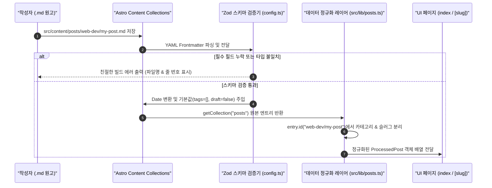
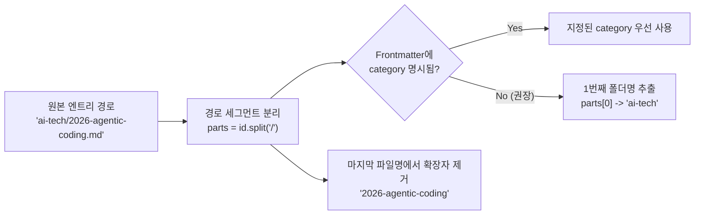

지난 **[웹진 제작 강의 1편]**에서는 왜 기술 웹진에 정적 사이트 생성기(SSG)가 최적인지 살펴보고, `config`, `content`, `lib`, `components`, `pages`로 이어지는 5계층 디렉토리 아키텍처를 설계했습니다. 이제 설계도를 바탕으로 실제 데이터를 읽어 들이는 엔진의 심장부를 만들 차례입니다.

이번 **2편**에서 해결할 핵심 기술 과제는 두 가지입니다.
1. 마크다운 상단의 YAML Frontmatter(`title`, `pubDate`, `tags` 등)에 오타가 있거나 날짜 형식이 잘못되었을 때 런타임 UI가 깨지는 대신 **빌드 시점에 즉시 타입 에러를 잡아내는 스키마 검증 파이프라인**을 구축합니다.
2. 글 작성자가 일일이 카테고리를 입력하지 않아도 `src/content/posts/ai-tech/agentic-coding.md`라는 **파일 경로 자체에서 `ai-tech` 카테고리와 `agentic-coding` URL 슬러그를 자동 추출**하는 데이터 정규화(Normalization) 레이어를 구현합니다.

---

## 1. 배경 이론: 왜 `fs.readFileSync` 대신 Content Collections와 Zod를 쓸까?

초기 정적 블로그나 Node.js 스크립트에서는 흔히 `fs.readdirSync`와 `gray-matter` 패키지를 조합해 마크다운 파일을 직접 읽곤 했습니다. 하지만 게시글이 수십 개를 넘어가고 여러 카테고리 폴더로 나뉘면 이 방식은 곧바로 한계에 부딪힙니다.

> "검증되지 않은 Frontmatter는 언제 터질지 모르는 시한폭탄과 같다. `pubDate: 2026-13-45` 같은 오타 하나가 전체 메인 페이지 빌드를 멈추거나 화면에 `Invalid Date`를 노출시킨다."

### 1.1 마크다운 데이터 로딩 방식 비교 분석

| 비교 기준 | 수동 파일 읽기 (`fs` + `gray-matter`) | `Astro.glob()` 레거시 API | **Content Collections + Zod (우리의 선택)** |
| :--- | :--- | :--- | :--- |
| **TypeScript 타입 추론** | 불가능 (`any` 또는 수동 타입 단언 필요) | 제한적 (`Record<string, any>`) | **완벽 지원 (스키마 기반 자동 타입 생성)** |
| **Frontmatter 유효성 검증** | 직접 `if`문으로 검사 코드 작성 필요 | 미지원 (런타임에 `undefined` 발생) | **Zod[^1]가 빌드 타임에 엄격 검증 및 변환** |
| **날짜 문자열 변환** | 수동으로 `new Date()` 파싱 필요 | 문자열 그대로 반환 | **`z.coerce.date()`로 즉시 `Date` 객체화** |
| **성능 및 캐싱** | 매 페이지 렌더링마다 중복 파싱 발생 위험 | 보통 | **Astro 내부 콘텐츠 스토어 캐싱으로 초고속 처리** |

Astro의 **Content Collections**[^2]는 `src/content/` 폴더 아래의 마크다운 파일들을 단순한 텍스트 파일이 아니라 **강력한 타입 안정성을 갖춘 로컬 데이터베이스 테이블**처럼 다룰 수 있게 해 줍니다.



---

## 2. 단계별 상세 구현: 스키마 정의부터 카테고리 자동 매핑까지

이제 실제 코드를 작성하며 데이터 레이어를 단계별로 완성해 보겠습니다.

### 2.1 Step 1: `src/content/config.ts`에 Zod 컬렉션 스키마 정의하기

Astro는 `src/content/config.ts` 파일을 예약된 설정 파일로 인식합니다. 여기서 `defineCollection`과 `z`(Zod)를 사용해 `posts` 컬렉션의 데이터 계약을 정의합니다.

```typescript title="src/content/config.ts"
import { defineCollection, z } from 'astro:content';

const postsCollection = defineCollection({
  type: 'content',
  schema: z.object({
    // 1. 필수 필드: 제목과 발행일
    title: z.string().min(1, '게시글 제목(title)은 비워둘 수 없습니다.'),
    pubDate: z.coerce.date(),
    updatedDate: z.coerce.date().optional(),

    // 2. 선택적 오버라이드 필드 (생략 시 3편의 자동 추출기가 본문에서 채워줌)
    description: z.string().optional(),
    thumbnail: z.string().optional(),
    category: z.string().optional(),

    // 3. 기본값이 주입되는 편의 필드
    tags: z.array(z.string()).default([]),
    featured: z.boolean().default(false),
    draft: z.boolean().default(false),
    author: z.string().default('Editorial Team'),
  }),
});

export const collections = {
  posts: postsCollection,
};
```

각 필드의 설계 의도를 자세히 살펴보겠습니다.
* **`z.coerce.date()`**: 마크다운 YAML에서 날짜를 `2026-10-30`처럼 따옴표 없이 쓰거나 `"2026-10-30T09:00:00Z"`처럼 문자열로 쓰더라도, Zod의 강제 형변환(`coerce`) 기능이 이를 표준 JavaScript `Date` 인스턴스로 일관되게 변환해 줍니다.
* **`description` & `thumbnail`의 `.optional()` 처리**: <mark>가장 중요한 포인트입니다.</mark> 일반 블로그 템플릿들은 이 두 필드를 필수(`required`)로 강제하여 글쓰기를 피곤하게 만듭니다. 우리는 이를 선택 사항으로 열어 두고, 작성자가 생략하면 다음 3편에서 만들 본문 파서가 자동으로 채워 넣도록 설계합니다.
* **`.default(...)` 체이닝**: 매번 `draft: false`, `tags: []`를 적지 않아도 Zod가 기본값을 주입하므로, Frontmatter에는 오직 `title`과 `pubDate` 단 두 줄만 적어도 완벽하게 유효한 게시글로 동작합니다!

> [!TIP]
> **타입 자동 생성 확인하기**
> `src/content/config.ts`를 저장한 뒤 터미널에서 `npx astro sync`를 실행하거나 개발 서버(`npm run dev`)를 띄우면, `.astro/types.d.ts`에 `CollectionEntry<'posts'>` 타입이 자동 생성되어 IDE 자동완성이 즉시 활성화됩니다.

### 2.2 Step 2: 파일 경로에서 카테고리와 라우팅 슬러그 추출하기

게시글 파일이 `src/content/posts/ai-tech/2026-agentic-coding-paradigm.md`에 저장되어 있을 때, Astro의 `entry.id` 또는 `entry.slug`는 `"ai-tech/2026-agentic-coding-paradigm"` 형태를 가집니다. 여기서 앞부분(`ai-tech`)은 **카테고리**로, 뒷부분(`2026-agentic-coding-paradigm`)은 **깨끗한 URL 슬러그**로 분리해 내는 헬퍼 함수를 작성합니다.



이 로직을 `src/lib/posts.ts`에 구현해 봅시다.

```typescript title="src/lib/posts.ts (카테고리 및 슬러그 추출 핵심 로직)"
import { getCollection, type CollectionEntry } from 'astro:content';
import { getCategoryMeta, type CategoryMeta } from '../config/categories';

/**
 * 파일 경로(entry.id) 또는 Frontmatter에서 카테고리 슬러그를 결정합니다.
 * 예: "ai-tech/my-post.md" -> "ai-tech"
 */
export function resolveCategoryFromEntry(entry: CollectionEntry<'posts'>): string {
  // 1순위: Frontmatter에 명시적으로 category를 지정한 경우
  if (entry.data.category && entry.data.category.trim().length > 0) {
    return entry.data.category.trim().toLowerCase();
  }

  // 2순위: src/content/posts/<category>/<filename>.md 폴더 구조에서 첫 번째 폴더명 추출
  const normalizedId = entry.id.replace(/\\/g, '/');
  const segments = normalizedId.split('/');
  if (segments.length >= 2) {
    return segments[0].toLowerCase();
  }

  // 루트에 바로 파일을 넣은 경우 기본 카테고리로 폴백
  return 'uncategorized';
}

/**
 * URL 라우팅에 사용할 깔끔한 포스트 슬러그를 반환합니다.
 * 예: "lectures/02-content-collections.md" -> "02-content-collections"
 */
export function resolveCleanSlug(entry: CollectionEntry<'posts'>): string {
  const normalizedSlug = entry.slug.replace(/\\/g, '/');
  const segments = normalizedSlug.split('/');
  return segments[segments.length - 1];
}
```

> [!IMPORTANT]
> **Windows 운영체제 경로 구분자(`\`) 정규화 필수!**
> 위 코드에서 `.replace(/\\/g, '/')`를 수행하는 이유가 무엇일까요? Windows 환경에서 빌드할 때 간혹 파일 시스템 경로에 백슬래시(`\`)가 섞여 들어오는 경우가 있습니다. 이를 슬래시(`/`)로 먼저 통일해 주어야 Windows 로컬 개발 환경과 Linux 기반 GitHub Actions 배포 환경 모두에서 100% 동일하게 동작합니다.

### 2.3 Step 3: 정렬, 카테고리 필터링, 연관 아티클 추천 쿼리 구현

이제 개별 게시글을 정규화한 `ProcessedPost` 인터페이스를 정의하고, 홈 화면과 상세 페이지에서 사용할 데이터 조회 API 함수들을 `src/lib/posts.ts`에 완성합니다.

```typescript title="src/lib/posts.ts (게시글 쿼리 및 추천 알고리즘)"
export interface ProcessedPost {
  entry: CollectionEntry<'posts'>;
  slug: string;
  title: string;
  pubDate: Date;
  updatedDate?: Date;
  category: string;
  categoryMeta: CategoryMeta;
  thumbnail: string;
  excerpt: string;
  readingTime: number;
  tags: string[];
  featured: boolean;
  author: string;
}

/**
 * 초안(draft: true)을 제외한 모든 게시글을 최신순(pubDate 내림차순)으로 반환합니다.
 */
export async function getAllPosts(): Promise<ProcessedPost[]> {
  const rawEntries = await getCollection('posts', ({ data }) => {
    return data.draft !== true;
  });

  const processed = rawEntries.map((entry) => {
    const category = resolveCategoryFromEntry(entry);
    const slug = resolveCleanSlug(entry);
    // 썸네일과 요약문 자동 추출은 3편에서 상세 구현하여 연결합니다!
    return {
      entry,
      slug,
      title: entry.data.title,
      pubDate: entry.data.pubDate,
      updatedDate: entry.data.updatedDate,
      category,
      categoryMeta: getCategoryMeta(category),
      thumbnail: entry.data.thumbnail || '/images/default-thumbnail.svg',
      excerpt: entry.data.description || '',
      readingTime: 5,
      tags: entry.data.tags,
      featured: entry.data.featured,
      author: entry.data.author,
    };
  });

  // 최신 발행일 순으로 정렬 (발행일이 같으면 슬러그 역순 정렬로 결정론적 순서 보장)
  return processed.sort((a, b) => {
    const timeDiff = b.pubDate.valueOf() - a.pubDate.valueOf();
    if (timeDiff !== 0) return timeDiff;
    return b.slug.localeCompare(a.slug);
  });
}

/**
 * 현재 게시글과 같은 카테고리이거나 겹치는 태그가 많은 연관 게시글을 추천합니다.
 */
export function getRelatedPosts(
  currentPost: ProcessedPost,
  allPosts: ProcessedPost[],
  limit = 3
): ProcessedPost[] {
  return allPosts
    .filter((post) => post.slug !== currentPost.slug)
    .map((post) => {
      let score = 0;
      if (post.category === currentPost.category) score += 3;
      const sharedTags = post.tags.filter((tag) => currentPost.tags.includes(tag));
      score += sharedTags.length * 2;
      return { post, score };
    })
    .sort((a, b) => b.score - a.score || b.post.pubDate.valueOf() - a.post.pubDate.valueOf())
    .slice(0, limit)
    .map((item) => item.post);
}
```

`getRelatedPosts` 함수를 보면 별도의 추천 엔진 없이도 **동일 카테고리 가중치(+3점)**와 **공통 태그 가중치(개당 +2점)**를 합산하여 가장 연관성 높은 아티클 3개를 하단에 추천해 줍니다. 점수가 같을 때는 최신 글이 우선 노출됩니다.

---

## 3. 자주 겪는 트러블슈팅 및 엣지 케이스 분석

Content Collections를 처음 도입할 때 자주 마주치는 함정과 해결 방법을 정리했습니다.

> [!CAUTION]
> **서로 다른 카테고리 폴더에 동일한 파일명을 만들 때의 슬러그 충돌 주의**
> 만약 `ai-tech/intro.md`와 `web-dev/intro.md`처럼 파일 이름을 똑같이 지으면 `resolveCleanSlug`가 둘 다 `"intro"`를 반환하여 `/posts/intro/` 경로가 충돌할 수 있습니다. 이를 방지하려면 파일명에 주제어를 명확히 담거나(`ai-agent-intro.md`), 라우팅을 `/posts/[category]/[slug]` 형태로 구성하는 것이 좋습니다.

<details>
<summary>트러블슈팅 팁: 같은 날짜(pubDate)에 여러 글을 올렸을 때 순서가 뒤섞이는 현상 해결하기</summary>

현재 `lectures/` 폴더의 5편과 6편처럼 하루(`2026-11-02`)에 두 편 이상의 글을 작성하면 `b.pubDate.valueOf() - a.pubDate.valueOf()` 결과가 `0`이 됩니다. 이때 추가 정렬 조건이 없으면 OS 파일 탐색 순서에 따라 5편과 6편의 순서가 뒤바뀔 수 있습니다.
위 코드의 `return b.slug.localeCompare(a.slug);`처럼 **2차 정렬 키(Tie-breaker)**로 파일 슬러그 비교를 넣어 주면 `06-...`이 `05-...`보다 최신 글로 일관되게 정렬됩니다.

</details>

---

## 4. 실습 점검 체크리스트 및 다음 편 예고

이번 2편에서 작성한 스키마와 데이터 레이어가 정상 작동하는지 확인해 봅시다.

- [x] `src/content/config.ts`에 `posts` 컬렉션과 Zod 스키마 정의하기
- [x] `z.coerce.date()`를 통해 YAML 날짜를 JavaScript `Date` 객체로 자동 변환하기
- [x] `resolveCategoryFromEntry`로 상위 폴더명에서 카테고리 자동 추출하기
- [x] `getAllPosts()`에서 `draft: true` 초안 필터링 및 최신순 결정론적 정렬 구현하기
- [x] 카테고리(+3점)와 태그(+2점) 가중치 기반의 `getRelatedPosts()` 추천 함수 작성하기
- [ ] 본문에서 첫 번째 이미지와 120자 요약문을 자동 추출하는 파서 연결하기 (3편 예정)

지금 상태에서도 Frontmatter에 `thumbnail`과 `description`을 직접 적은 글들은 완벽하게 동작합니다. 하지만 글 작성자가 두 필드를 비워 두었을 때는 어떨까요? 다음 **[웹진 제작 강의 3편]**에서는 마크다운 본문에서 코드 블록과 특수 기호를 정교하게 발라내고 **첫 번째 이미지와 깔끔한 120자 평문 요약문, 그리고 예상 읽기 시간(분)을 자동 추출하는 파서**를 만들어 보겠습니다!

---

[^1]: **Zod**: TypeScript 우선(TypeScript-first) 스키마 선언 및 유효성 검증 라이브러리로, 런타임 데이터 검증과 정적 타입 추론을 동시에 해결해 줍니다.
[^2]: **Astro Content Collections**: `src/content/` 내의 마크다운, MDX, JSON, YAML 데이터를 스키마 기반으로 안전하게 쿼리하고 관리하는 Astro 내장 기능입니다.
