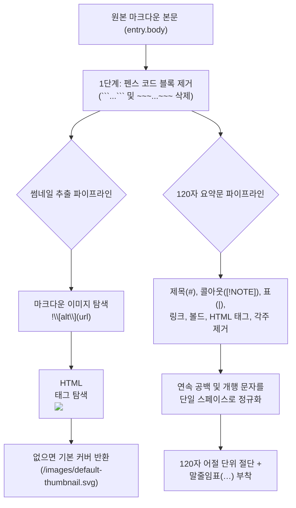

지난 **[웹진 제작 강의 2편]**에서는 Astro Content Collections와 Zod를 사용해 마크다운 Frontmatter를 검증하고, 폴더 이름으로부터 카테고리를 자동 매핑하는 데이터 레이어를 구축했습니다. 특히 글 작성자의 편의를 위해 `thumbnail`(대표 이미지)과 `description`(요약문) 필드를 필수 입력이 아닌 **선택 입력(`.optional()`)**으로 열어 두었지요.

실제로 지금 읽고 계신 이 **3편 강의 마크다운 파일의 Frontmatter**를 열어 보시면, 일부러 `description` 필드를 아예 적지 않은 것을 확인하실 수 있습니다! 그렇다면 메인 화면과 강의 목록 카드에 표시되는 이 글의 요약문은 어디서 온 것일까요? 바로 오늘 우리가 직접 구현할 **마크다운 본문 자동 추출기(`src/lib/markdown-extract.ts`)**가 본문 첫 문단을 읽고 마크다운 문법 기호를 깨끗하게 제거한 뒤 120자로 잘라낸 결과물입니다.

---

## 1. 배경 이론: 왜 단순 문자열 자르기(`slice(0, 120)`)로는 부족할까?

마크다운 원고의 원본 텍스트(`entry.body`)를 아무런 전처리 없이 그대로 앞에서부터 120자 잘라내어 웹진 카드 요약문으로 쓰면 어떤 참사가 벌어질까요?

> "요약문 카드에 `> [!NOTE] ## 1. 서론 안녕하세요 **굵은 글씨**와 [링크](https://...) 그리고 ```typescript const a = 1;...` 같은 외계어가 그대로 노출된다면 독자는 클릭하기도 전에 피로감을 느낀다."

### 1.1 마크다운 본문 추출 시 제거하거나 건너뛰어야 할 노이즈 요소들

웹진의 카드 UI에 품격 있는 순수 텍스트 요약문(Plain-text Excerpt)과 정확한 대표 이미지를 노출하려면 다음 5가지 엣지 케이스를 반드시 처리해야 합니다.

| 노이즈 유형 | 마크다운 원본 예시 | 잘못 처리했을 때의 문제점 | **올바른 추출기 동작 방식** |
| :--- | :--- | :--- | :--- |
| **펜스 코드 블록** | ```` ```md  ``` ```` | 코드 예시 안의 가짜 이미지를 대표 썸네일로 오인함 | **가장 먼저 코드 블록 전체를 제거한 뒤 이미지 탐색** |
| **GitHub 콜아웃 마커** | `> [!IMPORTANT]` | 요약문 첫머리에 `[!IMPORTANT]` 문자열이 그대로 찍힘 | **콜아웃 식별자 정규식 패턴 완전 제거** |
| **마크다운 이미지 & 링크** | ``, `[텍스트](url)` | 이미지 URL이나 괄호가 요약문에 노출됨 | **이미지는 삭제, 링크는 `텍스트`만 남기고 URL 제거** |
| **원시 HTML & 각주** | `<details>`, `<kbd>Ctrl</kbd>`, `[^1]` | HTML 태그 꺽쇠나 각주 번호가 요약문을 어지럽힘 | **HTML 태그 및 각주 참조 기호 스트리핑** |
| **단어 중간 절단** | `...아키텍처를 설` (120자 칼자름) | 어절 중간에서 글자가 잘려 어색한 문장이 됨 | **마지막 공백(어절 경계)을 찾아 자연스럽게 말줄임(`…`)** |



---

## 2. 단계별 상세 구현: 썸네일·요약문·읽기 시간 추출기 만들기

이제 `src/lib/markdown-extract.ts` 파일을 생성하고 세 가지 핵심 추출 함수를 단계별로 작성해 보겠습니다.

### 2.1 Step 1: 3단계 폴백(Fallback) 대표 썸네일 이미지 추출기

썸네일 결정 로직은 **1순위: Frontmatter 지정 이미지** → **2순위: 본문 내 첫 번째 이미지(마크다운 또는 HTML ``)** → **3순위: 기본 플레이스홀더 SVG** 순서로 동작합니다. 이때 코드 블록 안에 예시로 적어둔 이미지 문법은 절대 매칭되지 않도록 코드 블록을 먼저 지운 뒤 정규식을 실행합니다[^1].

```typescript title="src/lib/markdown-extract.ts (Step 1: 대표 이미지 추출)"
export const DEFAULT_THUMBNAIL = '/images/default-thumbnail.svg';

/**
 * 마크다운 본문에서 첫 번째로 등장하는 이미지 URL을 추출합니다.
 * 코드 블록(```...```) 내부에 작성된 예시 이미지 문법은 무시합니다.
 */
export function extractFirstImageFromBody(markdownBody?: string): string | null {
  if (!markdownBody) return null;

  // 1. 펜스 코드 블록 및 인라인 코드를 먼저 제거하여 오탐(False Positive) 방지
  const withoutCodeBlocks = markdownBody
    .replace(/```[\s\S]*?```/g, '')
    .replace(/~~~[\s\S]*?~~~/g, '')
    .replace(/`[^`\n]+`/g, '');

  // 2. 표준 마크다운 이미지 문법 매칭: 
  const mdImageRegex = /!\[[^\]]*\]\(\s*([^\s)"]+)(?:\s+["'][^"']*["'])?\s*\)/;
  const mdMatch = withoutCodeBlocks.match(mdImageRegex);
  if (mdMatch && mdMatch[1]) {
    return mdMatch[1].trim();
  }

  // 3. 원시 HTML  태그 문법 매칭
  const htmlImgRegex = /]+src=["']([^"']+)["'][^>]*>/i;
  const htmlMatch = withoutCodeBlocks.match(htmlImgRegex);
  if (htmlMatch && htmlMatch[1]) {
    return htmlMatch[1].trim();
  }

  return null;
}

/**
 * Frontmatter의 thumbnail 필드와 마크다운 본문을 종합하여 최종 썸네일 경로를 결정합니다.
 */
export function resolveThumbnail(frontmatterThumbnail?: string, markdownBody?: string): string {
  if (frontmatterThumbnail && frontmatterThumbnail.trim().length > 0) {
    return frontmatterThumbnail.trim();
  }
  const extracted = extractFirstImageFromBody(markdownBody);
  return extracted ?? DEFAULT_THUMBNAIL;
}
```

정규식 `/!\[[^\]]*\]\(\s*([^\s)"]+)(?:\s+["'][^"']*["'])?\s*\)/`의 동작 원리를 살펴볼까요?
* `!\[[^\]]*\]`: 이미지 대체 텍스트(`![alt]`) 부분을 매칭합니다.
* `\(\s*([^\s)"]+)`: 괄호 안의 실제 이미지 URL만 **첫 번째 캡처 그룹(`mdMatch[1]`)**으로 정확히 낚아챕니다.
* `(?:\s+["'][^"']*["'])?`: 만약 작성자가 ``처럼 캡션 타이틀을 함께 적었더라도 URL에 섞여 들어가지 않도록 비캡처 그룹(`(?:...)`)으로 분리해 무시합니다.

### 2.2 Step 2: 마크다운 노이즈 제거기(`stripMarkdownToPlainText`)와 120자 요약기

다음으로 마크다운 원문에서 표, 코드 블록, 콜아웃 지시자, 각주 정의, HTML 태그를 모두 벗겨내고 순수한 문장만 남기는 클리닝 파이프라인을 작성합니다.

```typescript title="src/lib/markdown-extract.ts (Step 2: 평문 변환 및 120자 요약문 추출)"
/**
 * 마크다운 문법 기호와 HTML 태그를 모두 제거하고 순수 텍스트만 반환합니다.
 */
export function stripMarkdownToPlainText(markdown: string): string {
  return (
    markdown
      // 1. 펜스 코드 블록 제거 (코드 내용이 요약문에 섞이지 않도록 통째로 삭제)
      .replace(/```[\s\S]*?```/g, ' ')
      .replace(/~~~[\s\S]*?~~~/g, ' ')
      // 2. 하단 각주 정의 줄 제거 (예: [^1]: 각주 설명...)
      .replace(/^\[\^[^\]]+\]:.*$/gm, ' ')
      // 3. 본문 내 각주 참조 기호 제거 (예: [^1])
      .replace(/\[\^[^\]]+\]/g, '')
      // 4. GitHub 스타일 콜아웃 헤더 마커 제거 (예: > [!NOTE], > [!TIP])
      .replace(/^>\s*\[!(?:NOTE|TIP|IMPORTANT|WARNING|CAUTION)\]\s*/gim, '')
      // 5. GFM 표 구분선 및 파이프(|) 기호 정리
      .replace(/^\|?[\s:-]+\|[\s|:-]*$/gm, ' ')
      .replace(/\|/g, ' ')
      // 6. 이미지 제거: 
      .replace(/!\[[^\]]*\]\([^)]*\)/g, ' ')
      // 7. 링크는 텍스트만 남기고 URL 제거: [텍스트](url) -> 텍스트
      .replace(/\[([^\]]+)\]\([^)]*\)/g, '$1')
      // 8. 원시 HTML 태그 제거 (<details>, <summary>, <mark>, <kbd> 등)
      .replace(/<summary>[\s\S]*?<\/summary>/gi, ' ')
      .replace(/<[^>]+>/g, ' ')
      // 9. 제목(#), 인용문(>), 수평선(---), 리스트 마커(-, *, 1.) 제거
      .replace(/^#{1,6}\s+/gm, '')
      .replace(/^>\s?/gm, '')
      .replace(/^(?:[-*_]\s*){3,}$/gm, ' ')
      .replace(/^\s*[-*+]\s+\[[ xX]\]\s+/gm, '')
      .replace(/^\s*[-*+]\s+/gm, '')
      .replace(/^\s*\d+\.\s+/gm, '')
      // 10. 인라인 서식 기호(**굵게**, *기울임*, ~~취소선~~, `코드`) 벗기기
      .replace(/(\*\*|__)(.*?)\1/g, '$2')
      .replace(/(\*|_)(.*?)\1/g, '$2')
      .replace(/~~(.*?)~~/g, '$1')
      .replace(/`([^`]+)`/g, '$1')
      // 11. 다중 개행 및 연속 공백을 단일 스페이스로 압축
      .replace(/\s+/g, ' ')
      .trim()
  );
}

/**
 * 요약문이 지정되지 않았을 때 본문에서 120자 내외의 자연스러운 요약문을 추출합니다.
 */
export function resolveExcerpt(
  frontmatterDescription?: string,
  markdownBody?: string,
  maxLength = 120
): string {
  if (frontmatterDescription && frontmatterDescription.trim().length > 0) {
    return frontmatterDescription.trim();
  }
  if (!markdownBody) return '';

  const plainText = stripMarkdownToPlainText(markdownBody);
  if (plainText.length <= maxLength) {
    return plainText;
  }

  // 글자 수 제한(maxLength)까지 자른 뒤, 단어 중간이 잘리지 않도록 마지막 공백 위치를 탐색
  const sliced = plainText.slice(0, maxLength);
  const lastSpaceIndex = sliced.lastIndexOf(' ');

  if (lastSpaceIndex > maxLength * 0.7) {
    return `${sliced.slice(0, lastSpaceIndex).trim()}…`;
  }
  return `${sliced.trim()}…`;
}
```

> [!TIP]
> **어절 경계 보존(`lastSpaceIndex > maxLength * 0.7`)의 디테일**
> 단순히 `plainText.slice(0, 120)`만 하면 `"정적 사이트 생성기를 활…"`처럼 조사나 어근이 반토막 난 채로 말줄임표가 붙습니다. 위 코드처럼 84자(`120 * 0.7`) 이후 지점에 공백이 존재하면 그 공백까지만 남기고 `…`을 붙여 주면 훨씬 매끄러운 한국어 요약문이 완성됩니다.

### 2.3 Step 3: 한국어·영어·코드 블록 가중치를 반영한 읽기 시간(Reading Time) 계산기

웹진 카드와 아티클 헤더에 표시되는 **`5분 읽기`** 배지는 독자가 글을 읽기 전에 분량을 가늠할 수 있게 해 주는 중요한 UX 요소입니다[^2]. 영어는 공백 기준 단어 수(분당 약 220단어), 한국어는 공백 제외 글자 수(분당 약 450~500자) 기준으로 읽는 속도가 다르므로 이를 결합해 계산합니다.

```typescript title="src/lib/markdown-extract.ts (Step 3: 예상 읽기 시간 계산기)"
/**
 * 마크다운 본문의 분량을 분석하여 예상 읽기 시간(분 단위, 최소 1분)을 반환합니다.
 */
export function calculateReadingTime(markdownBody?: string): number {
  if (!markdownBody) return 1;

  // 코드 블록 줄 수 계산 (코드는 일반 텍스트보다 천천히 읽으므로 줄당 가중치 부여)
  const codeBlocks = markdownBody.match(/```[\s\S]*?```/g) || [];
  const codeLines = codeBlocks.reduce((acc, block) => acc + block.split('\n').length, 0);

  const plainText = stripMarkdownToPlainText(markdownBody);
  // 공백을 제외한 순수 글자 수 기준 (한국어/영문 혼합 아티클 기준 분당 약 500자)
  const charCount = plainText.replace(/\s+/g, '').length;

  const textMinutes = charCount / 500;
  const codeMinutes = codeLines / 40; // 코드 40줄당 약 1분 소요 가정

  return Math.max(1, Math.ceil(textMinutes + codeMinutes));
}
```

이제 지난 2편에서 작성한 `src/lib/posts.ts`의 `getAllPosts()` 내부에서 `resolveThumbnail`, `resolveExcerpt`, `calculateReadingTime` 세 함수를 호출하도록 연결하기만 하면 데이터 추출 파이프라인이 완벽히 작동합니다!

---

## 3. 자주 겪는 트러블슈팅 및 엣지 케이스 분석

본문 추출기를 운영할 때 마주칠 수 있는 미묘한 버그와 해결책을 알아봅시다.

> [!WARNING]
> **정규식 탐욕적 매칭(Greedy Matching)으로 인한 본문 증발 주의!**
> 펜스 코드 블록을 제거할 때 `/```[\s\S]*```/g`처럼 물음표(`?`)를 빼먹으면, 글의 **첫 번째 코드 블록 시작점부터 마지막 코드 블록 끝점 사이에 있는 모든 일반 본문 문단까지 통째로 삭제**되어 버립니다. 반드시 게으른 수량자(`*?`, Lazy Quantifier)인 `/```[\s\S]*?```/g`를 사용해야 각 코드 블록만 개별적으로 제거됩니다!

<details>
<summary>심화 Q&A: 왜 Remark AST 대신 정규식(RegExp) 기반으로 요약문과 썸네일을 추출하나요?</summary>

Remark로 마크다운 전체를 파싱해 AST를 순회할 수도 있지만, 메인 페이지나 카테고리 목록 페이지에서 수백 개의 게시글 카드를 렌더링할 때 모든 글의 전체 AST를 매번 빌드하는 것보다 `entry.body` 문자열에서 정규식으로 썸네일과 앞부분 텍스트만 빠르게 추출하는 편이 빌드 속도가 훨씬 빠르고 직관적입니다. 또한 `src/lib/posts.ts`가 마크다운 렌더러 설정과 강하게 결합(Coupling)되지 않아 단위 테스트(Unit Test)를 작성하기도 매우 쉽습니다.

</details>

---

## 4. 실습 점검 체크리스트 및 다음 편 예고

이번 3편에서 구현한 본문 자동 추출기가 모든 엣지 케이스를 통과하는지 점검해 보세요.

- [x] 펜스 코드 블록(```` ``` ````)을 먼저 제거한 뒤 첫 번째 이미지를 찾는 `extractFirstImageFromBody` 구현하기
- [x] 마크다운 이미지(``)와 HTML 이미지(``) 두 가지 문법 모두 지원하기
- [x] 콜아웃 마커, 표, 각주, HTML 태그를 깨끗이 벗겨내는 `stripMarkdownToPlainText` 구현하기
- [x] 120자 내외에서 어절(공백) 단위로 자연스럽게 자르고 `…`을 붙이는 `resolveExcerpt` 완성하기
- [x] 본문 글자 수와 코드 블록 줄 수를 함께 고려한 `calculateReadingTime` 적용하기
- [ ] GFM, 콜아웃, 코드 하이라이팅을 렌더링하는 Remark·Rehype 파이프라인 구축하기 (4편 예정)

직접 이 3편 파일(`03-auto-extracting-thumbnails-and-excerpts.md`)처럼 Frontmatter에서 `description`이나 `thumbnail`을 지우고 저장해 보세요. 홈 화면과 목록 카드에 본문 첫 문단이 <mark>단 하나의 마크다운 기호 깨짐도 없이</mark> 깔끔한 120자 요약문으로 표시되는 것을 확인할 수 있습니다.

다음 **[웹진 제작 강의 4편]**에서는 마크다운 원고를 실제 화려한 HTML 아티클로 변환해 주는 **Unified(Remark·Rehype) AST 파이프라인과 Expressive Code**를 조립하여, 모든 확장 마크다운 문법을 완벽하게 지원하는 방법을 알아보겠습니다!

---

[^1]: **오탐(False Positive)**: 찾고자 하는 대상이 아닌데 조건에 잘못 걸려드는 현상입니다. 예컨대 마크다운 문법 강의 글에서 코드 블록 안에 예시로 적은 ``가 실제 게시글 썸네일로 선택되는 경우가 대표적입니다.
[^2]: **예상 읽기 시간(Estimated Reading Time)**: Medium을 비롯한 모던 웹진 플랫폼들이 도입한 UX 패턴으로, 독자에게 아티클의 깊이를 미리 알려주어 체류 시간(Dwell Time)과 완독률을 높이는 효과가 있습니다.
