지난 **[웹진 제작 강의 3편]**에서는 마크다운 본문에서 첫 번째 이미지와 120자 순수 텍스트 요약문, 그리고 예상 읽기 시간을 자동으로 추출하는 유틸리티를 완성했습니다. 이제 목록 화면의 카드 UI가 완벽해졌으니, 독자가 카드를 클릭해 들어왔을 때 마주할 **아티클 본문 렌더링 파이프라인**을 구축할 차례입니다.

이번 **4편**의 핵심 목표는 명확합니다. **"복잡한 마크다운 파서를 직접 정규식으로 짜지 않고, Unified 생태계의 표준 Remark·Rehype 플러그인들을 레고 블록처럼 조립하여 현존하는 거의 모든 확장 마크다운 문법을 완벽하게 렌더링한다."**

---

## 1. 배경 이론: 마크다운은 어떻게 HTML로 변환되는가? (Unified 파이프라인)

우리가 작성한 `.md` 텍스트 파일이 브라우저가 이해할 수 있는 `.html`로 변환될 때는 내부적으로 **Unified**라는 텍스트 처리 엔진을 거칩니다. 이때 텍스트를 그냥 문자열 치환으로 바꾸는 것이 아니라, **추상 구문 트리(AST, Abstract Syntax Tree)**[^1]로 변환하여 처리합니다.

1. **Remark (Markdown AST, `mdast`) 단계**: 마크다운 텍스트를 문단(`paragraph`), 제목(`heading`), 코드 블록(`code`), 표(`table`) 같은 마크다운 노드로 파싱하고 변형합니다.

```mermaid
flowchart LR
    MD["원본 마크다운\n(*.md)"] --> Parse["remark-parse\n(텍스트 -> MDAST)"]
    
    subgraph Remark["1. Remark 단계 (MDAST 변환)"]
        GFM["remark-gfm\n(표 / 취소선 / 체크리스트 / 각주)"]
        Alert["remark-github-blockquote-alert\n(> [!NOTE] 콜아웃 변환)"]
        MermaidPre["remarkMermaidPre\n(mermaid 블록 선제 분리)"]
    end

    subgraph EC["2. 코드 블록 엔진"]
        ExpCode["astro-expressive-code\n(Shiki 하이라이팅 + 파일 탭 + 복사 버튼)"]
    end

    subgraph Rehype["3. Rehype 단계 (HAST 변환)"]
        Raw["rehype-raw\n(원시 HTML 태그 파싱)"]
        Slug["rehype-slug\n(h1~h6 고유 id 생성)"]
        ExtLink["rehype-external-links\n(외부 링크 새 탭 열기)"]
    end

    Parse --> GFM --> Alert --> MermaidPre --> ExpCode --> Raw --> Slug --> ExtLink --> HTML["최종 시맨틱 HTML"]
```

2. **Rehype (HTML AST, `hast`) 단계**: 마크다운 트리를 `<h1>`, `<p>`, `<table>`, `<a>` 같은 HTML 요소 트리로 변환한 뒤, 헤딩 `id`를 부여하거나 외부 링크에 보안 속성을 추가하고 최종 HTML 문자열로 직렬화(Stringify)합니다.



### 1.1 우리가 조립할 플러그인 생태계 역할 일람표

직접 수천 줄의 파서를 작성하는 대신 아래 표에 정리된 검증된 오픈소스 플러그인들을 파이프라인에 연결합니다.

| 파이프라인 단계 | 패키지 이름 | 지원하는 마크다운 문법 및 핵심 역할 |
| :--- | :--- | :--- |
| **Remark** | `remark-gfm` | GitHub Flavored Markdown (표, `~~취소선~~`, `- [x]` 체크리스트, `[^1]` 각주, URL 자동 링크) |
| **Remark** | `remark-github-blockquote-alert` | `> [!NOTE]`, `> [!TIP]`, `> [!IMPORTANT]`, `> [!WARNING]`, `> [!CAUTION]` 5종 콜아웃 박스 |
| **Astro 통합** | `astro-expressive-code` | IDE 수준의 코드 구문 강조, `title="파일명"` 상단 탭, 줄 강조(`{2-4}`), 원클릭 클립보드 복사 |
| **Rehype** | `rehype-raw` | 마크다운 내부에 작성된 `<details>`, `<summary>`, `<kbd>`, `<mark>` 등 원시 HTML 정상 렌더링 |
| **Rehype** | `rehype-slug` | 모든 `<h2>`~`<h4>` 제목 텍스트를 기반으로 URL 앵커 이동용 고유 `id` 속성 자동 부여 |
| **Rehype** | `rehype-external-links` | `http://`, `https://` 외부 링크에 `target="_blank" rel="noopener noreferrer"` 자동 주입 |

---

## 2. 단계별 상세 구현: `astro.config.mjs` 파이프라인과 타이포그래피 스타일링

이제 설정 파일과 CSS를 작성하여 위 파이프라인을 실제로 가동해 보겠습니다.

### 2.1 Step 1: `astro.config.mjs`에 통합 모듈과 플러그인 등록하기

⚠️ <mark>여기서 가장 중요한 것은 플러그인의 실행 순서입니다.</mark> 특히 `astro-expressive-code` 통합 모듈은 반드시 `@astrojs/mdx`보다 앞선 위치에 등록되어야 하며, Mermaid 코드 블록은 Expressive Code가 가로채기 전에 Remark 단계에서 먼저 `<pre class="mermaid">`로 분리해 두어야 합니다.

```javascript title="astro.config.mjs"
import { defineConfig } from 'astro/config';
import tailwindcss from '@tailwindcss/vite';
import expressiveCode from 'astro-expressive-code';
import mdx from '@astrojs/mdx';
import sitemap from '@astrojs/sitemap';
import remarkGfm from 'remark-gfm';
import remarkDirective from 'remark-directive';
import remarkGithubBlockquoteAlert from 'remark-github-blockquote-alert';
import rehypeRaw from 'rehype-raw';
import rehypeSlug from 'rehype-slug';
import rehypeExternalLinks from 'rehype-external-links';
import { visit } from 'unist-util-visit';

// 5편에서 다룰 Mermaid 다이어그램을 Expressive Code보다 먼저 가로채는 커스텀 플러그인
function remarkMermaidPre() {
  return (tree) => {
    visit(tree, 'code', (node, index, parent) => {
      if (node.lang && node.lang.toLowerCase() === 'mermaid' && parent && typeof index === 'number') {
        const escaped = node.value
          .replace(/&/g, '&amp;')
          .replace(/</g, '&lt;')
          .replace(/>/g, '&gt;');
        parent.children[index] = {
          type: 'html',
          value: `<div class="mermaid-wrapper my-8"><pre class="mermaid">${escaped}</pre></div>`,
        };
      }
    });
  };
}

export default defineConfig({
  site: 'https://username.github.io',
  integrations: [
    // 1. Expressive Code는 반드시 mdx()보다 먼저 위치해야 합니다!
    expressiveCode({
      themes: ['github-dark', 'github-light'],
      styleOverrides: {
        borderRadius: '0.75rem',
        codeFontFamily: "'JetBrains Mono', 'Fira Code', monospace",
      },
    }),
    mdx(),
    sitemap(),
  ],
  markdown: {
    remarkPlugins: [
      remarkMermaidPre,
      remarkGfm,
      remarkDirective,
      remarkGithubBlockquoteAlert,
    ],
    rehypePlugins: [
      rehypeRaw,
      rehypeSlug,
      [
        rehypeExternalLinks,
        {
          target: '_blank',
          rel: ['noopener', 'noreferrer'],
        },
      ],
    ],
  },
  vite: {
    plugins: [tailwindcss()],
  },
});
```

> [!IMPORTANT]
> **왜 `rehype-external-links`로 `rel="noopener noreferrer"`를 자동 부여하나요?[^2]**
> 마크다운에 외부 사이트 링크(`[외부 아티클](https://example.com)`)를 걸었을 때 같은 탭에서 이동해 버리면 독자가 우리 웹진에서 이탈하게 됩니다. `target="_blank"`로 새 탭에서 열되, 보안 취약점(Reverse Tabnabbing)을 막고 참조자 정보를 보호하기 위해 `rel="noopener noreferrer"`를 Rehype 단계에서 일괄 주입하는 것이 모던 웹의 표준입니다.

### 2.2 Step 2: Expressive Code 고급 문법 활용하기

`astro-expressive-code`가 활성화되면 마크다운 코드 블록 첫 줄에 메타 문자열을 적어 다양한 시각 효과를 낼 수 있습니다.
* 파일명 탭 표시: ```` ```typescript title="src/lib/posts.ts" ````
* 특정 줄 하이라이트: ```` ```typescript {3, 5-7} ````
* 터미널 프레임 자동 전환: ```` ```bash ```` 또는 ```` ```powershell ````을 쓰면 자동으로 macOS 스타일 터미널 윈도우 헤더가 렌더링됩니다.

```typescript title="src/utils/demo.ts" {2, 6-8}
// 2번째 줄과 6~8번째 줄에 하이라이트가 적용되는 예시입니다.
export async function fetchMagazineStats(category: string) {
  const response = await fetch(`/api/stats/${category}`);
  if (!response.ok) {
    throw new Error('통계 데이터를 불러오지 못했습니다.');
  }
  const data = await response.json();
  return data;
}
```

### 2.3 Step 3: GitHub 콜아웃(Alert)과 GFM 표/체크리스트 CSS 스타일링

`remark-github-blockquote-alert` 플러그인은 마크다운의 `> [!TIP]` 구문을 만나면 `<div class="markdown-alert markdown-alert-tip">` 형태의 시맨틱 HTML로 변환해 줍니다. 이제 `src/styles/global.css`에 각 콜아웃 타입별 테마 컬러와 GFM 표, 키보드 태그(`<kbd>`) 스타일을 정의합니다.

```css title="src/styles/global.css (마크다운 확장 문법 스타일링 발췌)"
@import "tailwindcss";
@plugin "@tailwindcss/typography";

/* GitHub 스타일 콜아웃 (Alert) 5종 디자인 */
.markdown-alert {
  padding: 1rem 1.25rem;
  margin: 1.5rem 0;
  border-left: 4px solid;
  border-radius: 0.5rem;
  background-color: var(--color-slate-50);
}
.dark .markdown-alert {
  background-color: rgba(30, 41, 59, 0.6);
}
.markdown-alert-title {
  display: flex;
  align-items: center;
  gap: 0.5rem;
  font-weight: 700;
  margin-bottom: 0.375rem;
}

.markdown-alert-note { border-left-color: #3b82f6; }
.markdown-alert-note .markdown-alert-title { color: #2563eb; }

.markdown-alert-tip { border-left-color: #10b981; }
.markdown-alert-tip .markdown-alert-title { color: #059669; }

.markdown-alert-important { border-left-color: #8b5cf6; }
.markdown-alert-important .markdown-alert-title { color: #7c3aed; }

.markdown-alert-warning { border-left-color: #f59e0b; }
.markdown-alert-warning .markdown-alert-title { color: #d97706; }

.markdown-alert-caution { border-left-color: #ef4444; }
.markdown-alert-caution .markdown-alert-title { color: #dc2626; }

/* 키보드 단축키 <kbd> 태그 입체 버튼 스타일 */
kbd {
  display: inline-block;
  padding: 0.15rem 0.45rem;
  font-size: 0.8rem;
  font-family: var(--font-mono);
  background-color: #f1f5f9;
  border: 1px solid #cbd5e1;
  border-bottom-width: 2px;
  border-radius: 0.375rem;
  color: #334155;
}
```

> [!TIP]
> **5종 콜아웃 실제 렌더링 느낌 확인하기**
> 방금 작성한 CSS 덕분에 `> [!NOTE]`(파랑), `> [!TIP]`(초록), `> [!IMPORTANT]`(보라), `> [!WARNING]`(주황), `> [!CAUTION]`(빨강) 다섯 가지 콜아웃이 아이콘과 함께 선명하게 구분되어 독자의 시선을 사로잡습니다.

---

## 3. 자주 겪는 트러블슈팅 및 엣지 케이스 분석

마크다운 확장 파이프라인을 조립할 때 가장 빈번하게 발생하는 충돌 사례를 짚어 봅니다.

> [!CAUTION]
> **`rehype-raw` 누락 시 원시 HTML 및 커스텀 노드 렌더링 실패 주의!**
> 마크다운 안에 `<details><summary>접기/펼치기</summary>...</details>`나 `<mark>형광펜</mark>`, 혹은 우리가 `remarkMermaidPre`에서 변환한 `{ type: 'html', value: '<pre class="mermaid">...' }` 노드가 실제 DOM 요소로 파싱되려면 반드시 `rehypePlugins`의 **맨 앞부분에 `rehypeRaw`가 등록**되어 있어야 합니다. `rehypeRaw`가 없으면 HTML이 단순 문자열로 취급되거나 후속 Rehype 플러그인이 내부 요소를 탐색하지 못합니다.

<details>
<summary>심화 Q&A: 모바일 화면에서 GFM 표(Table)가 화면 밖으로 삐져나가 가로 스크롤을 유발할 때는 어떻게 하나요?</summary>

열(Column)이 4~5개 이상인 GFM 표는 모바일 뷰포트(폭 375px)에서 레이아웃을 깨뜨리기 쉽습니다. 이를 방지하려면 `.prose table`에 `display: block; overflow-x: auto; white-space: nowrap;`(또는 적절한 `min-width`) 속성을 부여하여, 페이지 전체가 흔들리는 대신 **표 영역 내부에서만 부드럽게 가로 스크롤**이 일어나도록 CSS를 구성해야 합니다.

</details>

---

## 4. 실습 점검 체크리스트 및 다음 편 예고

이번 4편에서 구성한 Unified 마크다운 파이프라인이 모든 문법을 정상적으로 렌더링하는지 점검해 봅시다.

- [x] `astro.config.mjs`에 `remark-gfm`, `remark-github-blockquote-alert` 등록하기
- [x] `astro-expressive-code` 통합 모듈로 코드 블록 파일명 탭과 복사 버튼 활성화하기
- [x] `rehype-raw`, `rehype-slug`, `rehype-external-links` 순서대로 Rehype 파이프라인 연결하기
- [x] `<kbd>Ctrl</kbd> + <kbd>C</kbd>`, `<mark>하이라이트</mark>`, `<details>` 원시 HTML 정상 렌더링 확인하기
- [x] 다크 모드와 라이트 모드 모두에서 5종 콜아웃 박스의 대비(Contrast) 확인하기
- [ ] `<pre class="mermaid">` 블록을 클라이언트에서 SVG 다이어그램으로 그리기 (5편 예정)

이제 우리의 웹진은 텍스트와 코드, 표, 콜아웃, 각주까지 완벽하게 표현할 수 있게 되었습니다. 다음 **[웹진 제작 강의 5편]**에서는 오늘 `remarkMermaidPre`로 분리해 둔 `<pre class="mermaid">` 노드를 실제 인터랙티브 SVG 다이어그램으로 그려내고, 다크 모드 전환 시 다이어그램 테마도 실시간으로 재렌더링하는 **Mermaid 렌더러와 스크롤 연동 목차(TOC)**를 구현해 보겠습니다!

---

[^1]: **AST (Abstract Syntax Tree, 추상 구문 트리)**: 문서나 소스 코드의 문법적 구조를 트리 형태로 표현한 데이터 구조입니다. 정규식 치환과 달리 문맥(예: 현재 노드가 코드 블록 안인지 인용문 안인지)을 정확히 구분하여 안전하게 변환할 수 있습니다.
[^2]: **Reverse Tabnabbing**: `target="_blank"`로 열린 외부 페이지가 `window.opener` 객체를 통해 원래 탭(우리 웹진)의 주소를 피싱 사이트로 몰래 바꿔치기하는 공격 기법입니다. `rel="noopener"`가 이를 원천 차단합니다.
