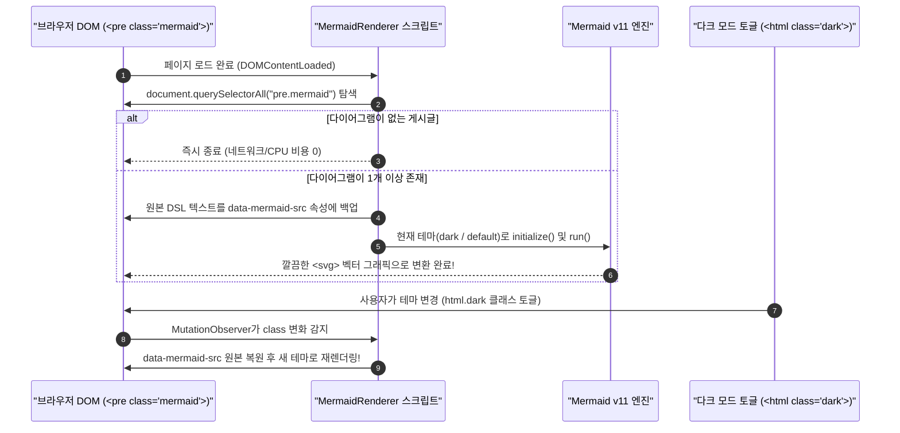
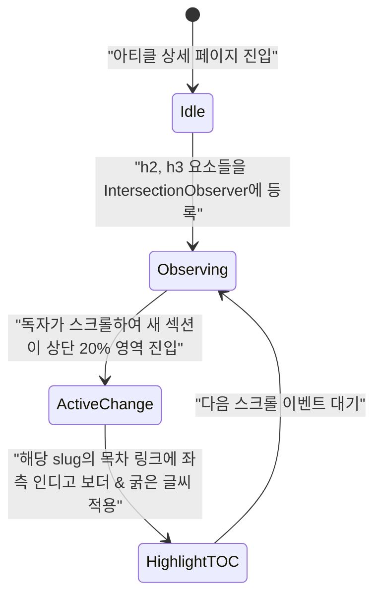

지난 **[웹진 제작 강의 4편]**에서는 Unified(Remark·Rehype) 생태계의 플러그인들과 Expressive Code를 조합하여 GFM 표, 5종 콜아웃 박스, 코드 구문 강조를 완벽하게 지원하는 마크다운 파이프라인을 완성했습니다. 또한 Expressive Code가 Mermaid 코드 블록까지 일반 소스 코드로 삼켜버리지 않도록, Remark 단계에서 `remarkMermaidPre` 커스텀 플러그인을 통해 `<pre class="mermaid">` HTML 노드로 선제 분리해 두었습니다.

이번 **5편**에서는 분리해 둔 `<pre class="mermaid">` 블록을 브라우저에서 미려한 벡터(SVG) 다이어그램으로 변환하고 **다크/라이트 테마 토글에 맞춰 실시간으로 색상을 다시 그리는 `MermaidRenderer` 컴포넌트**와, 긴 호흡의 기술 아티클을 읽을 때 현재 읽고 있는 섹션을 우측에 하이라이트해 주는 **스크롤 연동 목차(`TableOfContents`)**를 직접 구현합니다. *(참고로 이번 5편 역시 3편에서 만든 자동 요약기를 검증하기 위해 Frontmatter에서 `description`을 생략했습니다!)*

---

## 1. 배경 이론: 정적 사이트에서 다이어그램과 목차를 다루는 전략

기술 아티클의 가독성을 결정짓는 두 가지 핵심 시각 장치는 **아키텍처 다이어그램**과 **문서 목차(Table of Contents, TOC)**입니다. 각각의 구현 방식을 비교해 보며 왜 우리의 설계가 실무에 가장 적합한지 살펴봅시다.

> "다이어그램을 외부 툴(Draw.io, Figma)로 그려서 PNG 이미지로 첨부하면, 나중에 노드 글자 하나만 고치려 해도 원본 파일을 찾아 다시 익스포트해야 한다. 코드로 그리는 다이어그램(Diagram as Code)만이 마크다운 웹진의 지속 가능성을 보장한다."

### 1.1 Mermaid 렌더링 전략 비교 (빌드 타임 vs 클라이언트 동적 렌더링)

| 비교 항목 | 빌드 타임 렌더링 (`rehype-mermaid` + Playwright) | **클라이언트 조건부 렌더링 (`MermaidRenderer.astro`, 우리의 선택)** |
| :--- | :--- | :--- |
| **CI/CD 빌드 속도** | 매우 느림 (Headless Chromium 구동으로 수십 초 추가) | **초고속 (빌드 시 텍스트만 이스케이프, 0.01초 미만)** |
| **다크/라이트 테마 대응** | 정적 SVG 색상이 고정되어 테마 전환 시 글씨가 안 보임 | **`MutationObserver`로 테마 전환 즉시 SVG 재렌더링** |
| **일반 글 JS 오버헤드** | 0KB | **다이어그램이 없는 글에서는 Mermaid 번들 로드 안 함 (0KB)** |
| **설치 및 환경 의존성** | Linux 서버에 브라우저 바이너리 설치 필수 (잦은 에러) | **순수 NPM 패키지(`mermaid`)만으로 어디서나 동작** |

우리가 선택한 방식은 페이지 안에 `.mermaid` 요소가 **단 하나도 없으면 Mermaid 라이브러리를 아예 다운로드하지 않고**, `.mermaid` 요소가 존재하는 아티클에서만 동적 `import('mermaid')`를 수행하는 영리한 지연 로딩(Lazy Loading)[^1] 패턴입니다.



---

## 2. 단계별 상세 구현: Mermaid 렌더러와 IntersectionObserver TOC

이제 두 컴포넌트를 단계별로 구현해 보겠습니다.

### 2.1 Step 1: 커스텀 Remark 플러그인과 HTML 엔티티 이스케이프 복습

먼저 4편에서 `astro.config.mjs`에 추가했던 `remarkMermaidPre` 함수를 다시 한번 점검합니다. 여기서 가장 중요한 디테일은 다이어그램 코드 내부에 화살표(`-->`)나 제네릭(`<T>`), 부등호(`<`, `>`)가 들어 있을 때 브라우저가 이를 깨진 HTML 태그로 오인하지 않도록 **HTML 엔티티 이스케이프(`&lt;`, `&gt;`, `&amp;`)**를 수행하는 것입니다.

```javascript title="astro.config.mjs (remarkMermaidPre 핵심 로직)"
function escapeHtml(str) {
  return str
    .replace(/&/g, '&amp;')
    .replace(/</g, '&lt;')
    .replace(/>/g, '&gt;')
    .replace(/"/g, '&quot;');
}

function remarkMermaidPre() {
  return (tree) => {
    visit(tree, 'code', (node, index, parent) => {
      if (node.lang?.toLowerCase() === 'mermaid' && parent && typeof index === 'number') {
        parent.children[index] = {
          type: 'html',
          value: `<div class="mermaid-container my-8 overflow-x-auto rounded-xl border border-slate-200 dark:border-slate-800 bg-white dark:bg-slate-900/80 p-6 flex justify-center"><pre class="mermaid">${escapeHtml(node.value)}</pre></div>`,
        };
      }
    });
  };
}
```

### 2.2 Step 2: 테마 전환까지 완벽 대응하는 `MermaidRenderer.astro` 구현

Mermaid가 한 번 `<pre class="mermaid">` 안의 텍스트를 `<svg>...</svg>`로 덮어쓰고 나면, 원래 적혀 있던 `flowchart LR ...` 텍스트는 사라집니다. 따라서 사용자가 상단 헤더의 테마 버튼(<kbd>🌙</kbd> / <kbd>☀️</kbd>)을 눌러 다크 모드를 켰을 때 다시 그리려면, **최초 렌더링 직전에 원본 코드를 `data-mermaid-src` 커스텀 속성에 안전하게 백업**해 두어야 합니다!

```astro title="src/components/MermaidRenderer.astro"
<script>
  import mermaid from 'mermaid';

  async function renderMermaidDiagrams() {
    const elements = document.querySelectorAll<HTMLElement>('pre.mermaid');
    if (elements.length === 0) return;

    const isDark = document.documentElement.classList.contains('dark');

    mermaid.initialize({
      startOnLoad: false,
      theme: isDark ? 'dark' : 'default',
      securityLevel: 'loose',
      fontFamily: 'Pretendard, system-ui, -apple-system, sans-serif',
    });

    for (const el of elements) {
      // 최초 실행 시 원본 Mermaid DSL 코드를 data-mermaid-src에 백업
      if (!el.dataset.mermaidSrc) {
        el.dataset.mermaidSrc = el.textContent?.trim() || '';
      } else {
        // 테마 변경으로 인한 재렌더링 시 백업된 원본 텍스트 복원 및 data-processed 초기화
        el.textContent = el.dataset.mermaidSrc;
        el.removeAttribute('data-processed');
      }
    }

    try {
      await mermaid.run({
        querySelector: 'pre.mermaid',
      });
    } catch (err) {
      console.error('[MermaidRenderer] 다이어그램 렌더링 실패:', err);
    }
  }

  // 1. 초기 페이지 로드 시 실행
  document.addEventListener('DOMContentLoaded', () => {
    renderMermaidDiagrams();

    // 2. <html> 태그의 class 속성(dark 토글) 변화를 감지하여 즉시 재렌더링
    const observer = new MutationObserver((mutations) => {
      for (const mutation of mutations) {
        if (mutation.attributeName === 'class') {
          renderMermaidDiagrams();
          break;
        }
      }
    });

    observer.observe(document.documentElement, {
      attributes: true,
      attributeFilter: ['class'],
    });
  });
</script>
```

> [!TIP]
> **`el.removeAttribute('data-processed')`가 꼭 필요한 이유!**
> Mermaid 엔진은 한 번 렌더링을 마친 `<pre class="mermaid">` 태그에 `data-processed="true"` 속성을 붙여 두고, 다음번 `mermaid.run()` 호출 시 이 속성이 있는 노드는 건너뜁니다. 따라서 다크 모드 전환 시 원본 텍스트를 복원함과 동시에 `removeAttribute('data-processed')`로 이 마커를 지워 주어야 새 테마 색상으로 SVG를 다시 그려 줍니다.

### 2.3 Step 3: `IntersectionObserver` 기반 스크롤 연동 목차(`TableOfContents.astro`)

Astro에서 마크다운 엔트리의 `await entry.render()`를 호출하면 본문 컴포넌트(`Content`)와 함께 모든 제목 배열인 `headings`(`{ depth: number; slug: string; text: string }[]`)를 반환합니다. 우리는 가독성을 위해 `h2`(`depth === 2`)와 `h3`(`depth === 3`)만 추려 우측 Sticky 사이드바에 배치하고, 브라우저의 **`IntersectionObserver` API**[^2]로 현재 읽고 있는 섹션을 감지합니다.



아래는 `src/components/TableOfContents.astro`의 핵심 구현 코드입니다.

```astro title="src/components/TableOfContents.astro"
---
export interface HeadingItem {
  depth: number;
  slug: string;
  text: string;
}

interface Props {
  headings: HeadingItem[];
}

const { headings } = Astro.props;
// 본문 구조 파악에 가장 적합한 h2, h3 제목만 필터링
const tocHeadings = headings.filter((h) => h.depth === 2 || h.depth === 3);
---

{tocHeadings.length > 0 && (
  <nav aria-label="문서 목차" class="toc-nav sticky top-24 max-h-[calc(100vh-8rem)] overflow-y-auto pr-2">
    <h2 class="text-xs font-bold uppercase tracking-wider text-slate-400 dark:text-slate-500 mb-3">
      On This Page
    </h2>
    <ul class="space-y-1.5 border-l-2 border-slate-200 dark:border-slate-800 text-sm">
      {tocHeadings.map((heading) => (
        <li class={heading.depth === 3 ? 'pl-6' : 'pl-3'}>
          <a
            href={`#${heading.slug}`}
            data-toc-link={heading.slug}
            class="toc-link block py-1 text-slate-600 dark:text-slate-400 hover:text-indigo-600 dark:hover:text-indigo-400 transition-colors line-clamp-1"
          >
            {heading.text}
          </a>
        </li>
      ))}
    </ul>
  </nav>
)}

<script>
  function initTableOfContents() {
    const tocLinks = document.querySelectorAll<HTMLAnchorElement>('[data-toc-link]');
    if (tocLinks.length === 0) return;

    const headingElements = Array.from(tocLinks)
      .map((link) => document.getElementById(link.dataset.tocLink || ''))
      .filter((el): el is HTMLElement => el !== null);

    const setActiveSlug = (slug: string) => {
      tocLinks.forEach((link) => {
        const isMatched = link.dataset.tocLink === slug;
        link.classList.toggle('text-indigo-600', isMatched);
        link.classList.toggle('dark:text-indigo-400', isMatched);
        link.classList.toggle('font-semibold', isMatched);
      });
    };

    // 화면 상단 10% ~ 75% 지점에 들어온 헤딩을 감지하는 옵저버 설정
    const observer = new IntersectionObserver(
      (entries) => {
        const visible = entries.filter((entry) => entry.isIntersecting);
        if (visible.length > 0) {
          setActiveSlug(visible[0].target.id);
        }
      },
      { rootMargin: '-80px 0px -70% 0px', threshold: 0 }
    );

    headingElements.forEach((el) => observer.observe(el));
  }

  document.addEventListener('DOMContentLoaded', initTableOfContents);
</script>
```

---

## 3. 자주 겪는 트러블슈팅 및 Mermaid 문법 주의사항

Mermaid와 TOC를 실무에 적용할 때 자주 발생하는 두 가지 문제를 짚어 드립니다.

> [!WARNING]
> **Mermaid 노드 라벨 안에 괄호`()`나 특수문자가 있을 때 파싱 에러 주의!**
> Mermaid 플로우차트에서 `A[데이터 정규화 (src/lib/posts.ts)]`처럼 큰따옴표 없이 대괄호 안에 소괄호`()`를 넣으면, Mermaid 파서가 소괄호를 **모서리가 둥근 노드(Rounded Node) 시작 기호**로 오해하여 구문 에러(Syntax Error)를 일으킵니다. 라벨에 괄호, 슬래시, 콜론 등이 포함될 때는 반드시 <mark>`A["데이터 정규화 (src/lib/posts.ts)"]`처럼 큰따옴표로 감싸는 습관</mark>을 들이세요!

<details>
<summary>심화 Q&A: 왜 `window.addEventListener('scroll')` 대신 `IntersectionObserver`로 TOC를 구현하나요?</summary>

과거에는 `scroll` 이벤트마다 모든 `h2`, `h3` 요소의 `getBoundingClientRect().top`을 계산했습니다. 하지만 `scroll` 이벤트는 1초에 수십 번 발생하고, `getBoundingClientRect()`는 브라우저의 강제 동기 레이아웃(Forced Synchronous Layout / Reflow)을 유발하여 메인 스레드 프레임을 떨어뜨립니다. 반면 `IntersectionObserver`는 브라우저 엔진 내부에서 비동기적으로 교차 영역만 계산해 알려주므로 스크롤 성능 저하가 전혀 없습니다.

</details>

---

## 4. 실습 점검 체크리스트 및 다음 편 예고

이번 5편에서 구현한 다이어그램 렌더러와 스크롤 연동 목차가 잘 동작하는지 확인해 보세요.

- [x] `remarkMermaidPre`에서 HTML 엔티티 이스케이프(`&lt;`, `&gt;`, `&amp;`) 처리 확인하기
- [x] `MermaidRenderer.astro`에서 `data-mermaid-src` 원본 백업 및 초기 SVG 변환 확인하기
- [x] 상단 다크 모드 버튼을 눌렀을 때 `MutationObserver`가 다이어그램 테마를 즉시 바꾸는지 테스트하기
- [x] 우측 Sticky `TableOfContents.astro`가 스크롤에 따라 현재 섹션을 인디고 색상으로 하이라이트하는지 확인하기
- [ ] 확장형 카테고리 메가 메뉴와 Pagefind 검색 모달 연결하기 (6편 예정)

직접 지금 읽고 계신 이 5편 페이지를 위아래로 스크롤해 보시거나, 우측 상단의 테마 전환 버튼을 클릭해 보세요! 우측 목차의 활성 인디케이터가 부드럽게 따라오고, 본문 중간의 시퀀스 다이어그램과 상태 다이어그램의 색상이 다크/라이트 모드에 맞춰 즉시 전환되는 것을 경험하실 수 있습니다.

다음 **[웹진 제작 강의 6편]**에서는 카테고리가 수십 개로 늘어나도 한눈에 탐색할 수 있는 **반응형 다열 그리드 메가 메뉴**와, 백엔드 서버 없이도 정적 사이트에서 한글 본문 전체를 0.1초 만에 검색해 주는 **Pagefind 전문 검색 모달**을 만들어 보겠습니다!

---

[^1]: **지연 로딩 (Lazy Loading)**: 당장 화면 렌더링에 필요하지 않은 무거운 리소스(스크립트, 이미지 등)를 초기 로드 시점에는 건너뛰고, 실제로 필요한 조건이 충족되었을 때만 로드하는 성능 최적화 기법입니다.
[^2]: **IntersectionObserver API**: 타겟 요소가 상위 요소 또는 브라우저 뷰포트(Viewport)와 교차하는지 여부를 비동기적으로 관찰하는 웹 표준 API입니다.
