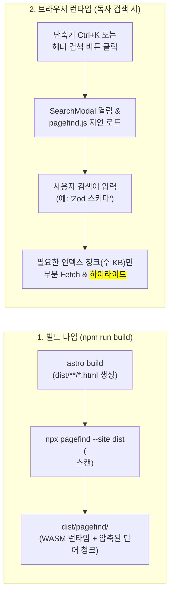

지난 **[웹진 제작 강의 5편]**에서는 Mermaid 코드 블록을 다크/라이트 테마 연동 SVG 다이어그램으로 변환하고, `IntersectionObserver`를 활용해 현재 읽고 있는 위치를 짚어주는 Sticky 목차(TOC)를 구현했습니다. 이제 개별 아티클의 읽기 경험은 상용 기술 매거진 수준에 도달했습니다.

그렇다면 웹진에 글이 100개, 500개로 쌓이고 카테고리가 5개에서 20개로 늘어났을 때 독자가 원하는 글을 어떻게 가장 빠르게 찾게 해 줄 수 있을까요? 이번 **6편**에서는 웹진의 정보 구조(Information Architecture)와 탐색 경험을 완성하는 두 가지 핵심 기능인 **다열 그리드 카테고리 메가 메뉴(`Header.astro`)**와 **Pagefind 기반 서버리스 전문(Full-Text) 검색 모달(`SearchModal.astro`)**을 구현합니다.

---

## 1. 배경 이론: 왜 메가 메뉴와 Pagefind 정적 검색인가?

일반적인 개인 블로그들은 상단 네비게이션 바(GNB)에 카테고리 링크를 가로로 죽 나열합니다. 카테고리가 3~4개일 때는 문제가 없지만, 카테고리가 8개만 넘어가도 메뉴가 두 줄로 꺾이거나 화면 밖으로 삐져나가 헤더 디자인이 완전히 무너집니다.

또한 검색 기능을 구현할 때도 흔히 모든 게시글 본문을 거대한 `search-index.json` 파일 하나로 만들어 브라우저에 통째로 내려받게(`Fuse.js` 등) 하거나, 외부 유료 검색 클라우드(Algolia)에 의존하곤 합니다.

> "게시글이 300개만 되어도 단일 `search-index.json` 파일 크기는 수 메가바이트(MB)에 달한다. 모바일 데이터 환경의 독자에게 검색 한 번 하자고 수 MB짜리 JSON을 통째로 다운로드하게 만드는 것은 폭력적이다."

### 1.1 정적 사이트 검색 엔진 아키텍처 대안 비교

| 비교 항목 | 클라이언트 JSON 전수 검색 (`Fuse.js`) | 외부 SaaS 검색 (`Algolia DocSearch`) | **Pagefind WASM 청크 검색 (우리의 선택)** |
| :--- | :--- | :--- | :--- |
| **네트워크 대역폭 소비** | 글 수에 비례해 폭증 (전체 JSON 다운로드) | 적음 (외부 API 호출) | **초경량 (검색어 해시에 해당하는 수 KB 청크만 로드)** |
| **외부 서버 / API 키** | 불필요 | 필수 (크롤러 승인 및 API 키 관리 필요) | **완전 불필요 (100% 정적 파일로 GitHub Pages 서빙)** |
| **한국어 형태소/본문 검색** | 부분 문자열 매칭 시 성능 저하 | 설정 까다로움 | **다국어(한국어/영어) 인덱스 분할 및 스니펫 하이라이트 내장** |
| **구축 난이도** | 보통 (직접 JSON 생성 엔드포인트 작성) | 높음 | **매우 낮음 (`npx pagefind --site dist` 명령 한 줄)** |

**Pagefind**[^1]는 Rust로 작성된 정적 검색 엔진으로, `astro build`가 생성한 `dist/` 폴더의 HTML 파일들을 스캔하여 단어별 조각(Chunk) 인덱스와 WebAssembly(WASM)[^2] 검색 런타임을 생성합니다. 독자가 검색창을 열고 `"Mermaid"`라고 입력하면 전체 인덱스가 아니라 `"Mermaid"`가 포함된 아주 작은 인덱스 조각(약 5~15KB)만 네트워크로 가져와 0.05초 만에 결과를 보여줍니다!



---

## 2. 단계별 상세 구현: 확장형 메가 메뉴와 Pagefind 검색 모달

이제 상단 네비게이션 메가 메뉴와 검색 모달을 차례대로 구현해 보겠습니다.

### 2.1 Step 1: 다열 그리드 카테고리 메가 메뉴(`Header.astro`) 구현

상단 헤더에는 가장 우선순위가 높은 대표 카테고리 몇 개를 빠르게 접근할 수 있게 두되, **`카테고리 탐색 ▾`** 버튼을 누르거나 마우스를 올리면 전체 카테고리의 아이콘, 한글 제목, 설명문, 그리고 **해당 카테고리에 속한 실시간 게시글 수(Badge)**가 2~3열 그리드 카드로 펼쳐지는 메가 메뉴를 만듭니다.

```astro title="src/components/Header.astro (카테고리 메가 메뉴 핵심 구조)"
---
import { getAllCategoriesWithCount } from '../lib/posts';
import { withBase } from '../lib/paths';

const categoriesWithCount = await getAllCategoriesWithCount();
const totalPostsCount = categoriesWithCount.reduce((sum, item) => sum + item.count, 0);
---

<header class="sticky top-0 z-40 w-full backdrop-blur-md bg-white/85 dark:bg-slate-950/85 border-b border-slate-200/80 dark:border-slate-800/80">
  <div class="max-w-7xl mx-auto px-4 sm:px-6 lg:px-8 h-16 flex items-center justify-between">
    <!-- 좌측 브랜드 로고 및 메가 메뉴 트리거 -->
    <div class="flex items-center gap-6">
      <a href={withBase('/')} class="text-xl font-extrabold tracking-tight text-slate-900 dark:text-white">
        BISUE <span class="text-indigo-600 dark:text-indigo-400">WEBZINE</span>
      </a>

      <!-- 데스크톱 메가 메뉴 드롭다운 컨테이너 -->
      <div class="relative group hidden md:block" id="mega-menu-container">
        <button
          type="button"
          id="mega-menu-trigger"
          aria-expanded="false"
          class="inline-flex items-center gap-1.5 px-3 py-2 rounded-lg text-sm font-semibold text-slate-700 dark:text-slate-200 hover:bg-slate-100 dark:hover:bg-slate-800 transition"
        >
          <span>카테고리 탐색</span>
          <span class="text-xs px-1.5 py-0.5 rounded-full bg-indigo-50 dark:bg-indigo-950 text-indigo-600 dark:text-indigo-400">
            {categoriesWithCount.length}
          </span>
        </button>

        <!-- 메가 메뉴 패널 (3열 반응형 그리드) -->
        <div
          id="mega-menu-panel"
          class="invisible opacity-0 group-hover:visible group-hover:opacity-100 focus-within:visible focus-within:opacity-100 transition-all duration-200 absolute left-0 top-full pt-3 w-[680px] z-50"
        >
          <div class="rounded-2xl bg-white dark:bg-slate-900 shadow-2xl border border-slate-200 dark:border-slate-800 p-5">
            <div class="flex items-center justify-between pb-3 mb-4 border-b border-slate-100 dark:border-slate-800">
              <span class="text-xs font-bold uppercase tracking-wider text-slate-400">
                전체 카테고리 디렉토리 (총 {totalPostsCount}편의 아티클)
              </span>
            </div>
            <div class="grid grid-cols-2 gap-3 max-h-[65vh] overflow-y-auto">
              {categoriesWithCount.map(({ meta, count }) => (
                <a
                  href={withBase(`/category/${meta.slug}/`)}
                  class="flex items-start gap-3 p-3 rounded-xl hover:bg-slate-50 dark:hover:bg-slate-800/70 transition group/card"
                >
                  <span class="text-2xl shrink-0 mt-0.5">{meta.icon}</span>
                  <div class="min-w-0 flex-1">
                    <div class="flex items-center justify-between gap-2">
                      <span class="font-bold text-sm text-slate-900 dark:text-white group-hover/card:text-indigo-600 dark:group-hover/card:text-indigo-400 truncate">
                        {meta.name}
                      </span>
                      <span class="text-xs font-medium px-2 py-0.5 rounded-full bg-slate-100 dark:bg-slate-800 text-slate-600 dark:text-slate-400">
                        {count}편
                      </span>
                    </div>
                    <p class="text-xs text-slate-500 dark:text-slate-400 line-clamp-1 mt-1">
                      {meta.description}
                    </p>
                  </div>
                </a>
              ))}
            </div>
          </div>
        </div>
      </div>
    </div>

    <!-- 우측 검색 모달 호출 버튼 (Ctrl+K) 및 테마 토글 -->
    <div class="flex items-center gap-2">
      <button
        type="button"
        data-open-search
        class="inline-flex items-center gap-2 px-3 py-1.5 rounded-lg border border-slate-200 dark:border-slate-800 text-sm text-slate-500 hover:border-indigo-400 transition"
      >
        <span>🔍 검색...</span>
        <kbd class="hidden sm:inline-block text-xs">Ctrl K</kbd>
      </button>
    </div>
  </div>
</header>
```

> [!TIP]
> **카테고리가 30개로 늘어나도 깨지지 않는 비밀 (`max-h-[65vh] overflow-y-auto`)**
> 메가 메뉴 내부 그리드에 `max-h-[65vh] overflow-y-auto`가 적용되어 있어, 향후 카테고리가 20~30개로 늘어나더라도 화면 아래로 잘리지 않고 메가 메뉴 패널 내부에서 깔끔하게 스크롤됩니다.

### 2.2 Step 2: Pagefind 인덱싱 대상 영역(`data-pagefind-body`) 지정하기

Pagefind가 상단 헤더나 푸터의 공통 메뉴 텍스트까지 중복 인덱싱하지 않고 **오직 게시글 본문과 제목, 카테고리, 태그만 정확하게 인덱싱**하도록 만들려면, 아티클 레이아웃(`src/layouts/PostLayout.astro`)의 `<article>` 태그에 `data-pagefind-body` 속성을 부여해야 합니다.

```astro title="src/layouts/PostLayout.astro (Pagefind 인덱싱 마커 설정)"
<article data-pagefind-body class="prose prose-slate dark:prose-invert max-w-none">
  <!-- 카테고리 및 메타데이터를 Pagefind 필터/메타로 등록 -->
  <span data-pagefind-filter="category" class="hidden">{post.categoryMeta.name}</span>
  
  <h1 data-pagefind-meta="title" class="text-3xl sm:text-4xl font-extrabold">
    {post.title}
  </h1>

  <!-- 실제 마크다운 렌더링 본문 영역 -->
  <div class="mt-8">
    <slot />
  </div>
</article>
```

이렇게 `<article data-pagefind-body>`를 한 곳에만 달아 주면, Pagefind는 이 속성이 없는 목록 페이지(`/`, `/category/*`)는 자동으로 건너뛰고 **개별 아티클 상세 페이지들만 중복 없이 깔끔하게 인덱싱**합니다!

### 2.3 Step 3: 단축키(<kbd>Ctrl</kbd>+<kbd>K</kbd>)와 디바운싱이 적용된 `SearchModal.astro` 구현

이제 사용자가 헤더의 검색 버튼을 클릭하거나 키보드에서 <kbd>Ctrl</kbd> + <kbd>K</kbd>(Mac에서는 <kbd>⌘</kbd> + <kbd>K</kbd>)를 눌렀을 때 열리는 검색 모달을 작성합니다. Pagefind의 런타임 스크립트(`/pagefind/pagefind.js`)를 동적으로 불러와 검색어를 전달하고, 반환된 결과의 `excerpt`(검색어 주변 문맥에 `<mark>` 하이라이트가 포함된 HTML 스니펫)를 화면에 렌더링합니다.

```astro title="src/components/SearchModal.astro (Pagefind 클라이언트 검색 엔진 연동)"
<div id="search-modal" class="fixed inset-0 z-50 hidden items-start justify-center pt-16 sm:pt-24 px-4">
  <!-- 배경 딤(Backdrop) 오버레이 -->
  <div id="search-backdrop" class="fixed inset-0 bg-slate-950/60 backdrop-blur-sm"></div>

  <!-- 검색 모달 다이얼로그 -->
  <div class="relative w-full max-w-2xl rounded-2xl bg-white dark:bg-slate-900 shadow-2xl border border-slate-200 dark:border-slate-800 overflow-hidden z-10">
    <div class="flex items-center px-4 border-b border-slate-200 dark:border-slate-800">
      <span class="text-slate-400 mr-3">🔍</span>
      <input
        id="search-input"
        type="search"
        placeholder="찾고 싶은 기술 키워드, 제목, 본문 내용을 입력하세요..."
        class="w-full py-4 bg-transparent text-slate-900 dark:text-white placeholder-slate-400 focus:outline-none text-base"
        autocomplete="off"
      />
      <kbd class="text-xs text-slate-400 cursor-pointer" id="search-close-btn">ESC</kbd>
    </div>

    <!-- 검색 결과 렌더링 리스트 -->
    <div id="search-results" class="max-h-[60vh] overflow-y-auto p-4 space-y-3">
      <p class="text-sm text-slate-500 text-center py-8">
        검색어를 입력하면 본문 전체에서 실시간으로 아티클을 찾아드립니다.
      </p>
    </div>
  </div>
</div>

<script is:inline define:vars={{ baseUrl: import.meta.env.BASE_URL }}>
  let pagefindInstance = null;

  async function ensurePagefindLoaded() {
    if (pagefindInstance) return pagefindInstance;
    const normalizedBase = baseUrl.endsWith('/') ? baseUrl : `${baseUrl}/`;
    const pagefindPath = `${normalizedBase}pagefind/pagefind.js`;
    pagefindInstance = await import(pagefindPath);
    await pagefindInstance.init();
    return pagefindInstance;
  }

  // 단축키 Ctrl+K / Cmd+K 및 ESC 바인딩
  document.addEventListener('keydown', (e) => {
    if ((e.ctrlKey || e.metaKey) && e.key.toLowerCase() === 'k') {
      e.preventDefault();
      openSearchModal();
    } else if (e.key === 'Escape') {
      closeSearchModal();
    }
  });
</script>
```

---

## 3. 자주 겪는 트러블슈팅 및 엣지 케이스 분석

Pagefind를 Astro와 함께 사용할 때 가장 많이 질문하는 핵심 이슈를 정리했습니다.

> [!IMPORTANT]
> **로컬 개발 서버(`npm run dev`)에서 `/pagefind/pagefind.js`가 404가 날 때 해결법**
> Pagefind 인덱스는 `astro build && npx pagefind --site dist`를 실행했을 때 `dist/pagefind/` 폴더에 생성됩니다. 따라서 프로젝트를 처음 클론한 직후 한 번도 빌드를 하지 않고 `npm run dev`만 실행하면 `pagefind/` 폴더가 없어 검색 시 안내 메시지가 표시될 수 있습니다. 로컬 개발 중에도 검색을 테스트하려면 먼저 `npm run build`를 한 번 실행해 인덱스를 생성해 두거나, 예외 처리 블록(`try / catch`)에서 친절한 안내 문구를 띄워 주는 것이 좋습니다.

<details>
<summary>심화 Q&A: Vite 번들러가 빌드 시점에 `/pagefind/pagefind.js`를 찾을 수 없다고 에러를 내는 이유는 무엇인가요?</summary>

일반 `<script>` 태그 안에서 `import('/pagefind/pagefind.js')`를 호출하면, Vite 번들러가 `astro build` 도중에 해당 파일을 번들링하려고 시도합니다. 하지만 `/pagefind/pagefind.js`는 `astro build`가 **끝난 직후**에 `npx pagefind --site dist` 명령어로 생성되는 파일이므로 빌드 도중에는 아직 존재하지 않습니다!
이를 해결하려면 위 코드처럼 `<script is:inline>`을 사용하거나 `new Function('path', 'return import(path)')(pagefindPath)` 패턴을 사용하여 Vite가 빌드 타임에 정적 분석하는 것을 우회하고 브라우저 런타임에 순수 ES Module 동적 임포트를 수행하도록 해야 합니다.

</details>

---

## 4. 실습 점검 체크리스트 및 다음 편 예고

이번 6편에서 구현한 메가 메뉴와 Pagefind 검색 모달이 정상 작동하는지 확인해 봅시다.

- [x] `Header.astro`에 카테고리 개수와 아티클 수를 실시간 집계하는 다열 그리드 메가 메뉴 구현하기
- [x] 모바일 뷰포트에서도 햄버거 드로어 메뉴를 통해 모든 카테고리에 접근 가능한지 확인하기
- [x] `PostLayout.astro`의 `<article>`에 `data-pagefind-body` 속성을 부여해 본문만 정밀 인덱싱하기
- [x] <kbd>Ctrl</kbd> + <kbd>K</kbd> 단축키로 검색 모달을 열고 한글 키워드 검색 시 `<mark>` 하이라이트 스니펫 확인하기
- [ ] GitHub Pages 서브 경로(`base`) 보정 및 GitHub Actions 무중단 자동 배포 파이프라인 구축하기 (7편 완결 예정)

이제 로컬 환경에서 우리의 웹진은 디자인, 마크다운 확장 문법, 다이어그램, 목차, 메가 메뉴, 전문 검색까지 모든 기능을 완벽히 갖추었습니다. 대망의 마지막 시간인 **[웹진 제작 강의 7편 · 완결]**에서는 로컬에서 완성한 웹진을 전 세계 누구나 접속할 수 있는 **GitHub Pages에 배포하면서 겪게 되는 서브 경로(Sub-path) 깨짐 문제를 완벽히 해결하고, `git push` 한 번으로 빌드부터 배포까지 끝나는 GitHub Actions CI/CD 파이프라인**을 완성해 보겠습니다!

---

[^1]: **Pagefind**: CloudCannon 팀이 개발한 오픈소스 정적 웹사이트 검색 라이브러리로, 별도의 백엔드 서버 없이 정적 호스팅만으로 대용량 문서 검색을 가능하게 해 줍니다.
[^2]: **WebAssembly (WASM)**: C, C++, Rust 등의 언어로 작성된 코드를 웹 브라우저에서 네이티브에 가까운 속도로 실행할 수 있게 해 주는 이진 명령어 포맷입니다.
