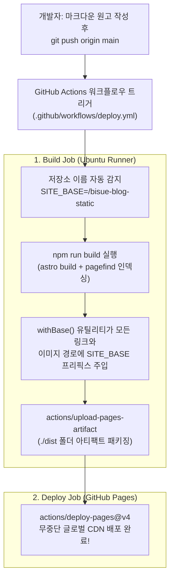

드디어 **바닥부터 만드는 마크다운 정적 웹진 엔진** 7부작 시리즈의 대단원인 **7편(완결)**에 도착했습니다! 지난 1편부터 6편까지 숨 가쁘게 달려오며 우리가 직접 구축한 아키텍처를 되돌아볼까요?

* **1~2편**: 5계층 디렉토리 설계 및 Astro Content Collections + Zod 스키마 기반 카테고리 자동 분류
* **3편**: 마크다운 본문에서 코드 블록과 노이즈를 제거해 첫 이미지와 120자 요약문을 뽑아내는 추출기
* **4~5편**: GFM, 5종 콜아웃, Expressive Code, 테마 연동 Mermaid 다이어그램, 스크롤 연동 TOC
* **6편**: 다열 그리드 카테고리 메가 메뉴와 Pagefind WASM 서버리스 전문 검색 모달

로컬 개발 서버(`http://localhost:4321/`)에서는 모든 기능이 한 치의 오차도 없이 완벽하게 동작합니다. 하지만 막상 이를 **GitHub Pages**에 배포하는 순간, 많은 개발자들이 **"로컬에서는 잘 나오던 이미지와 CSS, 페이지 링크가 배포 후 전부 404 에러로 깨져 버리는 당혹스러운 현상"**을 겪습니다. 이번 최종 편에서는 이 서브 경로(Sub-path) 문제의 원인을 뿌리부터 해결하는 `withBase()` 유틸리티를 설계하고, **`main` 브랜치에 마크다운 파일만 `git push`하면 자동으로 빌드·인덱싱·배포까지 완료되는 GitHub Actions CI/CD 파이프라인**을 완성합니다.

---

## 1. 배경 이론: 왜 GitHub Pages에 올리면 경로가 깨질까?

GitHub Pages는 저장소(Repository) 이름에 따라 두 가지 서로 다른 URL 구조를 부여합니다[^1].

| 구분 | 저장소 이름 예시 | 배포되는 실제 URL 구조 | 루트 경로 (`/`)의 의미 |
| :--- | :--- | :--- | :--- |
| **사용자/조직 사이트** | `username.github.io` | `https://username.github.io/` | 도메인 루트 자체가 프로젝트 루트 (`base: '/'`) |
| **프로젝트 사이트 (대부분)** | `bisue-blog-static` | `https://username.github.io/bisue-blog-static/` | **서브 경로 `/bisue-blog-static/`이 프로젝트 루트!** |

> "프로젝트 사이트(`https://username.github.io/bisue-blog-static/`) 환경에서 `<a href="/category/ai-tech/">`나 ``처럼 슬래시(`/`)로 시작하는 절대 경로를 하드코딩하면, 브라우저는 저장소 이름(`/bisue-blog-static`)을 무시하고 도메인 최상단인 `https://username.github.io/images/cover.svg`를 요청하여 404 Not Found를 발생시킨다."

그렇다고 모든 코드에 `/bisue-blog-static/images/...`를 하드코딩해 버리면 나중에 커스텀 도메인(`https://webzine.example.com/`)을 연결하거나 로컬에서 테스트할 때 다시 수백 군데를 고쳐야 합니다. 따라서 **환경 변수와 `import.meta.env.BASE_URL`을 결합한 동적 경로 보정 아키텍처**가 필수적입니다.



---

## 2. 단계별 상세 구현: 서브 경로 안전 조인과 GitHub Actions 워크플로우

이제 어떠한 배포 환경(로컬 루트, GitHub Pages 서브 경로, 커스텀 도메인)에서도 링크와 이미지가 절대 깨지지 않도록 경로 유틸리티와 배포 설정을 구현합니다.

### 2.1 Step 1: 모든 내부 경로와 에셋을 안전하게 감싸는 `src/lib/paths.ts`

Astro는 `astro.config.mjs`에 설정된 `base` 값을 런타임/빌드타임 상수인 `import.meta.env.BASE_URL`로 노출해 줍니다. 이를 활용해 내부 경로 문자열이 들어왔을 때 중복 슬래시(`//`)나 중복 프리픽스 없이 항상 올바른 경로를 반환하는 `withBase(path)` 함수를 작성합니다.

```typescript title="src/lib/paths.ts"
/**
 * GitHub Pages 서브 경로(예: /bisue-blog-static) 환경과
 * 루트 도메인(/) 환경 모두에서 깨지지 않는 안전한 경로를 생성합니다.
 */
export function withBase(path?: string | null): string {
  if (!path) return import.meta.env.BASE_URL || '/';

  // 1. 외부 URL(http://, https://), 데이터 URI(data:), 앵커(#), 메일(mailto:)은 변환하지 않고 그대로 반환
  if (/^(?:https?:\/\/|data:|mailto:|tel:|#)/i.test(path)) {
    return path;
  }

  const base = import.meta.env.BASE_URL || '/';
  const cleanBase = base.endsWith('/') ? base.slice(0, -1) : base;
  const cleanPath = path.startsWith('/') ? path : `/${path}`;

  // 2. 루트 배포(base === '/')인 경우
  if (!cleanBase || cleanBase === '') {
    return cleanPath;
  }

  // 3. 이미 base 경로가 붙어 있는 경우 중복 부착 방지 (Idempotency 보장)
  if (cleanPath === cleanBase || cleanPath.startsWith(`${cleanBase}/`)) {
    return cleanPath;
  }

  return `${cleanBase}${cleanPath}`;
}
```

> [!TIP]
> **멱등성(Idempotency)[^2] 보장의 중요성**
> `withBase(withBase('/images/cover.svg'))`처럼 실수로 `withBase`를 두 번 중첩 호출하더라도 `/bisue-blog-static/bisue-blog-static/images/cover.svg`가 되지 않도록 `cleanPath.startsWith(`${cleanBase}/`)` 조건으로 방어해 두었습니다. 이제 `Header.astro`, `PostCard.astro`, `HeroCard.astro`의 모든 `href`와 ``를 `withBase(...)`로 감싸 주기만 하면 됩니다!

### 2.2 Step 2: 환경 변수에 반응하는 `astro.config.mjs` 구성

로컬 개발 시에는 편하게 `http://localhost:4321/`에서 작업하고, GitHub Actions에서 빌드할 때는 워크플로우가 주입하는 `SITE_URL`과 `SITE_BASE` 환경 변수를 읽어 자동으로 서브 경로 빌드를 수행하도록 `astro.config.mjs` 상단을 구성합니다.

```javascript title="astro.config.mjs (환경 변수 기반 site 및 base 동적 설정)"
import { defineConfig } from 'astro/config';

// GitHub Actions 또는 로컬 환경 변수에서 배포 도메인과 서브 경로를 읽어옵니다.
const siteUrl = process.env.SITE_URL || 'https://username.github.io';
const siteBase = process.env.SITE_BASE || undefined;

export default defineConfig({
  site: siteUrl,
  base: siteBase,
  trailingSlash: 'ignore',
  // ... (4편에서 작성한 integrations 및 markdown 플러그인 설정 유지)
});
```

### 2.3 Step 3: `.github/workflows/deploy.yml` 자동 배포 파이프라인 작성

이제 프로젝트 루트에 `.github/workflows/deploy.yml` 파일을 생성합니다. 이 워크플로우는 GitHub 저장소 이름을 스스로 분석하여 `<username>.github.io` 저장소면 루트(`/`)로, 일반 프로젝트 저장소(예: `bisue-blog-static`)면 자동으로 `/<레포이름>`을 `SITE_BASE`에 주입한 뒤 Astro 빌드와 Pagefind 인덱싱을 수행하고 GitHub Pages에 배포합니다.

```yaml title=".github/workflows/deploy.yml"
name: Deploy Static Webzine to GitHub Pages

on:
  push:
    branches:
      - main
  workflow_dispatch:

# GitHub Pages 배포를 위한 최소 권한(Least Privilege) 부여
permissions:
  contents: read
  pages: write
  id-token: write

# 동시에 여러 번 push가 발생했을 때 진행 중인 이전 배포를 취소하고 최신 배포만 수행
concurrency:
  group: "pages"
  cancel-in-progress: true

jobs:
  build:
    runs-on: ubuntu-latest
    steps:
      - name: Checkout repository
        uses: actions/checkout@v4

      - name: Setup Node.js 22
        uses: actions/setup-node@v4
        with:
          node-version: 22
          cache: npm

      - name: Setup Pages configuration
        id: pages
        uses: actions/configure-pages@v5

      - name: Install dependencies
        run: npm ci

      - name: Build Astro site & Generate Pagefind index
        env:
          SITE_URL: ${{ steps.pages.outputs.origin }}
          SITE_BASE: ${{ steps.pages.outputs.base_path }}
        run: npm run build

      - name: Upload Pages artifact
        uses: actions/upload-pages-artifact@v3
        with:
          path: ./dist

  deploy:
    needs: build
    runs-on: ubuntu-latest
    environment:
      name: github-pages
      url: ${{ steps.deployment.outputs.page_url }}
    steps:
      - name: Deploy to GitHub Pages
        id: deployment
        uses: actions/deploy-pages@v4
```

위 YAML 파일에서 **`actions/configure-pages@v5`** 스텝을 주목하세요! 수동으로 저장소 이름을 쪼개는 셸 스크립트를 짤 필요 없이, GitHub 공식 액션이 제공하는 `${{ steps.pages.outputs.origin }}`과 `${{ steps.pages.outputs.base_path }}`를 그대로 `SITE_URL`과 `SITE_BASE` 환경 변수에 매핑해 주면, 커스텀 도메인을 연결하든 프로젝트 서브 경로로 배포하든 GitHub 설정에 맞춰 100% 자동으로 경로가 계산됩니다.

---

## 3. 자주 겪는 트러블슈팅 및 배포 후 점검 가이드

GitHub Pages 첫 배포 시 마주칠 수 있는 설정 문제와 해결 방법입니다.

> [!IMPORTANT]
> **GitHub 저장소 Settings > Pages에서 Source를 `GitHub Actions`로 변경 필수!**
> 저장소의 기본 Pages 설정은 `Deploy from a branch`로 되어 있는 경우가 많습니다. 첫 `git push`를 하기 전에 GitHub 웹 페이지의 **Settings → Pages → Build and deployment → Source** 드롭다운을 클릭해 반드시 <mark>**`GitHub Actions`**</mark>로 변경해 주세요.

> [!CAUTION]
> **마크다운 본문 내부 이미지(``)의 서브 경로 처리 주의**
> 컴포넌트(`PostCard.astro` 등)의 `thumbnail`은 `withBase(post.thumbnail)`로 감싸서 렌더링되지만, 마크다운 본문 한가운데에 직접 작성한 `` 이미지 태그도 서브 경로 환경에서 깨지지 않으려면 Rehype 단계에서 ``의 `src`에 `base`를 붙여 주거나 상대 경로를 활용해야 합니다.

<details>
<summary>심화 Q&A: 향후 나만의 커스텀 도메인(예: blog.myname.dev)을 연결하려면 코드를 수정해야 하나요?</summary>

**코드를 단 한 줄도 수정할 필요가 없습니다!**
1. 도메인 등록 대행사(Cloudflare, Route53, 가비아 등)에서 CNAME 레코드를 `<username>.github.io`로 연결합니다.
2. GitHub 저장소의 **Settings → Pages → Custom domain** 입력칸에 `blog.myname.dev`를 입력하고 **Enforce HTTPS**를 체크합니다.
3. 그러면 다음번 워크플로우 실행 시 `actions/configure-pages@v5`가 자동으로 `origin`을 `https://blog.myname.dev`로, `base_path`를 빈 문자열(`""`)로 감지하여 루트 경로 기반의 깔끔한 정적 사이트로 빌드해 줍니다!

</details>

---

## 4. 7부작 시리즈 전체 완주 체크리스트 및 마무리 인사

축하합니다! 여러분은 1편부터 7편까지의 여정을 통해 단순한 블로그 템플릿 복사를 넘어, **데이터 스키마 검증·본문 파싱·Unified AST 플러그인 조립·인터랙티브 아일랜드 컴포넌트·WASM 정적 검색·CI/CD 자동 배포**에 이르는 모던 정적 웹진 엔진의 전 과정을 직접 구축하셨습니다. 마지막으로 전체 시스템을 점검해 보세요.

- [x] **1편**: 5계층 디렉토리 아키텍처와 `src/config/categories.ts` 중앙 레지스트리 구성 완료
- [x] **2편**: `src/content/config.ts` Zod 스키마 검증 및 상위 폴더명 기반 카테고리 자동 분류 완료
- [x] **3편**: `src/lib/markdown-extract.ts` 본문 첫 이미지 & 120자 순수 텍스트 요약문 자동 추출 완료
- [x] **4편**: GFM, 5종 콜아웃, Expressive Code, 원시 HTML 렌더링 파이프라인 조립 완료
- [x] **5편**: 다크/라이트 테마 연동 Mermaid 다이어그램 렌더러 및 스크롤 연동 Sticky TOC 완료
- [x] **6편**: 다열 그리드 카테고리 메가 메뉴 및 Pagefind(<kbd>Ctrl</kbd>+<kbd>K</kbd>) 전문 검색 모달 연동 완료
- [x] **7편**: `withBase()` 서브 경로 안전 보정 및 `.github/workflows/deploy.yml` 무중단 배포 완료

이제 여러분이 해야 할 일은 단 하나뿐입니다. `src/content/posts/` 아래 원하는 카테고리 폴더에 새로운 `.md` 파일을 만들고, 여러분만의 깊이 있는 기술 인사이트와 이야기를 적어 내려가세요. 그리고 터미널에서 `git push`를 입력하는 순간, 여러분의 글은 전 세계 독자들에게 가장 빠르고 아름다운 웹진 형태로 전달될 것입니다. 긴 연재 강의를 끝까지 함께해 주셔서 진심으로 감사합니다! 🎉

---

[^1]: **GitHub Pages URL 정책**: 한 GitHub 계정당 1개의 사용자 사이트(`https://<username>.github.io/`)와 무제한의 프로젝트 사이트(`https://<username>.github.io/<repo-name>/`)를 무료로 호스팅할 수 있습니다.
[^2]: **멱등성 (Idempotency)**: 동일한 연산을 한 번 적용하든 여러 번 반복 적용하든 항상 동일한 결과를 반환하는 성질입니다. 경로 보정 함수에서 멱등성이 보장되지 않으면 중첩 호출 시 `/base/base/path`처럼 경로가 망가집니다.
