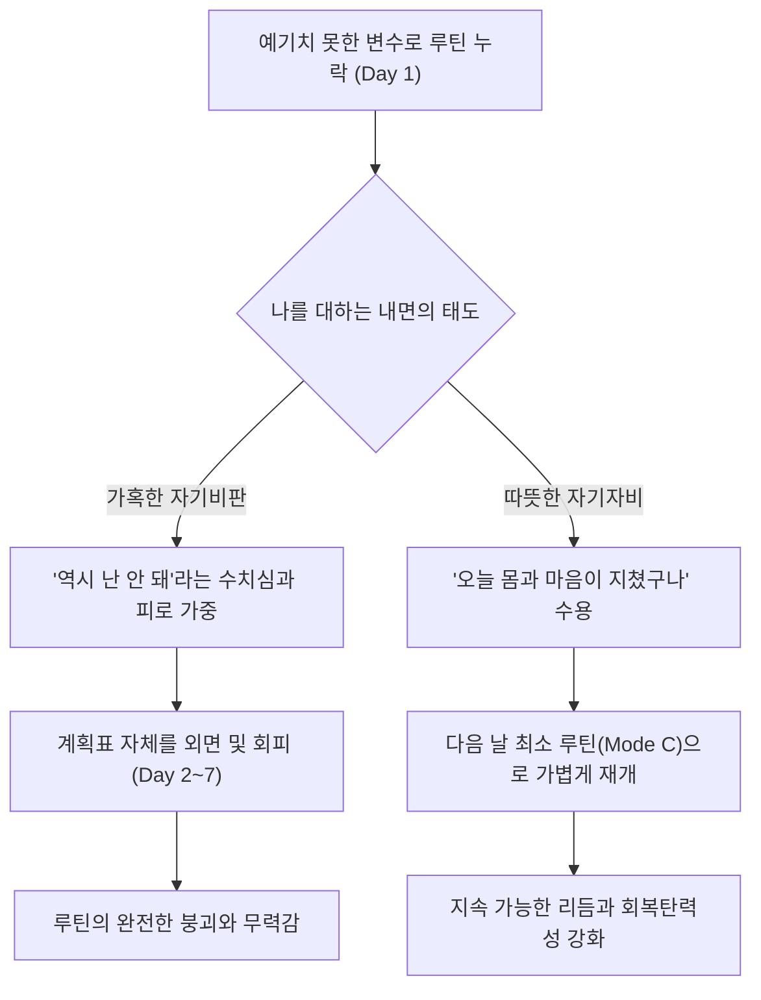

새해 첫날이나 새로운 달의 첫 번째 월요일마다 우리는 반듯하게 펼쳐진 새 노트에 완벽한 하루의 시간표를 적어 내려간다. 아침 일곱 시 기상, 미지근한 물 한 잔과 이십 분간의 스트레칭, 출근 전 삼십 분의 독서, 그리고 저녁마다 이어지는 글쓰기와 산책까지. 종이 위에 적힌 계획표 속의 나는 언제나 지치지 않는 체력과 흔들리지 않는 의지력을 가진 이상적인 인간이다.


처음 열흘 남짓은 달력의 빈칸마다 기분 좋은 동그라미와 체크 표시가 차곡차곡 채워진다. 그 작은 기호들이 쌓여갈수록 내 삶이 온전히 내 통제 아래 있다는 뿌듯함이 차오른다. 그러나 삶은 언제나 예고 없는 변수들을 데려온다. 갑작스러운 야근이나 몸살기운, 혹은 이유를 알 수 없는 깊은 무기력감이 찾아온 어느 날, 공들여 쌓아 올린 루틴의 탑에 첫 번째 빈칸이 생겨난다.

문제는 그 빈칸 하나가 아니다. 진짜 위기는 빈칸을 마주한 다음 날 아침, 나 자신을 향해 쏟아내는 가혹한 자기비판에서 시작된다. *‘역시 나는 끈기가 없어. 이번에도 작심삼일이구나.’* <mark>오랜 시간 루틴을 만들고 무너뜨리기를 반복하며 내가 깨달은 가장 중요한 사실은, 습관의 성패를 가르는 것이 ‘완벽한 연속성’이 아니라 ‘무너진 다음 날 나를 대하는 태도’라는 점이었다.</mark>

> "완벽주의는 흔히 최선을 다하려는 태도로 오해받지만, 실제로는 한 번의 실수도 용납하지 못해 결국 모든 시도를 포기하게 만드는 가장 가혹한 방어기제다."
> — 브레네 브라운, 『불완전함의 선물』 중에서[^1]

---

## 1. ‘전부 아니면 전무’라는 완벽주의의 함정

### 1.1 스물아홉 번의 성공을 지워버리는 단 하루의 실패

심리학에서는 인간이 목표를 추구할 때 흔히 빠지는 인지적 오류를 ‘전부 아니면 전무(All-or-Nothing) 사고’라고 부른다. 한 달 삼십 일 중 스물아홉 날을 성실하게 걸어왔더라도, 단 하루 삐끗하면 그동안 쌓아온 스물아홉 번의 성취를 모두 무효로 선언해 버리는 태도다.

새하얀 셔츠에 작은 커피 얼룩 하나가 튀었을 때 그 셔츠를 곧바로 쓰레기통에 버리는 사람은 없다. 물티슈로 얼룩을 가볍게 닦아내거나 집에 돌아가 세탁기를 돌리면 그만이다. ~~하지만 유독 매일의 습관과 루틴에 대해서만큼은 단 한 칸의 공백도 용납하지 못하고 기록장 전체를 찢어버리곤 했다.~~

이러한 태도는 루틴을 나를 돌보는 따뜻한 울타리가 아니라, 매일 통과해야만 하는 냉혹한 시험대로 변질시킨다. 시험대 위에서는 누구도 오래 버틸 수 없다. 결국 우리를 멈추게 하는 것은 그날의 게으름이나 피로가 아니라, 실패한 나 자신을 향해 던지는 수치심과 자책이라는 2차 가해다.

> [!NOTE]
> 행동심리학자 제임스 클리어(James Clear)의 연구에 따르면, 장기적인 습관 형성에서 하루를 건너뛰는 것은 습관 강도에 거의 영향을 미치지 않습니다. 진짜 치명적인 것은 하루의 누락이 자기혐오로 이어져 **‘연속 이틀 이상 포기하는 상태’**로 고착화되는 것입니다.

### 1.2 자기비판의 악순환과 자기자비의 선순환 구조

루틴이 깨진 날 우리 내면에서 벌어지는 두 가지 갈림길을 다이어그램으로 그려보면 그 차이가 분명하게 드러난다.



---

## 2. 몸과 마음의 날씨에 맞춘 ‘3단계 탄력 루틴’ 설계하기

### 2.1 매일 같은 컨디션일 수 없다는 사실을 인정하기

자연의 날씨가 매일 맑을 수 없듯, 인간의 신체 에너지와 정신적 가용량 또한 매일 다르게 출렁인다. 잠을 설친 날과 푹 잔 날, 감정이 평온한 날과 대인관계로 에너지를 소진한 날에 똑같은 강도의 `100% 루틴`을 요구하는 것은 폭우가 쏟아지는 날에도 평소와 똑같은 속도로 달리기를 강요하는 것과 다름없다.

그래서 나는 어느 날부터인가 모든 습관을 단 하나의 고정된 목표치로 설정하는 대신, 그날의 컨디션에 따라 기어를 변속할 수 있도록 **A·B·C 세 단계의 탄력적 기준**을 마련했다. 마치 자동차가 오르막길에서는 저단 기어로 바꾸어 엔진의 무리를 줄이듯, 삶의 오르막길에서도 기어를 낮추는 지혜가 필요하다.

### 2.2 에너지 잔량에 따른 3단계 루틴 매트릭스

내가 일상에서 유지하고 있는 네 가지 핵심 습관을 컨디션 단계별로 나누어 정리한 표다.

| 습관 영역 | Mode A: 쾌청한 날 (최적 루틴) | Mode B: 흐린 날 (표준 루틴) | Mode C: 폭우 치는 날 (비상 최소 루틴) |
| :--- | :--- | :--- | :--- |
| **아침 몸 깨우기** | 30분 야외 러닝 및 전신 스트레칭 | 실내 요가 매트 위에서 10분 스트레칭 | 창문 열고 심호흡 3회 + 기지개 켜기 |
| **매일의 독서** | 책상 앞에서 종이책 30페이지 정독 및 메모 | 이동 중이나 침대 맡에서 10페이지 읽기 | 머리맡의 책을 펼쳐 단 **두 문장**만 읽기 |
| **저녁 글쓰기** | 블로그 에세이 초고 1,500자 이상 집필 | 일기장에 오늘의 단상 한 단락(300자) 적기 | 노트에 오늘의 기분을 요약하는 **단어 3개** 적기 |
| **공간 정돈** | 책상 물걸레질 및 방 전체 청소기 돌리기 | 책상 위 사용한 컵과 문구류 제자리 두기 | 내일 아침 마실 물컵 하나만 씻어 두기 |
| **핵심 목적** | 성취감 극대화 및 역량 확장 | 일상의 안정적인 리듬 유지 | **‘흐름이 끊기지 않았다’는 정체성 보존** |

---

## 3. 완벽한 재시작보다 ‘우아한 일시정지’를 배우는 시간

### 3.1 두 문장만 읽어도 그날의 독서는 성공이다

위 표에서 가장 중요한 역할을 하는 것은 다름 아닌 **Mode C(비상 최소 루틴)**다. 너무 지쳐서 손가락 하나 까딱하기 싫은 밤, 침대에 눕기 전 책을 펼쳐 단 두 문장만 읽고 덮는 것이 과연 무슨 의미가 있을까 싶을지도 모른다. 지식을 쌓는 관점에서는 아무런 효과가 없을 것이다.

하지만 ‘나는 매일 책을 가까이하는 사람이다’라는 자기 정체성의 불씨를 꺼뜨리지 않는다는 점에서는 그 두 문장이 삼십 페이지 못지않은 위력을 발휘한다. 키보드의 <kbd>Pause</kbd> 버튼을 눌러 음악을 잠시 멈추는 것과 전원 플러그를 뽑아버리는 것은 완전히 다르다. 최소 루틴은 내 삶의 리듬이 완전히 꺼지지 않도록 유지해 주는 대기 전력(Standby Power)과 같다.

```text title="habit-recovery-log.txt"
[2026년 10월 셋째 주 루틴 기록 노트의 여백]

- 10/14 (수): Mode A 달성. 가을 햇살이 좋아 산책도 40분이나 했고 글도 잘 써졌다.
- 10/15 (목): 늦은 퇴근으로 지침. Mode C로 전환. 책 두 페이지만 읽고 일찍 잠들었다. (나를 칭찬함!)
- 10/16 (금): 감기 기운으로 모든 루틴 일시정지(Rest). 따뜻한 유자차를 마시며 일찍 눈을 감았다.
- 10/17 (토): 컨디션 회복. 자책 없이 가벼운 마음으로 Mode B부터 다시 시작.
```

> [!TIP]
> 습관 트래커나 다이어리를 쓸 때, 루틴을 지키지 못한 날을 텅 빈 공란이나 빨간색 `X` 표시로 남겨두지 마세요. 대신 초록색 펜으로 **`REST(충전)`** 혹은 **`PAUSE(쉼표)`**라고 직접 적어 넣으세요. 휴식 또한 내가 주체적으로 선택한 루틴의 일부로 기록할 때 죄책감이 사라집니다.

---

## 4. 루틴이 깨진 날을 부드럽게 통과하는 회복 수칙

### 4.1 자기비판의 목소리를 객관적 관찰로 바꾸기

계획대로 흘러가지 않은 하루의 끝에서, 나 자신을 다그치는 대신 다정하게 다독이기 위해 실천하는 세 가지 마음가짐이다.

1. **원인을 성격이 아닌 환경과 상태에서 찾기**: “내가 게을러서 안 했다”가 아니라 “어제 수면 시간이 두 시간 부족해서 뇌의 전두엽 에너지가 고갈되었다”라고 객관적인 인과관계를 파악한다[^2].
2. **가장 친한 친구에게 건넬 법한 말 건네기**: 소중한 친구가 피곤해서 하루 운동을 쉬었다고 할 때 “너는 왜 늘 그 모양이니?”라고 비난할 사람은 없다. 타인에게 베푸는 관대함의 절반만이라도 나 자신에게 허락한다.
3. **밀린 분량을 한꺼번에 보충하려 하지 않기**: 어제 못 읽은 삼십 페이지를 오늘 육십 페이지 읽어서 메우려 하면 독서 자체가 거대한 부채(Debt)가 된다. 어제의 빈칸은 어제에 두고, 오늘은 오늘의 분량만 가볍게 시작한다.

```markdown title="self-talk-refactoring.md"
# 내면의 대화(Self-Talk) 고쳐 쓰기 연습

- **과거의 가혹한 독백**:
  "이번 주에만 벌써 이틀이나 아침 독서를 빼먹었네. 역시 난 아침형 인간은 무리야. 이번 달 계획도 망했다."

- **다정한 회복의 독백**:
  "이번 주에 유난히 일정이 많아서 몸이 잠을 더 필요로 했구나. 이틀 푹 잤으니 내일 아침에는 욕심내지 말고 좋아하는 산문집 한 페이지만 읽으면서 다시 리듬을 찾아보자."
```

---

## 5. 다시 시작하는 아침을 위한 가벼운 체크리스트

루틴이 멈춘 다음 날 아침, 무거운 마음의 저항감을 낮추고 자연스럽게 궤도로 복귀하기 위해 점검하는 목록이다.

- [x] 어제 지키지 못한 계획표 옆에 자책 대신 `충전의 날`이라고 적어주기
- [x] 오늘 하루는 욕심내지 않고 가장 부담 없는 `Mode C`나 `Mode B` 목표만 설정하기
- [x] 밀린 분량을 합산하여 두 배로 하려는 보상 심리(보충 강박) 내려놓기
- [x] 책상 위에 따뜻한 차 한 잔을 올려두고 가장 쉬운 첫 동작(책 펼치기)만 실행하기
- [x] 저녁에 단 5분이라도 루틴을 재개한 나에게 작은 성취 표시 남기기
- [ ] 일주일에 하루는 아예 아무런 루틴도 체크하지 않는 ‘완전한 무계획의 날’ 지정하기

<details>
<summary>덧붙이는 짧은 에피소드: 만년필 잉크가 굳었을 때 대처하는 법</summary>

아끼는 만년필을 며칠 동안 깜빡하고 쓰지 않아 펜촉에 잉크가 굳어버린 적이 있었다. 조급한 마음에 종이 위에 대고 힘주어 긋거나 펜대를 거칠게 흔들었더니 오히려 종이만 찢어지고 펜촉의 정렬이 미세하게 어긋나 버렸다. 나중에 문구점 주인에게 배운 방법은 아주 단순했다. 미지근한 물이 담긴 컵에 펜촉을 하룻밤 가만히 담가두는 것이었다. 굳어 있던 잉크가 물속에서 스스로 풀려나길 기다려주자, 다음 날 만년필은 언제 그랬냐는 듯 다시 부드럽게 글씨를 써 내려갔다. 우리의 굳어버린 일상과 마음도 힘으로 다그칠 것이 아니라, 미지근한 온기 속에 잠시 담가두는 시간이 필요하다.
</details>

---

## 6. 넘어지지 않는 사람이 아니라 다시 걷는 사람으로

### 6.1 규율보다 다정함이 우리를 더 멀리 데려간다

오랫동안 나는 나를 엄격하게 채찍질해야만 더 나은 사람이 될 수 있다고 믿었다. 하지만 지난 수년간의 기록을 돌아보면, 내가 가장 오랫동안 꾸준히 지속하고 있는 산책과 독서, 글쓰기는 역설적이게도 내가 나 자신에게 가장 너그러워졌을 때 비로소 삶의 일부로 뿌리를 내렸다.

> [!IMPORTANT]
> 좋은 루틴이란 나를 가두는 감옥이 아니라, **언제든 지쳤을 때 잠시 나갔다 돌아와도 따뜻하게 맞아주는 집**과 같아야 합니다. 하루를 쉬었다고 해서 그동안 걸어온 길이 사라지는 것은 결코 아닙니다.

오늘 밤 당신의 달력에 체크하지 못한 빈칸이 하나 생겼더라도 너무 속상해하지 않았으면 좋겠다. 악보에서 쉼표(Rest)는 음악이 끝났다는 표시가 아니라, 다음 음표를 가장 정확한 호흡으로 연주하기 위해 반드시 필요한 침묵의 박자다. 오늘 하루 충분히 쉬었으니, 내일 아침에는 아무 일도 없었다는 듯이 가벼운 마음으로 다시 첫 줄을 시작하면 된다.

[^1]: 브레네 브라운(Brené Brown)은 수치심과 취약성 연구를 통해, 자기 자신에게 자비를 베푸는 사람일수록 실패 후 다시 도전하는 회복탄력성(Resilience)이 월등히 높다는 사실을 입증했다.
[^2]: 크리스틴 네프(Kristin Neff) 교수가 정립한 ‘자기자비(Self-Compassion)’ 개념은 자기 친절, 보편적 인간성(누구나 실수한다는 인식), 마음챙김의 세 가지 요소로 구성된다.
