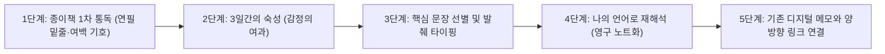

서재 한쪽 벽면을 채운 책장 앞을 서성이다가 아무 책이나 한 권 뽑아 펼쳐본다. 몇 해 전 어느 여름날, 연필로 꾹꾹 눌러 그어놓은 밑줄과 여백에 비뚤비뚤하게 적어둔 짧은 감상이 눈에 들어온다. 종이책 특유의 묵직한 물성과 종이 냄새, 그리고 책장을 넘길 때 손끝에 전해지는 사각거리는 촉감은 독서가 단순한 텍스트 소비가 아니라 하나의 신체적 경험임을 일깨워준다. 하지만 동시에 이런 아쉬움이 고개를 든다. *‘지난달에 읽었던 그 문장이 어느 책 몇 페이지에 있었더라?’*

반면 태블릿이나 노트북으로 정리한 디지털 메모는 단 몇 초의 검색(`Ctrl+F`)만으로도 수년 전의 문장을 정확히 눈앞에 소환해 준다. 그러나 화면 위에서 타이핑으로 옮겨 적은 문장들은 어쩐지 모두 비슷한 표정을 하고 있어서, 그 문장을 처음 만났을 때의 계절감이나 마음의 흔들림까지 오롯이 간직하기란 쉽지 않다. <mark>오랜 시행착오 끝에 나는 종이책의 감각적 몰입과 디지털 노트의 연결성을 결합한 ‘하이브리드 독서 시스템’에 정착하게 되었다.</mark>


> "책을 읽는다는 것은 타인의 생각으로 내 영혼의 지도를 다시 그리는 일이며, 메모는 그 지도 위에 남기는 나만의 등고선이다."
> — 발터 벤야민의 독서 노트에 관한 단상에서 착안[^1]

---

## 1. 아날로그의 물성과 디지털의 검색성 사이에서

### 1.1 종이책 밑줄이 가진 대체 불가능한 공간 기억

인지심리학 연구에 따르면 인간은 종이책을 읽을 때 텍스트의 내용뿐만 아니라 그 문장이 책의 어느 위치(왼쪽 페이지 상단인지, 오른쪽 페이지 하단인지)에 있었고, 남은 페이지의 두께가 어떠했는지를 ‘공간적 지도’처럼 함께 기억한다[^2]. 연필심을 종이 위에 마찰시키며 밑줄을 긋는 행위는 읽기의 속도를 의도적으로 늦추고, 저자의 문장과 내 생각이 마주치는 지점에 물리적인 닻을 내리는 일이다.

~~한때는 책을 깨끗하게 보아야 한다는 강박 때문에 포스트잇만 붙이거나 전자책 하이라이트 기능에만 의존했던 적도 있었다.~~ 하지만 깨끗하게 보존된 책은 시간이 흐른 뒤 다시 펼쳤을 때 내가 그 책을 통과하며 겪었던 사유의 흔적을 전혀 보여주지 못했다. 책의 여백(Margin)은 독자가 저자와 대화를 나누기 위해 비워둔 가장 사적인 광장이다.

> [!NOTE]
> 종이책에 직접 흔적을 남길 때는 형광펜보다 **심지가 부드러운 2B 연필이나 색연필**을 추천합니다. 뒷장으로 잉크가 배어 나오지 않을 뿐 아니라, 시간이 지난 뒤 다시 읽으며 생각이 바뀌었을 때 기존 밑줄 옆에 다른 농도로 새로운 흔적을 덧입히기 좋습니다.

### 1.2 디지털 아카이브가 해결해 주는 기억의 휘발성

아무리 밑줄을 정성껏 그어두어도, 책이 덮여 책장에 꽂히는 순간 그 문장들은 고립된 섬이 된다. 서로 다른 시기에 읽은 인문학 서적과 소설, 에세이의 문장들이 내 안에서 화학 반응을 일으키려면 그것들이 한자리에 모여 서로 부딪힐 수 있는 ‘평평한 작업대’가 필요하다. 그것이 바로 디지털 노트가 수행하는 역할이다.

종이책이 사유의 깊이를 파 내려가는 ‘수직적 도구’라면, 디지털 메모 앱은 서로 다른 책에서 길어 올린 생각들을 가로로 엮어내는 ‘수평적 그물망’이다. 이 두 가지 도구가 각자의 자리에서 제 역할을 다할 때 독서는 비로소 완결된 주기를 갖게 된다.



---

## 2. 세 가지 기호로 읽고 두 번 걸러내는 독서 파이프라인

### 2.1 책의 흐름을 끊지 않는 여백 기호학

책을 읽는 도중에 스마트폰이나 노트북을 켜고 문장을 받아 적기 시작하면, 독서의 몰입도는 순식간에 깨지고 만다. 그래서 나는 책을 읽는 동안에는 오직 연필 한 자루만 들고 페이지 여백에 세 가지 기호만 남긴다.

1. **직선 밑줄 (`___`)**: 저자의 핵심 논지나 문장 자체가 아름다워 간직하고 싶은 구절에 긋는다.
2. **물결 밑줄 (`~~~`)**: 직관적으로 와닿지는 않지만 곱씹어볼 필요가 있거나, 저자의 생각에 반론이 떠오르는 구절에 표시한다.
3. **별표와 모서리 접기 (`★` + Dog-ear)**: 책 전체를 통틀어 내 삶이나 글쓰기에 직접적인 영감을 준 결정적 페이지의 오른쪽 아래 모서리를 작게 접어둔다.

이렇게 최소한의 기호만으로 1차 독서를 마치면, 독서 특유의 리듬감과 서사적 즐거움을 해치지 않으면서도 나중에 다시 돌아올 표지판을 선명하게 남겨둘 수 있다.

### 2.2 독서 매체 및 기록 방식별 장단점 비교

내가 지난 수년간 시도해 본 다양한 독서 기록 방식의 특성을 비교해 보면 왜 하이브리드 방식이 가장 지속 가능했는지 명확해진다.

| 기록 방식 | 독서 몰입도 | 사유의 깊이 | 사후 검색 및 활용성 | 지속 가능성 (피로도) |
| :--- | :--- | :--- | :--- | :--- |
| **종이책 밑줄만 긋기** | 매우 높음 | 보통 (순간적 감상에 그침) | 매우 낮음 (다시 찾기 어려움) | 매우 높음 (부담 없음) |
| **전자책 하이라이트** | 보통 | 낮음 (기계적 밑줄 남발 위험) | 높음 (텍스트 내보내기 용이) | 높음 |
| **필사 노트에 손글씨** | 높음 | 매우 높음 (느린 속도의 음미) | 낮음 (키워드 검색 불가) | 낮음 (손목 피로 및 시간 소요) |
| **전용 독서 카드 작성** | 높음 | 높음 (요약 및 발췌 훈련) | 보통 (물리적 색인함 관리 필요) | 보통 (카드 분실 및 보관 부담) |
| **종이책 선별 + 디지털 노트** | **매우 높음** | **매우 높음 (2차 재가공 과정)** | **최상 (태그 및 링크 네트워크)** | **높음 (핵심만 추려 기록)** |

---

## 3. 밑줄을 ‘내 생각’으로 번역하는 디지털 메모의 기술

### 3.1 모든 밑줄을 옮겨 적지 않는다는 원칙

책을 다 읽자마자 곧바로 노트를 정리하지 않는다. 최소 사흘 정도 책을 책상 한쪽에 두고 묵혀둔다. 사흘이 지난 뒤 모서리를 접어둔 페이지를 다시 펼쳤을 때, 처음 읽을 때는 대단해 보였으나 감흥이 식어버린 문장들은 과감히 버린다. <mark>오직 시간이 지난 뒤에도 여전히 내 마음을 두드리는 문장 다섯 개 내외만 디지털 노트로 옮길 자격을 얻는다.</mark>

이때 가장 중요한 규칙은 **‘인용문 하나당 반드시 내 생각 세 문장 이상을 덧붙인다’**는 것이다. 저자의 문장을 그대로 복사해 붙여넣는 것은 수집이지 독서가 아니다. 키보드의 <kbd>Tab</kbd> 키나 인용 기호(`>`)로 저자의 말을 가두어 두고, 그 아래에 왜 이 문장에 밑줄을 그었는지, 내 삶의 어떤 경험과 연결되는지를 내 언어로 번역해야 비로소 그 지식은 내 것이 된다.

```markdown title="reading-note-template.md"
---
bookTitle: "고독의 즐거움"
author: "메이 사튼"
finishedDate: 2026-10-28
tags: ["고독", "에세이", "일상철학", "글쓰기"]
---

## 1. 한 줄 요약 (나의 언어로 정의하기)
타인과의 관계에서 오는 피로를 씻어내고 진짜 나 자신과 대면하기 위해 필요한 '자발적 고립'의 가치에 관한 기록.

## 2. 남기고 싶은 문장과 나의 사유
> "외로움은 타인이 없어서 생기는 빈곤함이지만, 고독은 자기 자신으로 충만한 풍요로움이다." (p. 64)

- **나의 단상**: 그동안 나는 혼자 있는 시간을 단순히 '약속이 없는 빈 시간'으로 여겼던 것은 아닐까. 저녁 산책에서 스마트폰을 끄고 걸을 때 느꼈던 그 충만함이 바로 사튼이 말한 고독의 본질과 닿아 있다.
- **연결 노트**: [[산책할 때 스마트폰을 집에 두고 나가기 시작했다]]
```

> [!TIP]
> 디지털 독서 노트를 작성할 때 책의 목차 순서대로 요약하려 하지 마세요. 백과사전식 요약은 나중에 절대 다시 읽지 않게 됩니다. 나를 가장 강하게 흔든 **단 하나의 질문이나 주제어**를 중심으로 노트를 쪼개어 저장하는 것이 글감으로 활용하기에 훨씬 유리합니다.

---

## 4. 제텔카스텐(Zettelkasten)을 일상 독서에 맞게 덜어내기

### 4.1 복잡한 분류법보다 ‘우연한 마주침’을 설계하기

한때 독일의 사회학자 니클라스 루만이 고안한 ‘제텔카스텐(메모 상자)’ 방식에 빠져 모든 노트에 복잡한 고유 번호를 붙이고 엄격한 계층 구조를 만들려 애썼던 적이 있다. 하지만 시스템이 복잡해질수록 노트를 쓰는 즐거움보다 분류 규칙을 지키는 피로감이 더 커졌다.

그래서 나는 복잡한 폴더 구조를 과감히 없애고, 오직 **세 개 이하의 주제 태그(`#고독`, `#글쓰기`, `#습관`)**와 노트 하단의 **관련 노트 링크**만 남겼다. 완벽한 도서관 사서가 되려는 욕심을 버리자, 오히려 몇 달 전에 적어둔 문학 소설의 밑줄과 어제 읽은 뇌과학 책의 메모가 자연스럽게 한 화면에서 마주치는 즐거움이 살아났다.

```text title="note-linking-example.txt"
[노트 간 연결 고리가 새로운 에세이 주제로 확장되는 과정]

1. 노트 A (메이 사튼, 『고독의 즐거움』): "고독은 자기 자신으로 충만한 시간이다."
   ↓ (공통 키워드: #자발적고립 #집중)
2. 노트 B (레이 올든버그, 『제3의 장소』): "적당한 타인의 존재가 오히려 개인의 내밀한 몰입을 돕는다."
   ↓ (질문 발생: 완전한 골방보다 단골 카페에서 더 고독을 잘 누리는 이유는 무엇일까?)
3. 새로운 에세이 탄생: "단골 카페의 조건: 적당한 소음과 무심한 친절의 미학"
```

---

## 5. 한 권의 책을 온전히 소화하기 위한 체크리스트

책을 덮는 순간부터 디지털 노트에 한 편의 짧은 단상이 완성되기까지의 과정을 루틴으로 정착시키기 위해 내가 활용하는 점검표다.

- [x] 책을 읽는 도중에는 스마트폰이나 사전을 찾지 않고 문맥으로 흐름 따라가기
- [x] 여백에 밑줄을 그을 때 짧은 핵심 키워드나 질문 한 줄을 연필로 메모하기
- [x] 완독 후 최소 3일간 책을 덮어두고 자연스럽게 기억에 남는 잔상 확인하기
- [x] 접어둔 페이지 중 가장 울림이 큰 구절 3~5개만 엄선하여 마크다운 노트에 타이핑하기
- [x] 발췌한 문장 아래에 반드시 나의 경험이나 반론을 세 문장 이상 덧붙이기
- [ ] 이전에 작성한 다른 책의 독서 노트와 최소 1개 이상의 연결 고리(내부 링크) 만들기

<details>
<summary>덧붙이는 짧은 노트: 중고 서점에 책을 팔지 못하는 이유</summary>

여백마다 내 연필 글씨가 빼곡히 적힌 책들은 결국 중고 서점에 내놓을 수 없다. 누군가는 책의 가치를 보존하기 위해 깨끗이 읽어야 한다고 말하지만, 나에게 책값이란 종이 묶음을 산 비용이 아니라 그 여백에 내 사유를 기입할 권리를 산 비용에 가깝다. 몇 년 뒤 우연히 펼친 페이지 귀퉁이에서 조금은 치기 어리고 진지했던 예전의 내 필체를 마주하는 순간은, 그 어떤 새 책도 줄 수 없는 묘한 위안을 건넨다.
</details>

---

## 6. 책장과 노트 사이에서 자라나는 나만의 문장들

### 6.1 수집가에서 생산자로 넘어가는 임계점

종이책의 밑줄이 씨앗이라면, 디지털 메모장에 옮겨 적어 내려간 단상들은 그 씨앗이 싹을 틔우는 온실과 같다. 처음에는 그저 남의 좋은 문장을 베껴 적고 짧은 감상을 덧붙이는 수준에서 시작했지만, 이런 노트가 백 개, 이백 개 쌓이자 놀라운 일이 벌어졌다. 서로 다른 저자들이 쓴 문장들이 내 메모장 안에서 대화를 나누기 시작한 것이다.

다독(多讀)의 함정은 읽은 책의 권수만 늘어나고 정작 내 생각의 근육은 자라지 않는 데 있다. 열 권의 책을 아무런 흔적 없이 스쳐 지나가듯 읽는 것보다, 단 한 권의 책이라도 연필로 밑줄을 긋고 사흘을 묵힌 뒤 내 언어로 다시 옮겨 적는 과정이 우리를 훨씬 더 깊은 사유로 안내한다.

> [!IMPORTANT]
> 독서법의 완성은 결국 **‘나만의 한 단락을 쓰는 것’**에 있습니다. 아무리 정교한 디지털 노트 시스템을 갖추더라도, 그것이 내 삶의 태도를 바꾸거나 나만의 문장으로 이어지지 않는다면 지식의 박물관에 불과합니다.

오늘 밤에도 책상 위에는 연필 한 자루와 읽다만 종이책이 놓여 있고, 그 옆에는 닫혀 있는 노트북이 있다. 먼저 스탠드 불빛 아래에서 종이의 결을 느끼며 밑줄을 긋는 고요한 시간을 충분히 누릴 생각이다. 그리고 며칠 뒤, 그 밑줄들이 내 안에서 충분히 발효되었을 때 비로소 노트북을 열어 나만의 새로운 문장을 이어 써 내려갈 것이다.

[^1]: 발터 벤야민은 『일방통행로』와 수많은 독서 아카이브에서 텍스트를 필사하고 발췌하는 행위가 단순한 복제를 넘어 텍스트의 심층을 걸어 통과하는 행위임을 강조했다.
[^2]: 노르웨이 스타방에르 대학의 안 마그레테 망엔(Anne Mangen) 교수의 연구에 따르면, 종이책 독자는 책의 물리적 두께와 페이지 위치를 통해 서사 구조와 시공간적 순서를 전자책 독자보다 더 입체적으로 재구성한다.
