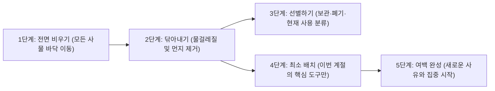

아침저녁으로 창문을 통해 들어오는 바람의 온도가 달라지고, 반소매 티셔츠 위로 얇은 가디건을 걸치게 되는 계절의 길목마다 내가 어김없이 치르는 작은 의식이 있다. 바로 주말 오전 내내 창문을 활짝 열어젖히고 책상 위에 놓인 모든 물건을 바닥으로 내려놓는 일이다. 삼 개월이라는 한 계절을 통과하는 동안 책상 귀퉁이에는 내가 무엇에 골몰했고 무엇에 쫓기며 살았는지를 보여주는 흔적들이 지층처럼 쌓여 있다.

다 읽지 못한 채 책갈피가 꽂혀 있는 책 서너 권, 언젠가 다시 보겠다며 출력해 둔 A4 용지 뭉치, 영수증과 메모지 조각들, 그리고 잉크가 반쯤 마른 펜들까지. 그것들을 전부 걷어내고 마른걸레에 따뜻한 물을 적셔 나무 상판을 길게 닦아내다 보면, 묘하게도 복잡하게 엉켜 있던 내 머릿속의 표면을 함께 닦아내고 있는 듯한 기분이 든다. <mark>책상이란 결국 내 정신의 모양이 물리적 공간으로 투사된 가장 정직한 거울이기 때문이다.</mark>

> "우리 주변의 사물들을 정돈하는 행위는 단순한 가사 노동이 아니라, 지나간 시간과 화해하고 다가올 시간의 자리를 마련하는 내면의 정화 의식이다."
> — 도미니크 로로, 『심플하게 산다』 중에서[^1]

---

## 1. 책상 위의 풍경은 내 머릿속의 현재 상태를 보여준다

### 1.1 시각적 혼잡도가 인지 에너지를 갉아먹는 방식

글이 잘 써지지 않거나 해야 할 일을 앞두고 자꾸만 딴짓을 하게 되는 날에는 어김없이 책상 위가 어수선하다. 사람의 눈은 생각보다 훨씬 성실해서, 내가 모니터 화면만 보려고 애써도 시야 가장자리(Peripheral Vision)에 걸리는 영수증 조각이나 읽다만 책의 표지 글씨를 무의식중에 계속해서 읽어내고 처리한다.

신경과학 연구에 따르면 시야 안에 정리되지 않은 사물들이 많이 놓여 있을수록 뇌의 시각 피질은 불필요한 정보 필터링에 에너지를 소모하며, 이는 곧 작업 기억(Working Memory)의 저하와 만성적인 피로로 이어진다[^2]. ~~예전에는 책상 위에 서류와 책이 잔뜩 쌓여 있는 모습을 보며 치열하게 일하고 있는 증거라고 스스로를 위안하곤 했다.~~ 하지만 그것은 열정의 증거가 아니라, 결정을 미루고 방치해 둔 미완의 과제들이 내 주의를 계속해서 붙잡고 늘어지는 풍경에 가까웠다.

> [!NOTE]
> 프린스턴 대학교 신경과학 연구소의 실험 결과, 정돈된 책상 환경에서 작업할 때 뇌의 전두엽이 목표 과제에 집중하는 지속 시간이 어수선한 환경에 비해 평균 **30% 이상 향상**되는 것으로 나타났습니다.

### 1.2 계절맞이 책상 정리가 생각의 전환으로 이어지는 흐름

한 계절의 묵은 흔적을 걷어내고 새로운 계절의 작업대를 세팅하는 다섯 단계의 과정이다.



---

## 2. 사물의 자리를 다시 정하는 ‘거리의 경제학’

### 2.1 팔을 뻗어 닿는 거리에는 ‘오늘의 물건’만 둔다

책상 위를 완전히 비우고 나뭇결이 드러난 빈 상판을 마주하면, 이제 어떤 물건에게 다시 이 자리로 올라올 자격을 줄 것인가를 엄격하게 심사하게 된다. 내가 정한 가장 단순하고 강력한 원칙은 **‘사용 빈도에 비례해 나와의 물리적 거리를 배치한다’**는 것이다.

마치 컴퓨터에서 당장 쓰지 않는 백그라운드 프로그램을 작업 관리자(<kbd>Ctrl+Shift+Esc</kbd>)로 종료시켜 메모리를 확보하듯, 매일 손이 가지 않는 물건들은 과감하게 책상 상판에서 서랍 속으로, 혹은 책장 깊은 곳으로 이동시킨다.

### 2.2 사용 빈도와 거리에 따른 책상 구역 설계표

계절이 바뀔 때마다 내가 책상과 주변 수납공간을 재구성하는 기준을 표로 정리해 보았다.

| 구역 구분 | 나와의 물리적 거리 | 사용 빈도 기준 | 배치하는 사물 목록 | 관리 원칙 |
| :--- | :--- | :--- | :--- | :--- |
| **Zone 0 (핵심 작업면)** | 눈앞 정면 (30cm 이내) | 매시간 사용 | 노트북/모니터, 키보드, 현재 읽는 책 1권 | 작업 종료 시 완전히 비워둘 것 |
| **Zone 1 (상판 가장자리)** | 팔을 뻗어 닿는 거리 (50cm) | 하루 1회 이상 | 만년필 1자루, 무지 노트, 스탠드 조명, 물컵 | 최대 5개 이하의 사물만 허용 |
| **Zone 2 (책상 1단 서랍)** | 의자에 앉아 여는 거리 | 주 2~3회 사용 | 여분의 필기구, 포스트잇, 충전 케이블, 안경닦이 | 칸막이 트레이로 섞이지 않게 분리 |
| **Zone 3 (책장 및 보관함)** | 자리에서 일어나야 닿는 거리 | 월 1회 이하 | 지난 계절의 노트, 참고 도서, 영수증 철, 소모품 | 계절마다 불필요한 문서 폐기 |
| **폐기 및 방출 구역** | 작업 공간 외부 | 지난 3개월간 미사용 | 다 쓴 볼펜, 철 지난 인쇄물, 중복된 문구류 | 미련 없이 분리수거 또는 나눔 |

---

## 3. 계절의 온도를 책상 위에 들이는 작은 변화들

### 3.1 여름의 유리컵을 넣으며 가을의 도자기 머그를 꺼내는 일

책상 정리는 단순히 불필요한 쓰레기를 버리는 효율성의 작업에 그치지 않는다. 그것은 다가오는 계절의 빛과 공기를 내 가장 가까운 일상 속으로 초대하는 다정한 환대의 의식이기도 하다.

1. **촉감과 재질의 교체**: 여름내 차가운 얼음물을 담아 마시던 투명한 유리컵과 금속 코스터를 설거지해 찬장에 넣고, 두 손으로 감싸 쥐었을 때 온기가 오래 남는 두툼한 도자기 머그잔과 패브릭 티코스터를 꺼내 놓는다.
2. **조명의 색온도 조절**: 해가 짧아지는 가을과 겨울에는 스탠드 조명의 각도를 조금 낮추고 전구색(3000K)의 따뜻한 불빛이 나무 상판 위에 은은하게 번지도록 위치를 조정한다.
3. **이번 계절의 책 세 권 고르기**: 책장 전체에서 올가을에 꼭 정독하고 싶은 책 딱 세 권만 골라 책상 왼쪽 끝에 나란히 세워둔다. 수백 권의 책이 꽂힌 책장보다 눈앞에 선별된 세 권의 책이 나를 훨씬 더 자주 독서로 이끈다.

```yaml title="autumn-desk-inventory.yaml"
season: "2026 Autumn (October - December)"
desk_surface_items:
  center:
    - "14인치 노트북 (작업 후 덮어두기)"
    - "B5 만년필용 무지 노트 1권"
  right_side:
    - "다크 브라운 가죽 펜 트레이 (만년필 1, 2B 연필 1, 지우개 1)"
    - "크림색 도자기 머그잔과 원목 코스터"
  left_side:
    - "황동 스탠드 조명 (전구색 LED)"
    - "이번 계절의 책 3권 (산문집 2, 역사서 1)"
removed_to_drawer:
  - "여름용 미니 선풍기"
  - "지난 분기 프로젝트 인쇄물 묶음"
  - "손이 자주 가지 않던 컬러 형광펜 세트"
```

> [!TIP]
> 책상 정리가 막막할 때는 ‘버릴 물건’을 고르지 말고, 일단 책상 위의 모든 물건을 바닥에 내려놓은 뒤 **‘오늘 당장 내 책상 위에 다시 올려놓고 싶은 가장 소중한 물건 다섯 개’**만 먼저 골라 올려보세요. 나머지 물건들이 정말로 상판 위에 있어야 하는지 단번에 판별할 수 있습니다.

---

## 4. 물리적 책상에서 디지털 바탕화면으로 이어지는 청소

### 4.1 나무 상판을 닦은 뒤에는 모니터 속 폴더도 비운다

물리적인 책상 위를 아무리 깨끗하게 닦아놓아도, 노트북 화면을 열었을 때 바탕화면에 수십 개의 스크린샷 파일과 `새 폴더 (2)` 같은 아이콘들이 어지럽게 널려 있으면 정돈의 감각은 반감되고 만다. 그래서 나는 계절맞이 책상 정리의 마지막 십오 분을 언제나 ‘디지털 작업대 청소’에 할애한다.

지난 계절 동안 다운로드 폴더에 쌓인 임시 파일들을 비우고, 바탕화면에는 오직 현재 진행 중인 글쓰기 폴더 하나만 남겨둔다. 그리고 계절의 빛깔에 어울리는 차분한 단색 배경화면으로 교체하면, 비로소 눈앞의 공간과 화면 너머의 공간이 하나의 호흡으로 정갈하게 정렬된다.

```text title="digital-desk-reset.txt"
[환절기 디지털 작업대 15분 정리 루틴]

1. 바탕화면(Desktop)의 모든 파일들을 '2026-Q3-Archive' 폴더 하나로 모아 문서함에 이동
2. 다운로드(Downloads) 폴더에서 설치 파일(.exe, .dmg) 및 일회성 이미지 일괄 삭제
3. 웹 브라우저에 열어둔 채 방치된 탭 20여 개 중 꼭 읽을 3개만 북마크하고 모두 닫기
4. 눈이 편안한 낮은 채도의 가을 풍경이나 무채색 질감으로 배경화면 변경
```

---

## 5. 환절기 책상 리셋(Reset)을 위한 실천 체크리스트

계절이 바뀌는 주말 오전, 한 시간 남짓 투자해 작업 공간의 호흡을 되찾는 점검표다.

- [x] 책상 위의 모든 물건을 하나도 남김없이 바닥으로 내려놓고 물걸레로 상판 닦기
- [x] 모니터 뒷면과 전선 주변에 쌓인 묵은 먼지를 털어내고 케이블 타이로 선 정리하기
- [x] 펜꽂이에 꽂힌 모든 필기구를 종이에 그어보고 나오지 않거나 안 쓰는 펜 정리하기
- [x] 지난 계절 동안 쌓인 종이 영수증과 메모지 중 필요한 내용만 디지털 노트에 옮기고 파기하기
- [x] 노트북 바탕화면과 다운로드 폴더의 불필요한 임시 파일 비우기
- [ ] 다가오는 계절의 분위기에 어울리는 작은 엽서 한 장이나 찻잔 하나로 포인트 주기

<details>
<summary>덧붙이는 짧은 에피소드: 서랍 구석에서 발견한 작년 가을의 쪽지</summary>

이번 가을 책상 서랍을 비우다가 맨 안쪽 귀퉁이에 끼어 있던 작은 노란색 포스트잇 한 장을 발견했다. 정확히 일 년 전인 작년 10월에 내가 급하게 갈겨쓴 메모였는데, 거기에는 당시 겪고 있던 일의 막막함과 함께 *‘내년 이맘때쯤이면 이 고민도 아무것도 아닌 일이 되어 있겠지’*라는 문장이 적혀 있었다. 그 쪽지를 읽는 순간 나도 모르게 피식 웃음이 났다. 정말로 일 년 전 나를 밤잠 못 이루게 했던 그 문제는 이미 오래전에 해결되어 기억조차 가물가물해져 있었기 때문이다. 책상을 정리한다는 것은 이처럼 내가 무사히 건너온 시간의 증거들을 확인하며 오늘의 나를 안심시키는 일이기도 하다.
</details>

---

## 6. 비워진 나무 상판 위에서 시작될 새로운 문장들

### 6.1 매일 밤 ‘초기화된 책상’을 마주하는 기쁨

계절맞이 대청소로 한 번 책상의 기준을 바로잡아 두면, 그다음부터는 매일 밤 잠들기 전 단 오 분의 정리만으로도 그 여백을 유지할 수 있다. 다 마신 찻잔을 싱크대에 가져다 놓고, 펼쳐두었던 노트를 덮어 제자리에 맞추고, 만년필 뚜껑을 닫아 펜 트레이에 올려놓는 짧은 동작. 그것은 오늘 하루의 일과가 무사히 끝났음을 나 자신에게 알리는 퇴근 타종과도 같다.

> [!IMPORTANT]
> 다음 날 아침 눈을 비비며 방문을 열었을 때, **어제의 피로가 어지럽게 널려 있는 책상이 아니라 나를 기다리는 깨끗하고 단정한 빈 나무 상판**을 마주하는 것만으로도 하루를 시작하는 마음의 품격이 달라집니다.

선선한 가을바람이 열린 창문 틈으로 불어와 아무것도 놓이지 않은 책상 위를 기분 좋게 스쳐 지나간다. 이제 막 닦아낸 단정한 여백 위에 따뜻한 차 한 잔을 올려두고, 올가을의 첫 번째 문장을 천천히 써 내려갈 준비가 끝났다.

[^1]: 프랑스 출신의 수필가 도미니크 로로(Dominique Loreau)는 동양의 선(Zen) 미학과 서구의 실용주의를 결합해, 소유물을 줄이고 공간을 정돈하는 것이 곧 정신의 자유로 직결됨을 설파했다.
[^2]: 프린스턴 대학교 사비네 카스트너(Sabine Kastner) 교수 연구팀이 2011년 신경과학 저널(Journal of Neuroscience)에 발표한 논문 *"Interactions of Top-Down and Bottom-Up Mechanisms in Human Visual Cortex"*를 참조함.
