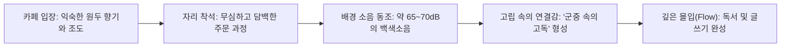

누구에게나 집도 아니고 일터도 아니지만, 마음이 복잡하거나 글이 풀리지 않을 때 습관처럼 발길이 향하는 ‘제3의 공간’이 하나쯤 있기 마련이다. 나에게 그곳은 동네 은행나무 가로수길 끝자락, 일층 세탁소 옆 계단을 반쯤 올라가면 나오는 작은 로스터리 카페다. 화려한 간판도 없고, 소셜 미디어에서 유행하는 사진 촬영용 디저트도 팔지 않지만, 주말 오후면 각자의 책과 노트북을 펼친 동네 사람들이 소리 없이 자리를 채우는 곳이다.

나는 왜 수많은 신상 카페들을 두고 굳이 그 낡은 나무 테이블이 있는 곳으로만 돌아가게 될까? 어느 비 오는 토요일 오후, 창가 자리에 앉아 커피 잔 위로 피어오르는 김을 바라보며 내가 사랑하는 단골 카페들이 가진 보이지 않는 공통점들을 하나씩 헤아려 보았다. <mark>오래 머물고 싶은 공간의 비밀은 화려한 인테리어가 아니라, 인간을 긴장시키지 않는 ‘적당한 백색소음’과 서로의 고독을 침범하지 않는 ‘무심한 친절’에 있었다.</mark>

> "진정한 환대란 손님에게 끊임없이 말을 걸고 관심을 쏟는 것이 아니라, 그 사람이 공간의 일부처럼 자연스럽게 스며들어 자기 자신으로 존재할 수 있도록 내버려 두는 기술이다."
> — 레이 올든버그의 『제3의 장소(The Great Good Place)』 개념에서 확장[^1]

---

## 1. 완전한 침묵보다 우리를 집중하게 만드는 ‘70데시벨의 마법’

### 1.1 도서관의 정적이 주는 역설적인 긴장감

글을 쓰거나 책을 깊이 읽어야 할 때 역설적이게도 나는 독서실이나 도서관처럼 완벽한 정적이 흐르는 공간에서는 좀처럼 집중하지 못한다. 숨소리조차 조심해야 하는 고요 속에서는 책장을 넘기는 작은 마찰음이나 키보드를 두드리는 소리조차 타인에게 방해가 될까 봐 온 신경이 곤두서기 때문이다. 외부의 소리가 완전히 사라지면 오히려 내 머릿속의 잡념이 확성기를 켠 것처럼 크게 울려 퍼진다.

반면 단골 카페에는 언제나 적당한 온도의 소음이 공기처럼 떠다닌다. 에스프레소 머신이 증기를 뿜어내는 치익거리는 소리, 원두 그라인더가 돌아가는 묵직한 저음, 잔과 받침이 부딪히는 맑은 도자기 소리, 그리고 무슨 내용인지 정확히 들리지 않을 만큼 적당히 뭉개진 옆 테이블의 낮은 대화 소리까지. ~~너무 시끄러워 귀가 아픈 대형 프랜차이즈 매장이나 너무 조용해 눈치가 보이는 공간 사이에서~~ 이 미묘한 균형을 지키는 곳을 찾기란 생각보다 쉽지 않다.

> [!NOTE]
> 일리노이 대학교 라비 메타(Ravi Mehta) 연구팀의 실험에 따르면, 약 **70데시벨(dB)** 수준의 적당한 카페 배경 소음은 뇌의 추상적 사고를 자극하여 완전한 정적(50dB 이하)이나 과도한 소음(85dB 이상)보다 창의적 문제 해결 능력을 가장 크게 높여줍니다[^2].

### 1.2 카페의 물리적·정서적 요소가 몰입으로 이어지는 과정

내가 단골 카페의 문을 열고 들어가 한 편의 글을 완성하고 나오기까지의 감각적 흐름을 정리해 보았다.



---

## 2. 공간의 소음과 환경에 따른 집중도 비교

### 2.1 소리와 의자, 조도가 만드는 보이지 않는 건축

좋은 단골 카페는 눈으로 보는 공간이 아니라 몸으로 겪는 공간이다. 천장에 매달린 조명이 눈에 직접 닿아 눈부시지 않은지, 테이블의 높이와 의자의 좌판 각도가 두 시간쯤 책을 읽기에 적당한지, 흘러나오는 음악에 가사가 너무 또렷하게 박혀 있어 읽던 문장을 방해하지는 않는지가 모두 중요하다.

내가 작업을 시도해 본 다섯 가지 공간 유형별로 소음도와 몰입의 질을 비교해 보았다.

| 공간 유형 | 평균 소음도 | 주요 청각 자극 | 타인과의 거리감 | 독서 및 글쓰기 몰입도 |
| :--- | :--- | :--- | :--- | :--- |
| **집 (내 방 책상)** | 35~45 dB | 시계 초침 소리, 냉장고 소음 | 완전한 고립 (나태해지기 쉬움) | 보통 (침대의 유혹과 주의 분산) |
| **열람실 / 도서관** | 40~50 dB | 기침 소리, 종이 넘기는 소리 | 과도한 의식 (소음 발생 경계) | 낮음~보통 (심리적 경직 발생) |
| **동네 단골 로스터리** | **65~70 dB** | **그라인더 소리, 잔잔한 연주곡** | **느슨한 연대감 (군중 속 고독)** | **최상 (편안한 이완과 집중의 조화)** |
| **SNS 핫플레이스 카페** | 75~85 dB | 카메라 셔터음, 높은 톤의 대화 | 구경꾼과 피사체의 긴장 관계 | 매우 낮음 (시각·청각 피로 극심) |
| **대형 번화가 카페** | 80~90 dB | 호출벨 소리, 유행가 가사, 소음 | 익명성은 높으나 산만함 | 낮음 (단기 작업 외 집중 불가) |

---

## 3. ‘무심한 친절’이라는 가장 세련된 거리감

### 3.1 아는 체하되 캐묻지 않는 주인의 태도

단골이 된다는 것의 가장 큰 딜레마는 주인과의 거리가 너무 가까워질 때 발생한다. 내가 문을 열고 들어설 때마다 반갑게 안부를 묻고, 무슨 일을 하는지, 요즘은 왜 자주 안 보였는지를 시시콜콜 물어오기 시작하면, 역설적이게도 나는 그 카페에 갈 때마다 ‘인사를 나누고 스몰토크를 해야 할 에너지’를 미리 계산하게 된다. 컨디션이 좋지 않거나 아무 말도 하고 싶지 않은 날에는 결국 그 카페 앞을 지나쳐 다른 곳으로 발길을 돌리게 되는 것이다.

내가 지난 삼 년째 다니고 있는 이 동네 카페의 사장님은 그 미묘한 경계를 누구보다 정확히 알고 계신다. 문을 열고 들어가면 눈인사와 함께 가볍게 고개만 한 번 끄덕여 주실 뿐, 불필요한 사담을 건네지 않는다. 하지만 내가 말없이 “따뜻한 드립 커피 한 잔이요”라고 말하면, 내가 산미 없는 묵직한 원두를 좋아한다는 것과 머그잔에 물을 조금 더 타서 연하게 마신다는 것을 기억해 두었다가 소리 없이 내어주신다.

1. **사생활을 침범하지 않는 배려**: 손님이 혼자 생각에 잠겨 있을 때 그 침묵의 막을 깨뜨리지 않는 사려 깊음.
2. **기억을 통한 무언의 환대**: 말로 친밀함을 과시하는 대신, 손님의 작은 취향(원두 종류, 얼음 양, 선호하는 자리)을 조용히 맞춰주는 세심함.
3. **시간을 재촉하지 않는 공기**: 빈 잔을 성급하게 치우러 오지 않고, 해가 질 무렵이면 말없이 테이블 위의 작은 캔들 조명을 켜주고 가는 온기.

```yaml title="my-favorite-cafe-spec.yaml"
cafe_profile:
  location: "동네 가로수길 끝 2층 (창문 너머로 플라타너스 잎이 보이는 자리)"
  acoustics:
    bgm: "보컬이 없는 빌 에반스(Bill Evans) 피아노 트리오 또는 바흐 첼로 모음곡"
    decibel: "68dB 내외의 규칙적인 에스프레소 추출음"
  furniture:
    table_height: "72cm (노트북 타이핑과 종이책 필기에 가장 편안한 높이)"
    lighting: "3000K 색온도의 눈부심 없는 간접 조명"
  hospitality_rule: "가벼운 목례, 취향의 기억, 그리고 완벽한 무관심의 조화"
```

> [!TIP]
> 새로운 동네에서 나만의 단골 카페를 찾고 싶다면, 화려한 주말 오후 대신 **화요일이나 수요일 오후 두 시쯤** 방문해 보세요. 그 시간대에 사장님이 어떤 음악을 틀어놓는지, 그리고 혼자 온 손님들이 어떤 표정으로 앉아 있는지를 보면 그 공간의 진짜 성격을 단번에 알 수 있습니다.

---

## 4. 시간대별로 변하는 카페의 표정과 작업 리듬

### 4.1 오전 열한 시의 햇살과 오후 다섯 시의 스탠드 불빛

같은 카페라도 방문하는 시간대에 따라 공기의 밀도와 그곳에서 잘되는 작업의 종류가 미묘하게 달라진다. 오픈 직후인 오전 열한 시에는 갓 로스팅한 원두의 고소하고 쌉싸름한 향기가 매장 가득 차올라, 논리적인 구조가 필요한 긴 글의 개요를 짜거나 어려운 인문서를 정독하기에 가장 좋다.

반면 해가 기울기 시작하는 오후 네 시부터 여섯 시 사이는 창가 자리로 긴 그림자가 드리워지고 노란색 백열전구의 온기가 살아나는 시간이다. 이때는 이성적인 분석보다 감성적인 에세이의 문장을 다듬거나 수첩에 조용히 일기를 적어 내려가기에 더할 나위 없이 훌륭한 분위기가 만들어진다.

```text title="cafe-time-slot-log.txt"
[단골 카페 시간대별 나만의 활용 노트]

- 11:00 ~ 13:00 (오전 타임): 아메리카노 1잔 + 에세이 초고 집필 (집중력 최고조)
- 14:00 ~ 16:00 (오후 타임): 핸드드립 커피 + 종이책 50페이지 밑줄 그으며 읽기
- 17:00 ~ 18:30 (해 질 녘): 따뜻한 카모마일 티 + 오늘 쓴 문장 소리 없이 퇴고하기
```

---

## 5. 좋은 단골 손님으로 오래 머물기 위한 나만의 에티켓

좋은 카페는 주인 혼자 만드는 것이 아니라, 그 공간을 아끼는 손님들의 태도가 함께 빚어내는 결과물이다. 마치 노트북을 닫기 전 <kbd>Ctrl+S</kbd>를 눌러 작업물을 안전하게 저장하듯, 나 역시 이 소중한 제3의 공간을 오래 지키기 위해 스스로 정해둔 작은 규칙들이 있다.

- [x] 손님이 몰리는 주말 피크 타임에는 노트북 작업을 삼가고 책만 읽거나 두 시간 이내에 자리 비켜주기
- [x] 두 시간 이상 머물게 될 때는 디저트나 두 번째 음료(리필 또는 차)를 자연스럽게 추가 주문하기
- [x] 카페 안에서 통화가 필요할 때는 반드시 복도나 계단 밖으로 나가서 받기
- [x] 자리를 일어설 때 흘린 빵 부스러기나 물기를 냅킨으로 깨끗이 닦고 의자 넣어두기
- [x] 혼자 방문했을 때는 4인용 큰 테이블 대신 2인용 작은 테이블이나 창가 바(Bar) 좌석에 앉기
- [ ] 계절이 바뀔 때쯤 계산대 앞에서 사장님께 “항상 커피 잘 마시고 있습니다”라고 짧은 감사 인사 건네기

<details>
<summary>덧붙이는 짧은 에피소드: 비 오는 날 건네받은 따뜻한 물 한 잔의 기억</summary>

작년 늦가을, 갑작스러운 소나기를 만나 우산도 없이 어깨가 흠뻑 젖은 채 카페 문을 열고 들어간 적이 있었다. 평소처럼 구석 자리에 앉아 따뜻한 커피를 주문했는데, 잠시 후 사장님이 커피 트레이 옆에 마른 수건 한 장과 김이 모락모락 나는 따뜻한 레몬수 한 잔을 아무 말 없이 함께 내려놓고 가셨다. “비 많이 맞으셨죠?”라는 한마디 말조차 없었지만, 그 무심한 손길이 건네는 다정함에 코끝이 찡해졌던 기억이 난다. 말하지 않아도 전해지는 마음이란 바로 그런 것이었다.
</details>

---

## 6. 군중 속의 고독이 주는 가장 따뜻한 위안

### 6.1 혼자이지만 외롭지 않은 공간의 힘

방 안에서 혼자 글을 쓸 때 찾아오는 고립감과 카페 구석 자리에서 혼자 글을 쓸 때 느끼는 고독은 그 결이 완전히 다르다. 고개를 들면 각자의 삶에 열중하고 있는 타인들의 뒷모습이 보이고, 창밖으로는 계절을 따라 흔들리는 나뭇잎이 보이며, 코끝에는 갓 볶은 원두의 고소한 향기가 머무는 곳. 그곳에서 우리는 타인과 적당한 거리를 유지한 채 가장 안전하게 세상과 연결되어 있음을 느낀다.

> [!IMPORTANT]
> 단골 카페란 단순히 커피를 사 마시는 상업 공간이 아니라, **일상의 무게를 잠시 문밖에 내려놓고 가장 나다운 속도로 호흡을 가다듬는 도시의 작은 대피소**입니다.

이번 주말에도 나는 가방에 읽다만 종이책 한 권과 만년필을 챙겨 넣고 그 계단을 오를 것이다. 가벼운 눈인사 끝에 찾아오는 구석 자리의 평화, 그리고 적당한 소음 속에서 첫 문장을 적어 내려가는 그 고요한 기쁨이 벌써부터 기다려진다.

[^1]: 미국의 사회학자 레이 올든버그(Ray Oldenburg)는 가정(제1의 장소)과 직장(제2의 장소) 외에 시민들이 격식 없이 모여 휴식과 정서적 안정을 얻는 카페·서점·공원 등을 ‘제3의 장소’로 명명했다.
[^2]: 2012년 소비자 연구 저널(Journal of Consumer Research)에 실린 논문 *"Is Noise Always Bad? Exploring the Effects of Ambient Noise on Creative Cognition"*에서 70dB의 생활 소음이 창의적 사고에 미치는 긍정적 효과가 규명되었다.
