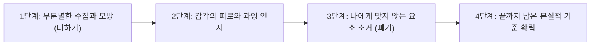

이십 대의 나는 취향이 좋은 사람이란 곧 ‘많은 것을 알고, 많은 것을 소유하며, 남들이 모르는 희귀한 것들을 줄줄이 꿰고 있는 사람’이라고 믿었다. 독립 서점에서 산 개성 강한 잡지들, 여행지마다 사 모은 화려한 엽서와 소품들, 플레이리스트에 끝없이 추가해 둔 수백 곡의 재즈와 인디 음악들까지, 내 방과 내 일상은 언제나 무언가로 가득 차 있어야만 안심이 되었다. 취향을 증명하기 위해 끊임없이 바깥에서 새로운 것들을 사들이고 덧입히는 ‘더하기의 시절’이었다.

하지만 서른을 넘기고 여러 번의 이사와 계절의 변화를 겪으며, 내 방에 끝까지 살아남은 사물들과 내 플레이리스트에서 실제로 반복 재생되는 음악들을 가만히 들여다보게 되었다. 놀랍게도 나를 가장 나답게 설명해 주는 것은 내가 욕망하며 끌어모았던 화려한 목록이 아니라, <mark>오랜 시간 동안 불편하거나 피로하다는 이유로 하나둘씩 내 삶에서 조용히 덜어낸 것들의 빈자리였다.</mark>

> "완벽함이란 더 이상 보탤 것이 없을 때가 아니라, 더 이상 뺄 것이 없을 때 완성된다."
> — 앙투안 드 생텍쥐페리, 『인간의 대지』 중에서[^1]

---

## 1. 더하기의 피로와 덜어내기의 미학

### 1.1 알고리즘이 권하는 ‘모두의 취향’에서 벗어나기

오늘날 우리는 취향조차 추천 알고리즘에 의해 자동으로 큐레이션 되는 시대에 살고 있다. 온라인 쇼핑몰을 열면 ‘당신이 좋아할 만한 아이템’이 끝없이 뜨고, 영상 플랫폼은 내가 방금 본 콘텐츠와 비슷한 자극을 쉼 없이 밀어 넣는다. 문제는 이러한 추천이 우리의 취향을 정교하게 다듬어주는 것이 아니라, 오히려 유행하는 기호의 평균치 안으로 우리를 끊임없이 편입시킨다는 점이다.

~~남들이 좋다고 말하는 핫플레이스를 찾아다니고, 유행하는 인테리어 소품을 방 안에 들일수록 역설적이게도 공간의 고유한 공기는 옅어졌다.~~ 무엇을 좋아하는지 말하기는 쉽지만, 정작 내가 **‘무엇을 견디지 못하는지’**, **‘무엇이 없어야 비로소 편안해지는지’**를 아는 일은 훨씬 더 깊은 자기 관찰을 요구한다.

백화점 쇼윈도에 진열된 화려한 오브제들을 내 방으로 그대로 옮겨놓는다고 해서 내 삶이 아름다워지는 것은 아니다. 나에게 맞지 않는 과잉된 장식들은 시간이 지날수록 시선을 어지럽히는 시각적 부채가 될 뿐이다.

> [!NOTE]
> 미학에서 말하는 **‘네거티브 스페이스(Negative Space, 여백)’**는 단순히 비어 있는 공간이 아닙니다. 그려진 대상(Positive Space)의 윤곽을 선명하게 드러내고 숨 쉴 틈을 만들어주는 가장 적극적인 조형 요소입니다. 삶의 취향 또한 이와 같습니다.

### 1.2 취향이 형성되는 네 단계의 여과 과정

취향은 하루아침에 하늘에서 떨어지는 감각이 아니라, 수많은 시행착오와 과잉을 거친 뒤에 남는 침전물에 가깝다. 처음부터 미니멀리스트로 태어나는 사람은 없다. 충분히 겪어보고, 충분히 피로해 본 사람만이 무엇을 덜어내야 할지 정확히 알 수 있다.



---

## 2. 공간과 일상에서 내가 덜어낸 것들의 목록

### 2.1 시각적 소음을 줄이자 드러난 삶의 질감

어느 주말 오후, 나는 방 안을 둘러보며 ‘예쁘지만 내 시선을 피로하게 만드는 것들’을 하나씩 상자에 담아 치워보기로 했다. 화려한 패턴이 들어간 쿠션 커버, 글씨가 어지럽게 적힌 패키지의 생활용품들, 일 년에 한 번도 입지 않으면서 ‘언젠가 어울릴 날이 오겠지’ 하고 걸어둔 옷들을 정리하자 방 안의 채도가 한 톤 낮아지면서 차분한 고요가 찾아왔다.

마치 문서 편집기에서 불필요한 서식과 장식을 모두 지우는 <kbd>Backspace</kbd> 키를 길게 누른 것처럼, 시각적 군더더기가 사라진 자리에는 나무 책상의 나뭇결, 오후 세 시에 창문 블라인드 틈으로 들어오는 햇살의 각도, 그리고 좋아하는 머그잔 하나가 가진 단정한 곡선이 비로소 주인공처럼 또렷이 떠올랐다.

### 2.2 영역별로 살펴본 ‘더하기’와 ‘빼기’의 태도 변화

내가 일상의 여러 영역에서 취향을 다듬어가며 겪은 기준의 변화를 표로 정리해 보았다.

| 삶의 영역 | 과거의 기준 (무엇을 더할까) | 현재의 기준 (무엇을 빼낼까) | 결과적으로 남은 나의 취향 |
| :--- | :--- | :--- | :--- |
| **옷장 (의복)** | 유행하는 컬러, 눈에 띄는 디테일 추가 | 까슬거리는 소재, 손이 많이 가는 관리법 배제 | 피부에 닿는 촉감이 좋은 무채색 천연 소재 |
| **책상과 방** | 감성 소품, 포스터, 다양한 문구류 진열 | 화려한 로고, 알록달록한 플라스틱 용기 제거 | 나뭇결과 여백이 살아있는 정갈한 작업대 |
| **인간관계** | 인맥 넓히기, 모든 모임에 참석하기 | 에너지를 소모시키는 의례적·과시적 만남 거절 | 침묵이 어색하지 않은 소수와의 깊은 대화 |
| **글쓰기와 말** | 현학적인 어휘, 화려한 수식어와 부사 나열 | 불필요한 접속사, 과장된 형용사 덜어내기 | 담백하고 명료한 단문 중심의 문체 |
| **식생활과 음료** | 화려한 토핑과 시럽이 올라간 메뉴 탐색 | 인공 향료와 과도한 당분, 자극적인 양념 배제 | 원재료의 산지와 계절감이 느껴지는 담백한 맛 |
| **여가 시간** | 주말마다 빽빽한 핫플레이스 투어 일정 | 보여주기식 인증샷 코스, 북적이는 인파 회피 | 동네 단골 카페에서의 독서와 느린 산책 |

---

## 3. 거절할 줄 아는 용기가 만드는 고유한 윤곽

### 3.1 ‘좋아하는 것’보다 ‘하지 않는 것’이 나를 더 잘 설명한다

누군가에게 나의 취향을 설명할 때, “나는 재즈와 고전 소설, 그리고 드립 커피를 좋아해”라고 말하는 것보다 “나는 시끄러운 전자음이 나오는 공간과 인공 시럽이 들어간 음료, 그리고 결말을 재촉하는 자극적인 영상은 보지 않아”라고 말하는 편이 훨씬 더 구체적인 삶의 윤곽을 그려준다.

1. **감각의 역치 낮추기**: 강한 자극과 화려한 장식을 덜어내면, 아주 미세한 빛의 변화나 찻잎의 은은한 향기만으로도 충분한 기쁨을 누릴 수 있는 예민하고 건강한 감각이 살아난다.
2. **선택 피로(Decision Fatigue)의 감소**: 내 삶에 들일 사물과 시간의 기준이 ‘소거법’으로 명확해지면, 쇼핑이나 일정 관리에서 불필요하게 에너지를 낭비하지 않게 된다.
3. **유행에 흔들리지 않는 단단함**: 외부의 트렌드가 아무리 빠르게 바뀌어도, 나만의 ‘빼기 원칙’이라는 거름망을 통과하지 못하는 것들은 내 일상을 어지럽히지 못한다.

> [!TIP]
> 자신의 취향이 무엇인지 막막하게 느껴진다면, 백지에 ‘내가 좋아하는 것’을 쓰려고 애쓰는 대신 **‘내가 있을 때 가장 빨리 피로해지는 공간, 소리, 물건, 대화 주제’**를 먼저 열 가지만 적어보세요. 그것을 피하는 방향에 당신의 진짜 취향이 숨어 있습니다.

### 3.2 나만의 취향 필터(Filter) 설정 노트

새로운 물건을 사거나 새로운 습관을 들이기 전에 내가 마음속으로 대조해 보는 작은 기준표다.

```yaml title="my-taste-filter.yaml"
taste_principles:
  visual:
    exclude: ["형광색 및 고채도 플라스틱", "브랜드 로고가 크게 드러난 디자인", "시선을 분산시키는 복잡한 패턴"]
    keep: ["자연스러운 경년변화가 일어나는 나무·가죽·면", "무광(Matte) 질감", "세 가지 이하의 차분한 색조"]
  auditory:
    exclude: ["가사가 공격적이거나 고음이 반복되는 배경음악", "TV를 습관적으로 켜두는 소음"]
    keep: ["어쿠스틱 악기의 잔향", "비 오는 날의 창밖 소리", "종이 넘기는 사각거림"]
  lifestyle:
    exclude: ["알림을 강요하는 구독 서비스", "남에게 보여주기 위한 소비", "일회성 유행 아이템"]
    keep: ["10년 뒤에도 쓸 수 있는 내구성", "손질하고 닦아 쓰는 즐거움이 있는 도구"]
```

---

## 4. 사물과 시간의 부피를 줄이는 ‘1년 유예 상자’ 실험

### 4.1 당장 버리기 망설여지는 것들과 이별하는 기술

물론 무언가를 덜어내는 과정이 늘 명쾌한 것은 아니다. 선물 받은 물건이거나 한때 큰마음을 먹고 샀던 물건들은 당장 쓰지 않더라도 쉽게 손에서 놓기 어렵다. 그럴 때 내가 활용하는 방법은 방 구석에 **‘유예 상자(Holding Box)’** 하나를 마련해 두는 것이다.

애매한 물건들을 일단 그 상자에 넣고 뚜껑을 닫은 뒤 날짜를 적어둔다. 그리고 사계절이 한 바퀴 도는 동안 단 한 번도 그 상자를 열어 물건을 꺼내지 않았다면, 그 물건은 내 삶에 없어도 아무런 지장이 없는 사물임이 증명된 셈이다.

```text title="declutter-rule.txt"
[사물을 내 삶에 남길지 결정하는 3단계 질문]

질문 1. 지난 1년(사계절) 동안 실제로 내 손이 닿아 기능을 수행한 적이 있는가?
질문 2. 만약 오늘 처음 가게에서 이 물건을 다시 만난다면 내 돈을 주고 기꺼이 살 것인가?
질문 3. 이 물건을 볼 때 '관리해야 한다는 부담감'보다 '쓰는 기쁨'이 더 큰가?
-> 세 질문 중 두 개 이상 '아니오'라면 감사한 마음으로 보내줄 때가 된 것이다.
```

---

## 5. 일상의 군더더기를 덜어내는 취향 점검 리스트

취향을 가꾸는 일은 결국 일상을 주기적으로 가지치기하는 정원사의 노동과 닮아 있다. 한 달에 한 번쯤 스스로에게 던져보는 질문들이다.

- [x] 최근 한 달간 한 번도 손이 가지 않았는데 ‘아까워서’ 방치해 둔 물건 한 가지 비우기
- [x] 내 마음이 동하지 않는데도 타인의 시선이나 유행 때문에 장바구니에 담아둔 상품 삭제하기
- [x] 스마트폰 홈 화면에서 내 주의력을 빼앗는 불필요한 쇼핑·SNS 앱 아이콘 걷어내기
- [x] 글을 쓸 때 초고에서 습관적으로 들어간 부사(‘정말’, ‘매우’, ‘너무’)의 절반 이상 지워내기
- [x] 생활용품의 화려한 비닐 라벨을 떼어내어 욕실과 주방의 시각적 피로도 낮추기
- [ ] 주말 약속 중 의무감으로 잡으려던 모임을 정중히 사양하고 나만의 고독한 시간 확보하기

<details>
<summary>덧붙이는 짧은 노트: 빈 벽이 주는 가장 사치스러운 위로</summary>

예전에는 방 안의 하얀 벽면이 허전해 보여서 좋아하는 영화 포스터와 엽서들을 테이프로 빈틈없이 붙이곤 했다. 그러다 벽지를 새로 도배한 뒤, 아무것도 붙이지 않은 채 하얀 벽을 그대로 두어 보았다. 놀랍게도 그 빈 벽은 하루 종일 가장 아름다운 그림을 보여주었다. 아침에는 창밖 나뭇가지의 그림자가 바람에 흔들리는 수묵화가 되었고, 해 질 녘에는 붉은 노을빛이 천천히 번져가는 캔버스가 되었다. 벽에 무언가를 채우지 않았기에 비로소 빛과 시간이 그 자리를 채울 수 있었던 것이다.
</details>

---

## 6. 끝까지 살아남은 소수의 것들을 사랑하는 법

### 6.1 결핍이 아니라 밀도를 높이는 작업

무엇을 빼낼 것인가를 고민하는 일은 삶을 빈곤하고 금욕적으로 만드는 것이 아니다. 오히려 내 한정된 시간과 애정, 그리고 주의를 정말로 가치 있는 소수의 대상에게 온전히 집중시키기 위해 주변의 잡음을 음소거하는 과정이다[^2]. 열 개의 어중간한 머그잔을 치우고 손에 가장 잘 맞는 도자기 잔 하나만 남겼을 때, 매일 아침 커피를 내리는 시간의 밀도는 이전과 비교할 수 없을 만큼 깊어진다.

> [!IMPORTANT]
> 좋은 취향이란 남들에게 과시하기 위한 세련된 포장지가 아니라, **내가 나 자신과 가장 평화롭게 머물기 위해 설계한 삶의 환경**입니다. 무엇을 덜어낼지 결정하는 순간, 우리는 비로소 소비자의 위치에서 벗어나 내 삶의 편집자가 됩니다.

앞으로도 세상은 우리에게 끊임없이 더 많은 것을 가지라고, 더 새로운 것을 경험해 보라고 속삭일 것이다. 그 소란스러운 권유 속에서 나는 조용히 고개를 가로저으며, 내 삶에서 또 무엇을 기분 좋게 덜어낼 수 있을지 궁리해 본다. 덜어낸 자리마다 맑은 바람이 통하고, 끝까지 내 곁에 남은 단출한 것들이 은은한 빛을 내기 시작한다.

[^1]: 생텍쥐페리는 비행기 설계와 문학 창작 모두에서 군더더기를 깎아내어 본질적인 기능과 아름다움에 도달하는 과정을 최고의 성취로 보았다.
[^2]: 조각가 미켈란젤로가 “조각이란 대리석 덩어리 안에 이미 존재하는 형상을 가리고 있는 불필요한 돌조각들을 깎아내는 일”이라고 말한 것처럼, 취향 또한 자기다움을 가리는 외부의 욕망을 덜어내는 과정이다.
